# Assignment 5 — AI-Assisted Azure DevOps Dual-Pipeline Failure Triage

Part of the DevOps Micro Internship (DMI) — Agentic AI Track

---

## Student Information

**Full Name:** Oluwagbade Odimayo

**GitHub Repository or Fork URL:** https://github.com/gbadedata/devops-micro-internship-pravinmishra

**Assignment folder:** [`week-10-azure-devops/assignment-05-pipeline-triage`](./assignment-05-pipeline-triage/)

**Public LinkedIn Post URL:** Not published, by choice.

---

## Purpose

In this assignment, I configured an AI-assisted, read-only failure-triage workflow for the EpicBook Infrastructure and Application Pipelines. The workflow uses Bash to gather Azure DevOps pipeline evidence and Claude Code to analyze the evidence and recommend a recovery action while keeping all changes under human control.

## Note on the Supplied Files

The resource ZIP for this assignment contains an earlier, single-pipeline version of `pipeline-triage.sh` and `SKILL.md`. As downloaded, the script fails the Task 3 syntax check (it has Windows line endings), reads only one pipeline, cannot download step logs, and reports an unconfigured run as `HEALTHY` with exit code 0. I asked the mentors whether an updated version was coming and got no reply, so I extended the two files to meet the requirements in this brief.

The files exactly as downloaded are the first commit in the assignment folder's history, so every change can be checked with `git diff`. Each change and the requirement behind it is listed in [`CHANGES.md`](./assignment-05-pipeline-triage/CHANGES.md).

---

# Task 0 — Verify Tools, Authentication, and Pipeline Details

## Goal

Verify the required tools, Azure DevOps authentication, organization and project details, and numeric pipeline IDs.

No screenshot is required for this task.

I checked that `curl`, `jq`, Git, the Azure CLI with the `azure-devops` extension, and Claude Code were installed, and that Azure DevOps authentication worked for organization `https://dev.azure.com/gbadedata` and project `DMI-Week10`. I then read the numeric pipeline IDs with `az pipelines list`: 5 for `gbadedata.epicbook-infra` and 6 for `gbadedata.epicbook-app`.

---

# Task 1 — Capture the Healthy Baseline and Prepare the Supplied Files

## Goal

Confirm that both EpicBook pipelines are healthy and place the supplied assignment files in the correct repository locations.

## Evidence

### Screenshot 1 — Healthy Baseline for Both Pipelines

Terminal output showing the latest completed Infrastructure and Application Pipeline runs with successful results.

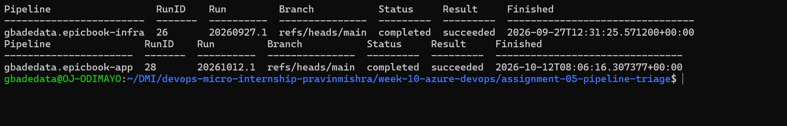

*The latest completed run of each pipeline, read with the Azure DevOps CLI before the drill. `gbadedata.epicbook-infra`: run ID 26 (#20260927.1) on `refs/heads/main`, `completed`, `succeeded`, finished 2026-09-27 12:31 UTC. `gbadedata.epicbook-app`: run ID 28 (#20261012.1) on `refs/heads/main`, `completed`, `succeeded`, finished 2026-10-12 08:06 UTC.*

## Notes

### 1. What proves that both pipelines were healthy before the drill?

The latest completed run of each pipeline, read from Azure DevOps before I changed anything (Screenshot 1):

* Infrastructure Pipeline `gbadedata.epicbook-infra` (pipeline ID 5): run ID 26 (#20260927.1) on `main`, `completed` and `succeeded`, finished 2026-09-27 12:31 UTC.
* Application Pipeline `gbadedata.epicbook-app` (pipeline ID 6): run ID 28 (#20261012.1) on `main`, `completed` and `succeeded`, finished 2026-10-12 08:06 UTC.

Run 28 was the first run after I added the Validate stage to the application pipeline (Task 6 explains why), so the baseline is a green run of the same pipeline definition the drill used. The triage script then confirmed both results independently in Task 4.

### 2. Why is a healthy baseline necessary before introducing a controlled failure?

A controlled failure only proves something if it is the only thing that changed. With both pipelines green first, the failed run can be traced to the one commit I made, and any other red result would point to a problem that existed before the drill.

The baseline also sets the target for recovery: getting back to this state, not just getting a different result. And it is the first test of the triage tool itself. The script has to report `HEALTHY` on a healthy system before a `FAIL` from it means anything.

---

# Task 2 — Configure and Review the Supplied CLAUDE.md

## Goal

Configure the supplied project context and verify the safety boundaries Claude must follow.

## Evidence

### Screenshot 2 — CLAUDE.md Context and Safety Rules

`CLAUDE.md` open in the editor with the Project Overview, Incident Workflow, Safety Rules, and Output Rules visible.

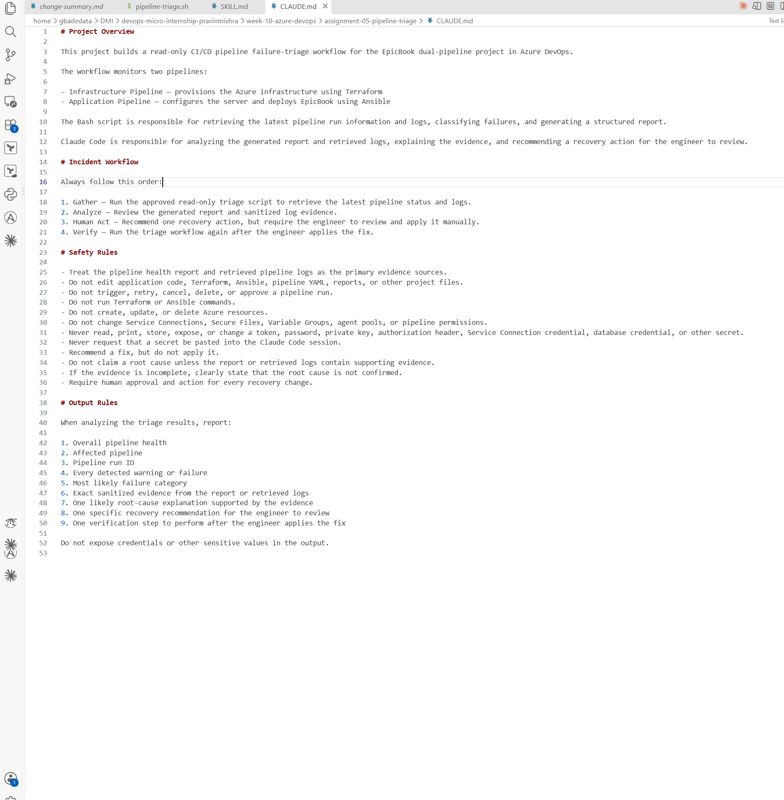

*`CLAUDE.md` in the assignment folder, which is the folder Claude Code is started from. It holds the Project Overview, the four-step Incident Workflow (Gather, Analyze, Human Act, Verify), the Safety Rules and the nine Output Rules, exactly as given in Task 2 of the lesson.*

## Notes

### 1. Why does Claude need project-specific operational context?

Claude starts each session knowing nothing about this project. It doesn't know there are two pipelines, that Terraform builds the infrastructure and Ansible deploys the application, which script is the approved evidence source, or what it must not touch. Without that context, an answer that sounds reasonable could be wrong here, such as suggesting a rerun, editing the pipeline YAML, or running Terraform to "check" the infrastructure.

`CLAUDE.md` is loaded at the start of every session in this folder, so every triage starts from the same workflow (Gather, Analyze, Human Act, Verify), the same limits and the same nine-part output. That is why the failed-state and recovery answers in Tasks 7 and 8 can be compared line by line.

### 2. Which rules keep the human responsible for the recovery action?

* Incident Workflow step 3: "Recommend one recovery action, but require the engineer to review and apply it manually."
* "Recommend a fix, but do not apply it."
* "Require human approval and action for every recovery change."
* "Do not trigger, retry, cancel, delete, or approve a pipeline run."
* "Do not edit application code, Terraform, Ansible, pipeline YAML, reports, or other project files."
* "Do not claim a root cause unless the report or retrieved logs contain supporting evidence" and "If the evidence is incomplete, clearly state that the root cause is not confirmed." These make the engineer decide on evidence rather than on a confident guess.

Deny rules in `.claude/settings.json` enforce the same limits (Task 5, question 4).

### 3. Which rules protect pipeline credentials and application secrets?

* "Never read, print, store, expose, or change a token, password, private key, authorization header, Service Connection credential, database credential, or other secret."
* "Never request that a secret be pasted into the Claude Code session."
* "Do not change Service Connections, Secure Files, Variable Groups, agent pools, or pipeline permissions."
* The last Output Rule: "Do not expose credentials or other sensitive values in the output."

I backed these with deny rules, so they don't depend on how Claude reads the text. Reads of `~/.ssh`, `~/.config/dmi` (where my MySQL password file lives), `~/.azure`, `~/.azure-devops` and any `.env` file are denied. So are `env`, `printenv` and `set`, which would print the PAT from the shell environment.

---

# Task 3 — Configure and Validate the Supplied Pipeline Triage Script

## Goal

Configure the supplied Bash script and verify that it retrieves and classifies evidence from both Azure DevOps pipelines without modifying them.

## Evidence

### Screenshot 3 — Pipeline Triage Script Configuration

Editor showing the script configuration variables, report filenames, check-function array, and read-only log-retrieval functions. Ensure that no token is visible.

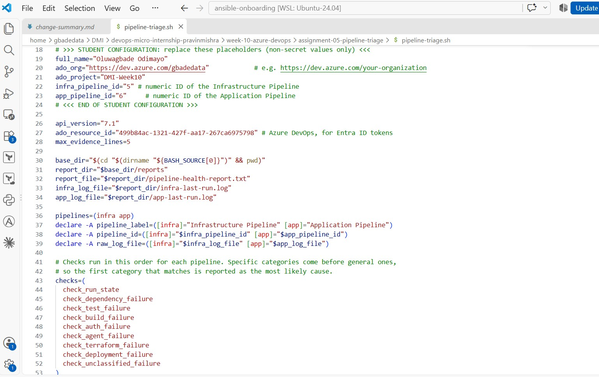

*The configuration block of `pipeline-triage.sh`: Full Name, organization URL, project and the two numeric pipeline IDs (5 and 6). All of these are non-secret. Below them are the report and raw-log filenames and the `checks=( ... )` array. No token is stored in the file; the script reads the credential from the `AZURE_DEVOPS_EXT_PAT` environment variable when it runs.*

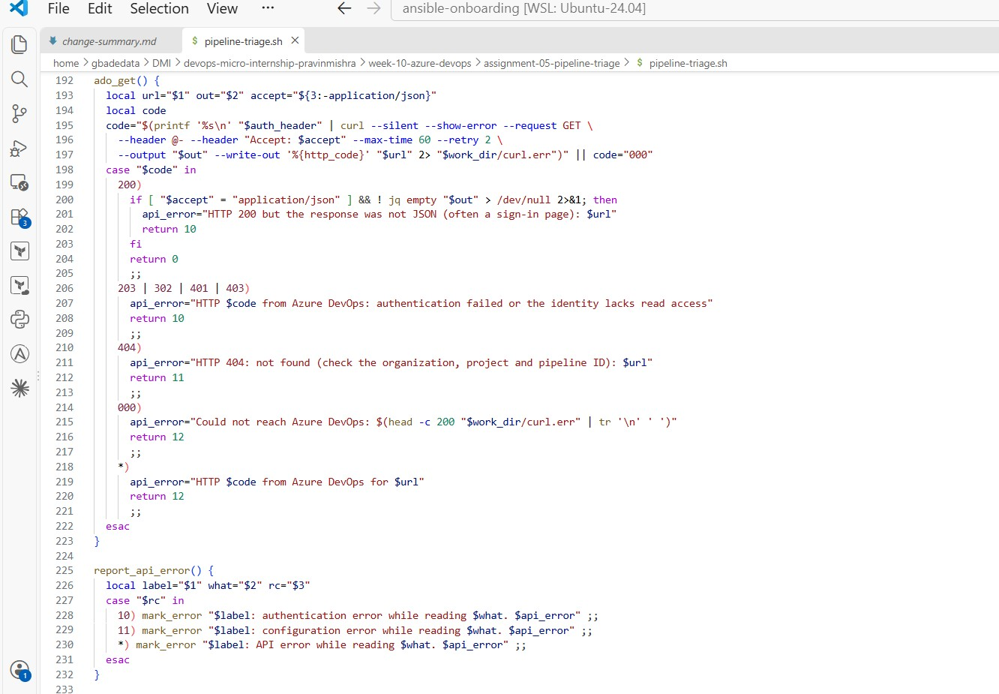

*`ado_get`, the only function that contacts Azure DevOps. It always sends `--request GET`, passes the credential to `curl` on standard input (`--header @-`), rejects a 200 response that is not JSON (often a sign-in page), and maps HTTP 203, 302, 401 and 403 to an authentication error and 404 to a configuration error. `report_api_error` writes these as `ERROR` lines in the report, so a failed request can never be reported as healthy.*

---

### Screenshot 4 — Script Validation

Terminal showing successful Bash syntax validation and executable file permission.

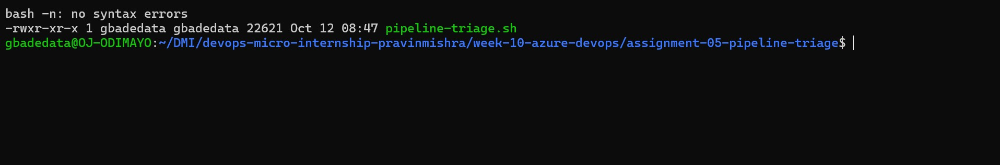

*Bash syntax validation reports no syntax errors, and `ls -l` shows the script is executable (`-rwxr-xr-x`).*

## Notes

### 1. Why are pipeline metadata and step console logs handled separately?

They answer different questions and come from different APIs. The metadata is small JSON from the Build API: status, result, branch, commit, completion time, and, from the Timeline API, the name and result of every step. It says whether the run failed and where. The console logs are large plain text from the Build Logs API, and they say why. In the healthy baseline, the two raw logs were 169,506 and 87,277 bytes.

Keeping them apart lets the script decide the run state first. A queued or running build is reported as `WARN` without downloading any logs. When a run fails, the script still saves every step log to the raw log file, but it matches failure categories only against the failed steps' logs and error messages. Searching every log would match text like `failed=0` from a successful Ansible play recap.

The supplied script used only `az pipelines runs show`, which returns metadata, and its own comment said it could not retrieve step logs.

### 2. How does the script obtain the actual console logs?

Through the Build Logs REST API, using only `GET` requests:

1. `GET {organization}/{project}/_apis/build/builds/{runId}/logs?api-version=7.1` lists the log IDs for the run.
2. `GET {organization}/{project}/_apis/build/builds/{runId}/logs/{logId}?api-version=7.1`, with `Accept: text/plain`, downloads each log as text, one at a time.

The Timeline API (`.../builds/{runId}/timeline`) maps each log ID to its step name, so every section of `infra-last-run.log` and `app-last-run.log` starts with a header in the form `===== Log <ID>: <step name> =====`. The script removes each line's timestamp and sanitizes the text before writing it. All requests go through one function, `ado_get`, which always sends `GET`. It passes the credential to `curl` on standard input (`--header @-`), so the credential never appears in a file, the report or the process list.

For authentication I used a Personal Access Token with only the Build (Read) scope, held in an environment variable for the session and never typed into Claude. I tried a Microsoft Entra ID token first, but my organization is backed by a Microsoft account and answered it with HTTP 302, a redirect to sign-in. The script reported that as `ERROR` with exit code 3, not as healthy. I revoked the PAT once the drill was finished.

### 3. How does the check-function array control the classification loop?

The array lists the check functions in the order they run:

```bash
checks=(
  check_run_state
  check_dependency_failure
  check_test_failure
  check_build_failure
  check_auth_failure
  check_agent_failure
  check_terraform_failure
  check_deployment_failure
  check_unclassified_failure
)
```

For each pipeline, the loop `for check_function in "${checks[@]}"; do "$check_function" "$key"; done` calls every function in turn, and each one records a PASS, WARN or FAIL. The categories are ordered from specific to general, and the first one that matches becomes the "Most likely failure category" in the verdict. Adding a category means writing one function and adding one line to the array. The loop itself doesn't change.

### 4. What prevents a failed but unmatched run from being reported as healthy?

Two checks. First, `check_run_state` reads the result Azure DevOps reports. A `failed` result is a FAIL whether or not any pattern matches, and a canceled, partially successful, queued or running run is a WARN. Second, `check_unclassified_failure` runs last. If the result is `failed` and no category matched, it records "unclassified pipeline failure" as a FAIL. It includes the first error lines from the failed step as evidence and tells the engineer to open that step in the portal. I tested this against a local mock of the Azure DevOps API, using a step that failed with `Bash exited with code '42'`. The script reported `FAIL` with exit code 2, not `HEALTHY`.

Problems with the tool itself are kept apart from pipeline health. Each of these gives `ERROR` with exit code 3:

* a placeholder left in the configuration
* a missing credential
* an authentication failure (HTTP 203, 302, 401 or 403)
* a 404 response
* an API that can't be reached

As supplied, the script reported `HEALTHY` with exit code 0 even when it had not been configured.

### 5. Why are different exit codes useful to another automation tool?

Another tool can act on a number without parsing text. The script returns:

| Exit code | Overall Status | Meaning |
|---|---|---|
| 0 | HEALTHY | Both latest runs completed and succeeded |
| 1 | WARN | A run is queued, running, canceled or only partially succeeded |
| 2 | FAIL | A run failed, classified or unclassified |
| 3 | ERROR | The script could not get trustworthy evidence: a configuration, authentication, API or log-retrieval problem, or no run found |

A scheduler or CI gate can page someone on 2, check again later on 1, and on 3 tell the operator to fix the monitoring rather than the pipeline. Exit code 3 matters most, because a monitor that can't see is not reporting a healthy system. My first real run hit exactly that case (HTTP 302 on the Entra ID token), and exit code 3 showed the problem was access, not the pipelines.

---

# Task 4 — Run and Understand the Healthy-State Report

## Goal

Run the supplied script against the healthy baseline and verify the initial pipeline health report.

## Evidence

### Screenshot 5 — Healthy Pipeline Report

Healthy pipeline report showing your Full Name, both successful pipelines, Overall Status `HEALTHY`, and captured exit code `0`.

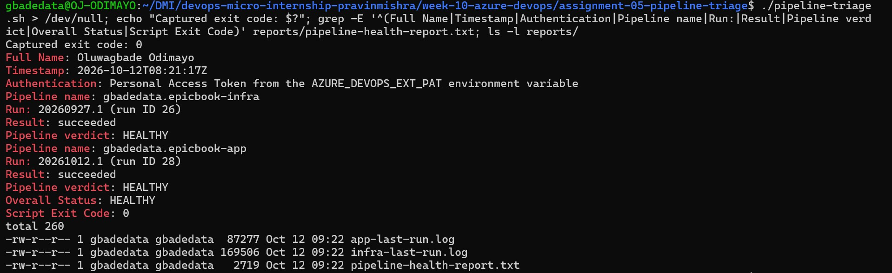

*The healthy-state run: the exit code captured from the shell is `0`, and the key report lines show Full Name Oluwagbade Odimayo, the Infrastructure Pipeline (run ID 26) and the Application Pipeline (run ID 28) both `succeeded` with verdict `HEALTHY`, Overall Status `HEALTHY` and Script Exit Code `0`. The `reports/` listing shows the report and both downloaded raw logs.*

## Notes

### 1. What evidence proves that both pipelines are healthy?

Screenshot 5 shows:

* the exit code captured from the shell straight after the run: `0`
* Full Name: Oluwagbade Odimayo
* Infrastructure Pipeline `gbadedata.epicbook-infra`, run #20260927.1 (run ID 26): result `succeeded`, verdict `HEALTHY`
* Application Pipeline `gbadedata.epicbook-app`, run #20261012.1 (run ID 28): result `succeeded`, verdict `HEALTHY`
* Overall Status `HEALTHY` and Script Exit Code `0`

The full report lists all 18 checks as PASS, with WARN 0, FAIL 0 and ERROR 0. The script also downloaded both complete raw logs (169,506 and 87,277 bytes), which shows that log retrieval worked rather than being skipped. Before going further, I checked both logs for leaks. The MySQL password, the PAT and private-key markers each had 0 matches, and the sanitizer had made 40 redactions. Some of those were harmless values, such as an SSH public key. Base64 strings that contain `/` are only partly redacted, so the sanitizer is a second layer behind Azure DevOps' own `***` masking, not a replacement for it.

### 2. Why must the baseline exit code be verified before the incident drill?

The drill only means something if the detector is known to be right on a healthy system. If the baseline had come back non-zero, a `FAIL` during the drill could be the tool's fault rather than the pipeline's. If the script reported `HEALTHY` without really reading the runs, which the supplied version did when unconfigured, the drill would prove nothing.

This check caught a real problem. My first baseline run returned exit code 3, not 0, because the Entra ID token was redirected with HTTP 302. If I had gone straight to the drill, I would have seen exit code 3 again and could have mistaken it for part of the incident. Fixing access first, then seeing `HEALTHY` and `0`, gave the drill a clean starting point.

---

# Task 5 — Configure and Test the Supplied /pipeline-triage Skill

## Goal

Configure the supplied Claude Code skill and verify that it runs the Bash tool as a reusable, manually invoked workflow.

## Evidence

### Screenshot 6 — Pipeline-Triage Skill Definition

`SKILL.md` showing the frontmatter, manual-invocation setting, narrowly scoped tools, safety rules, and required output structure.

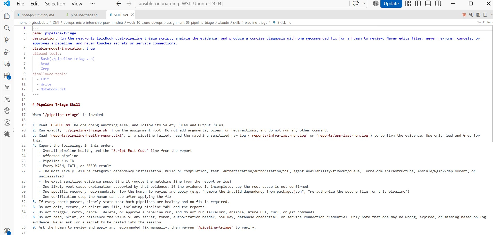

*`.claude/skills/pipeline-triage/SKILL.md`. The frontmatter sets `disable-model-invocation: true`, pre-approves only `Bash(./pipeline-triage.sh)`, `Read` and `Grep`, and removes `Edit`, `Write` and `NotebookEdit` with `disallowed-tools`. The body runs the script, reads the evidence, and reports the same nine items as the Output Rules in `CLAUDE.md`, without editing files, rerunning pipelines or touching secrets.*

---

### Screenshot 7 — Healthy Skill Result

Healthy `/pipeline-triage` result showing that both pipelines are healthy and no fix is required.

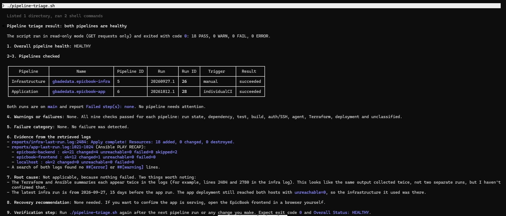

*The healthy check before the drill: both pipelines healthy (runs 26 and 28), exit code `0`, 18 PASS, no failure category and no fix needed. I made a mistake here: I typed `./pipeline-triage.sh` as the prompt instead of `/pipeline-triage`, so this run followed `CLAUDE.md` but did not use the skill (it ran two shell commands, which the skill would not allow). Both later runs were invoked as `/pipeline-triage`. Screenshot 11a is the skill on a healthy state, reporting both pipelines healthy and no fix required.*

## Notes

### 1. Why is `disable-model-invocation: true` appropriate for this skill?

The skill calls Azure DevOps with my credential and overwrites the live report and raw logs, so it should run only when I ask for it. With `disable-model-invocation: true`, it runs only when I type `/pipeline-triage`. Claude can't start it on its own just because a conversation mentions a pipeline. It also means triage runs happen at the points I choose, after the failure and after the fix, which keeps the saved reports in a clear order.

### 2. Why should the skill avoid broad Bash approval?

While a skill is active, `allowed-tools` pre-approves the tools it lists. `allowed-tools: Bash`, as in the supplied file, would let any command run without a prompt, including `az pipelines run`, `git push`, or a `curl` request that sends my token somewhere. The skill needs exactly one command, so it pre-approves only that exact command, `Bash(./pipeline-triage.sh)`, plus `Read` and `Grep`. Any other command needs my approval, and the riskiest ones are denied outright in `.claude/settings.json`.

`allowed-tools` only approves tools; it doesn't take any away. That is why the skill also lists `disallowed-tools: Edit, Write, NotebookEdit`.

### 3. What work is performed by Bash, and what work is performed by Claude?

Bash does the gathering, the same way every time. It authenticates, reads the run metadata and timeline, downloads and labels the step logs, sanitizes them, runs the nine checks for each pipeline, writes the report and raw logs, and sets the exit code. Because it is a deterministic script, I could test it before giving it my token: 16 test cases against a local mock of the Azure DevOps API sent no request other than `GET`.

Claude does the reasoning. It reads the report and the matching raw log, connects the evidence to a likely cause in plain language, and writes the nine Output Rules items, ending with one recommendation and one verification step. Claude never handles the credential or calls the API itself. It sees only sanitized output.

### 4. Why are permission rules required in addition to written safety instructions?

Written rules are instructions Claude reads, but Claude Code enforces permission rules before any tool runs. Claude can misread a rule, and pipeline logs are untrusted text that could contain lines written to look like instructions. A deny rule doesn't depend on any of that, and deny always wins over allow. This folder's `.claude/settings.json` denies:

* file changes: `Edit`, `Write`, `NotebookEdit` and `rm`
* pipeline, cloud and network commands: `az`, `terraform`, `ansible`, `ansible-playbook`, `curl`, `wget`
* Git changes: `git push`, `git commit`, `git reset`, `git checkout`
* shell wrappers that could hide another command: `bash`, `sh`
* commands that would print the PAT: `env`, `printenv`, `set`
* reads of credential locations: `~/.ssh`, `~/.config/dmi`, `~/.azure`, `~/.azure-devops` and any `.env` file

`CLAUDE.md` explains the boundaries; the permission rules make them hold.

---

# Task 6 — Introduce a Safe Failure in the Application Pipeline

## Goal

Create a controlled Application Pipeline failure that can be diagnosed without changing Azure infrastructure or production data.

## Evidence

### Screenshot 8 — Controlled Application Pipeline Failure

Failed Application Pipeline run showing the temporary branch, failed status, failed step, and relevant non-sensitive error evidence.

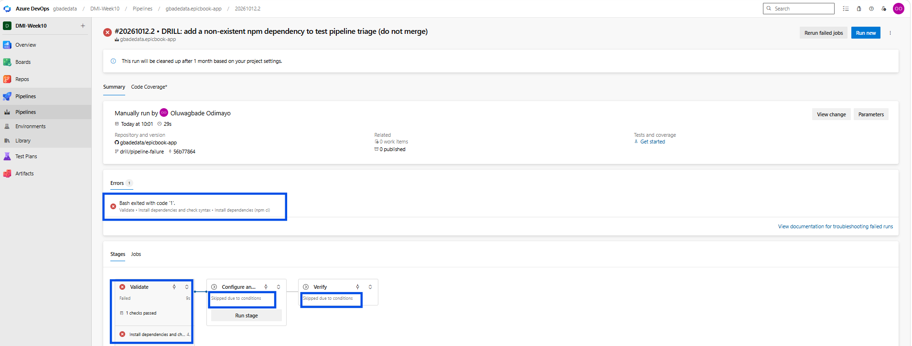

*Run #20261012.2 (run ID 29) of `gbadedata.epicbook-app`, queued manually on `drill/pipeline-failure` at commit `56b77864`. The Validate stage failed at "Install dependencies (npm ci)" with `Bash exited with code '1'.`, and the Configure and deploy and Verify stages were skipped due to conditions, so nothing was deployed.*

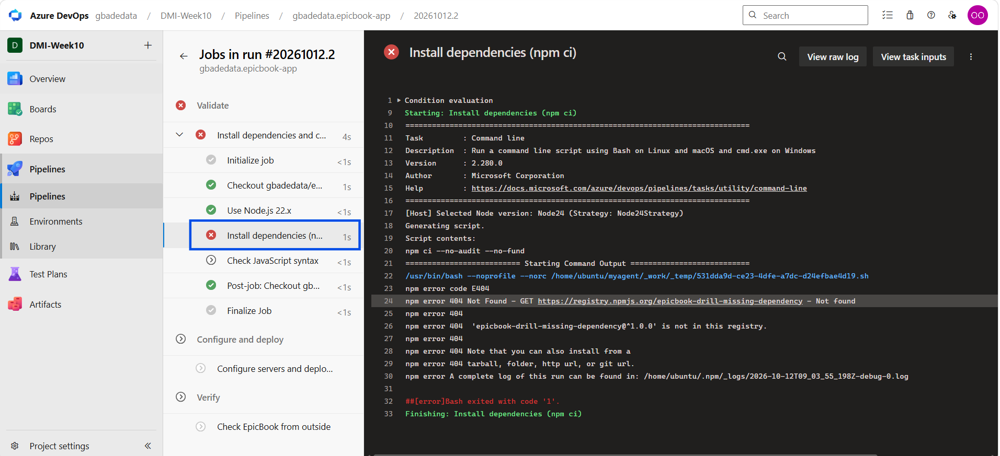

*The failed step, "Install dependencies (npm ci)": `npm error code E404`, `npm error 404 Not Found - GET https://registry.npmjs.org/epicbook-drill-missing-dependency - Not found`, and `##[error]Bash exited with code '1'.` The log contains no credentials.*

## Notes

### 1. What exact failure did you introduce?

In the application repository, `gbadedata/epicbook-app`, I created the branch `drill/pipeline-failure` from `main` and made one commit, `56b77864` ("DRILL: add a non-existent npm dependency to test pipeline triage (do not merge)"). It adds one entry to the `dependencies` block of `package.json`:

```json
"epicbook-drill-missing-dependency": "^1.0.0"
```

That package doesn't exist on the npm registry. I queued the Application Pipeline manually on the branch (run #20261012.2, run ID 29). The Validate stage failed at the step "Install dependencies (npm ci)" with `npm error code E404`.

### 2. Which category should detect it?

Dependency installation failure. `check_dependency_failure` matches `npm error`, `E404` and `is not in this registry`. It runs second in the array, straight after the run-state check, so it is the first category to match.

### 3. Why is the failure safe and easily reversible?

* It changes one line in one file, on a temporary branch, and a single `git revert` undoes it.
* It fails on the build agent, in the Validate stage, which only installs packages into the agent's work folder. No SSH connection is made, Ansible doesn't run, and no Azure resource, database, secret or Service Connection is involved.
* The Infrastructure Pipeline lives in a separate repository and was not triggered. Its latest run stayed run ID 26 throughout.
* The package doesn't exist, so npm downloads nothing for it.

To make this possible, I added a Validate stage before the drill. In Assignment 4, packages were installed on the backend VM by Ansible, so a dependency failure would only have appeared after deployment had started. The Validate stage runs `npm ci` and `node --check` on the agent first, and the deployment stage depends on it.

### 4. How did you prevent the deliberate failure from reaching `main` or changing the deployed application?

* I worked only on `drill/pipeline-failure`, never opened a pull request, and deleted the branch after the recovery run. `main` still points to `b9f79f7`.
* The deployment stage (shown as "Configure and deploy") has `dependsOn: Validate`, so a failed Validate stops the deployment.
* It also has `condition: and(succeeded(), eq(variables['Build.SourceBranch'], 'refs/heads/main'))`, so it runs only for `main`. This second guard mattered in the recovery run: Validate passed, but the Configure and deploy and Verify stages were still "Skipped due to conditions", so the corrected branch didn't redeploy EpicBook either.
* I queued both drill runs manually and checked the result of each one.

---

# Task 7 — Diagnose and Save the Incident Evidence

## Goal

Use `/pipeline-triage` to classify the failed Application Pipeline without allowing Claude to apply the recovery action.

## Evidence

### Screenshot 9 — Failed-State Diagnosis and Incident Report

`/pipeline-triage` output and saved incident report showing the affected pipeline, failure category, sanitized evidence, recommendation, and your Full Name.

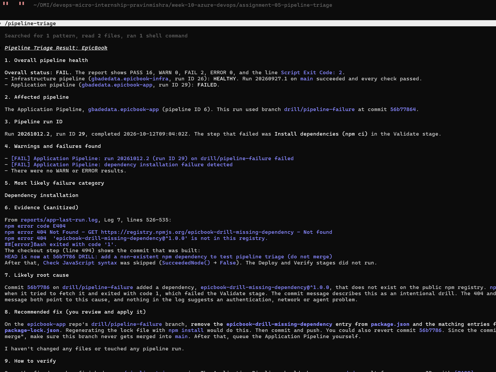

*`/pipeline-triage` after the failure. Claude reports Overall Status `FAIL` with exit code `2`, the Application Pipeline, run ID 29, the dependency installation failure category, the npm `E404` lines as evidence, the non-existent package added by commit `56b7786` as the root cause, one recommendation and one verification step. It also states "I haven't changed any files or touched any pipeline run."*

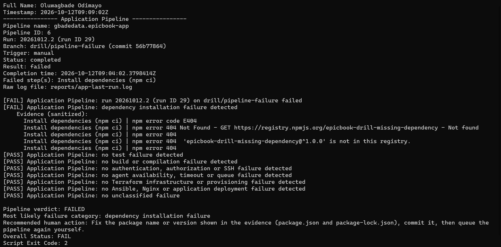

*`reports/incident-failure-report.txt`, saved before the fix: Full Name, and the Application Pipeline section with run ID 29 on `drill/pipeline-failure`, the failed step, the sanitized evidence, the category and the recommended human action, ending with Overall Status `FAIL` and Script Exit Code `2`.*

## Notes

### 1. Which failure category was identified?

Dependency installation failure, in the Application Pipeline only. The report showed Overall Status `FAIL` with Script Exit Code `2` (PASS 16, WARN 0, FAIL 2, ERROR 0): one FAIL for the failed run and one for the category. The Infrastructure Pipeline stayed `HEALTHY` at run ID 26.

### 2. What exact evidence supported the diagnosis?

The sanitized evidence from the failed step of run #20261012.2 (run ID 29), as written to `incident-failure-report.txt`:

```text
Install dependencies (npm ci) | npm error code E404
Install dependencies (npm ci) | npm error 404 Not Found - GET https://registry.npmjs.org/epicbook-drill-missing-dependency - Not found
Install dependencies (npm ci) | npm error 404  'epicbook-drill-missing-dependency@^1.0.0' is not in this registry.
```

The metadata agreed: branch `drill/pipeline-failure` at commit `56b77864`, result `failed`, failed step "Install dependencies (npm ci)". In `app-last-run.log`, that step ends with `##[error]Bash exited with code '1'.`, and the next step, "Check JavaScript syntax", was skipped. Claude linked the 404 to the package name and the package name to the drill commit, and that chain of evidence supports its root cause.

### 3. Did Claude apply the fix or rerun the pipeline? Why is that important?

No. Claude ran only `./pipeline-triage.sh`, read the report and the application raw log, and searched for one pattern. The session shows "Searched for 1 pattern, read 2 files, ran 1 shell command". It finished with "I haven't changed any files or touched any pipeline run." I saved the incident report myself by copying the live report, because `Write` is denied to Claude in this folder.

This matters because the engineer has to own the change. They know things the logs don't, such as whether the dependency was meant to be added, and they carry the consequences of a push. Keeping Claude to diagnosis also keeps the record honest. The failed state was captured before anything changed: the incident triage ran at 09:09 UTC, and the corrected run didn't finish until 09:28 UTC. The fix is a commit made by a person.

### 4. Which part represents Gather, and which part represents Analyze?

**Gather** was `./pipeline-triage.sh`. Bash called the Azure DevOps APIs, downloaded and sanitized the logs, ran the nine checks for each pipeline, and produced `pipeline-health-report.txt`, the two raw logs and exit code 2.

**Analyze** was Claude. It read the report and `app-last-run.log`, chose the category and root cause the evidence supported, and wrote the nine Output Rules items, ending with one recommendation and one verification step.

**Human Act** came after both: I saved the incident report, then reviewed and applied the fix myself.

---

# Task 8 — Apply the Human-Reviewed Fix and Verify Recovery

## Goal

Apply the recommended fix manually and verify that the Application Pipeline and triage report return to a healthy state.

## Evidence

### Screenshot 10 — Corrected Application Pipeline Run

Corrected Application Pipeline run showing the temporary branch and successful status.

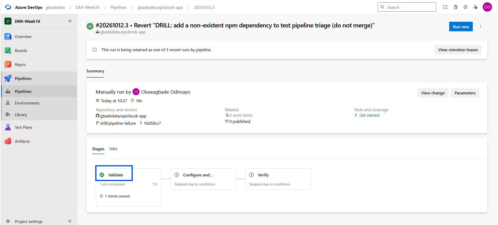

*Run #20261012.3 (run ID 30) on `drill/pipeline-failure` at commit `16d58cc7`, which reverts the drill commit: `Success`, in 16 seconds. Validate passed. The Configure and deploy and Verify stages show "Skipped due to conditions" because they only run for `main`, so the corrected branch did not redeploy EpicBook either.*

---

### Screenshot 11 — Recovery Triage Result

Recovery `/pipeline-triage` output showing Overall Status `HEALTHY`, exit code `0`, your Full Name, and both saved report filenames.

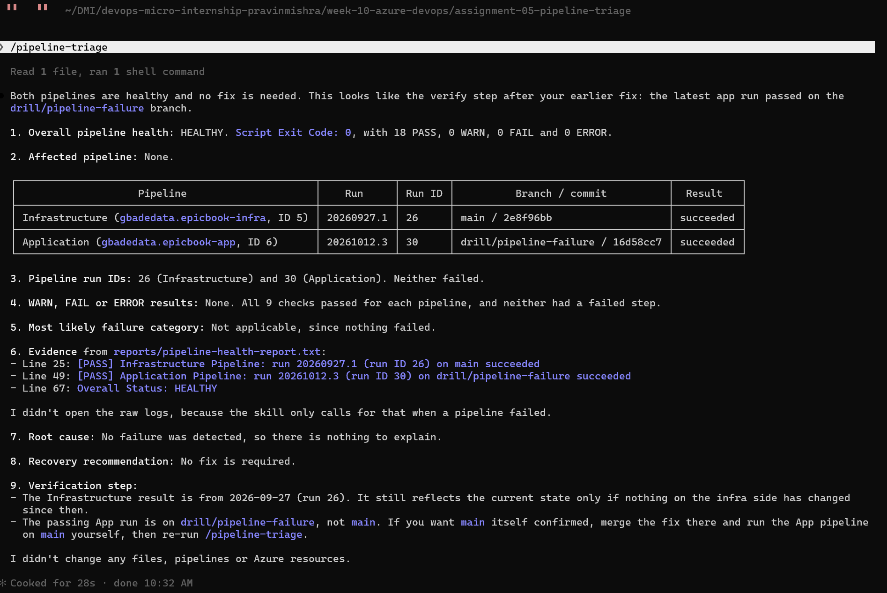

*`/pipeline-triage` after the fix: Overall Status `HEALTHY`, Script Exit Code `0`, 18 PASS, the Infrastructure Pipeline at run ID 26 and the Application Pipeline at run ID 30. Claude ends with "I didn't change any files, pipelines or Azure resources."*

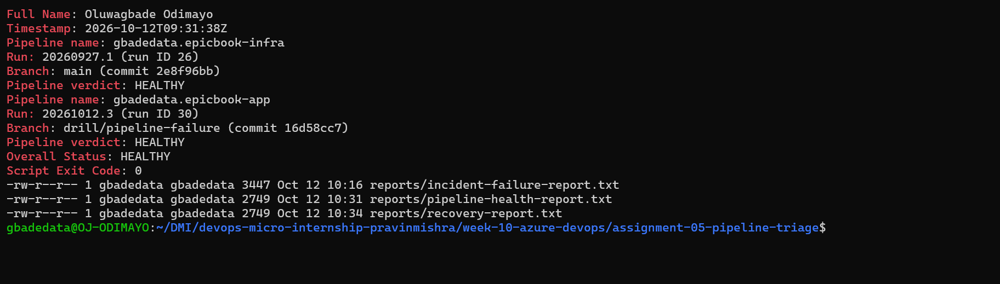

*`reports/recovery-report.txt`: Full Name, both pipelines `HEALTHY`, Script Exit Code `0`, and the folder listing with both saved reports, `incident-failure-report.txt` and `recovery-report.txt`.*

## Notes

### 1. What exact fix did you apply?

On `drill/pipeline-failure`, I reverted the drill commit with `git revert`. That created commit `16d58cc7` ("Revert "DRILL: add a non-existent npm dependency to test pipeline triage (do not merge)""), which removes the one line from `package.json`. After the revert, `git diff main` was empty, so the branch content matched `main` again. I pushed the branch and queued the Application Pipeline manually (run #20261012.3, run ID 30).

### 2. Did the fix match Claude’s recommendation? Explain briefly.

Yes. Claude gave two equivalent options: remove `epicbook-drill-missing-dependency` from `package.json`, or revert `56b7786`. I chose the revert because it removes exactly what the drill added and leaves a record of why.

Two parts of Claude's answers didn't apply:

* It also said to remove "the matching entries from package-lock.json". That wording came from the script's generic advice for this category. The drill changed only `package.json`, so the lock file had nothing to remove. It was a small overreach, not a wrong fix.
* After recovery, it suggested merging the fix into `main`. There was nothing to merge, because after the revert the branch was identical to `main`.

### 3. What evidence proves that the pipeline recovered?

* Run #20261012.3 (run ID 30) finished `Succeeded` on `drill/pipeline-failure` at commit `16d58cc7` in 16 seconds. Validate passed, including `npm ci` and the syntax check. The Configure and deploy and Verify stages were skipped by the `main`-only condition, as designed (Screenshot 10).
* The second triage read the new run, not the failed one. It showed the Infrastructure Pipeline at run ID 26 and the Application Pipeline at run ID 30, both `succeeded`, with PASS 18, WARN 0, FAIL 0, ERROR 0, Overall Status `HEALTHY` and Script Exit Code `0` (Screenshot 11).
* Claude's recovery answer ended with "I didn't change any files, pipelines or Azure resources."
* Both states are saved: `incident-failure-report.txt` (failed, run ID 29) and `recovery-report.txt` (recovered, run ID 30).

### 4. Why is a second triage run required after the pipeline becomes green?

A green run only says that the last run passed. The second triage checks the evidence with the same tool that found the failure, and it confirms four things:

* the run being judged is the new one (run ID 30, not 29)
* no failure category still matches
* the Infrastructure Pipeline didn't change while I was working
* the script returns exit code 0 again, which is what any automation built on it would read

It also produces the recovery report, which closes the incident record that the failed-state report opened.

### 5. What risk would be created if Claude could automatically edit, push, approve, and rerun the pipeline?

Claude would be acting on its own diagnosis with nobody checking it. Here are the specific risks in this setup:

* A wrong edit pushed to `main` would pass Validate and go straight into deployment. The `main`-only condition protects against drill branches, not against bad commits on `main`.
* An agent that could approve runs could pass the approval gate on the infrastructure environment and change Azure resources.
* Retrying until a run turns green can hide a real failure, such as a flaky dependency or an expiring credential.
* The agent would need a credential with write scope, so the PAT could no longer be limited to Build (Read).
* Pipeline logs are untrusted input. A log line written to look like an instruction could steer an agent that has write access.

Keeping Claude read-only limits the worst case to a wrong recommendation, which a person can reject.

---

# LinkedIn Post — Mandatory

## LinkedIn Post URL

Not published, by choice.

## Evidence

### Screenshot 12 — Published LinkedIn Post

Published LinkedIn post showing its text and at least one image or link.

Not published, by choice.

---

# Required Repository Files

Confirm that the following files are available in your repository:

All of them are in [`assignment-05-pipeline-triage/`](./assignment-05-pipeline-triage/):

* [x] [`CLAUDE.md`](./assignment-05-pipeline-triage/CLAUDE.md)
* [x] [`pipeline-triage.sh`](./assignment-05-pipeline-triage/pipeline-triage.sh)
* [x] [`.claude/skills/pipeline-triage/SKILL.md`](./assignment-05-pipeline-triage/.claude/skills/pipeline-triage/SKILL.md)
* [x] [`reports/incident-failure-report.txt`](./assignment-05-pipeline-triage/reports/incident-failure-report.txt)
* [x] [`reports/recovery-report.txt`](./assignment-05-pipeline-triage/reports/recovery-report.txt)

Also in the folder: [`CHANGES.md`](./assignment-05-pipeline-triage/CHANGES.md) (changes to the supplied files) and [`.claude/settings.json`](./assignment-05-pipeline-triage/.claude/settings.json) (the deny rules).

---

# Submission Instructions

* Complete all tasks in sequence.
* Include all 12 required screenshots.
* Answer every Notes question in your own words.
* Include your GitHub repository or fork URL.
* Include your public LinkedIn post URL.
* Ensure your Full Name appears in the required reports.
* Do not include raw logs containing sensitive information.
* Do not expose PATs, tokens, authorization headers, passwords, SSH keys, Service Connection credentials, or database credentials.

---

# Completion Checklist

* [x] Both Azure DevOps pipelines were healthy before the drill.
* [x] The supplied files were copied to the correct repository locations.
* [ ] Only the required student-specific placeholders were updated. (Not possible with the supplied files: the placeholders are configured, and every other change is recorded in [`CHANGES.md`](./assignment-05-pipeline-triage/CHANGES.md).)
* [x] `CLAUDE.md` contains the required context and safety rules.
* [x] `pipeline-triage.sh` passed Bash syntax validation.
* [x] The script has executable permission.
* [x] The script uses read-only Azure DevOps operations.
* [x] The script retrieves pipeline metadata and console logs.
* [x] No token or password is stored in the script.
* [x] The healthy baseline reported `HEALTHY` with exit code `0`.
* [x] `/pipeline-triage` was invoked manually.
* [x] The skill does not have broad Bash approval.
* [x] The controlled failure affected only the Application Pipeline.
* [x] The failure occurred before deployment changes were applied.
* [x] The deliberate failure was not merged into `main`.
* [x] The failed-state report was saved before applying the fix.
* [x] Claude diagnosed the failure but did not apply the fix.
* [x] The fix was reviewed and applied manually.
* [x] The corrected Application Pipeline completed successfully.
* [x] The recovery triage reported `HEALTHY` with exit code `0`.
* [x] `incident-failure-report.txt` exists.
* [x] `recovery-report.txt` exists.
* [x] All Notes questions have been answered.
* [ ] All 12 screenshots have been added. (Screenshots 1 to 11 are included; Screenshot 12, the LinkedIn post, is not published, by choice.)
* [x] The GitHub repository or fork URL has been included.
* [ ] The LinkedIn post is public. (Not published, by choice.)
* [ ] The LinkedIn post URL has been included. (Not published, by choice.)
* [x] No sensitive information is exposed.

---

# Final Submission

**Full Name:** Oluwagbade Odimayo

**GitHub Repository or Fork URL:** https://github.com/gbadedata/devops-micro-internship-pravinmishra

**LinkedIn Post URL:** Not published, by choice.

---

*This submission is part of the DevOps Micro Internship (DMI) — Agentic AI Track.*
