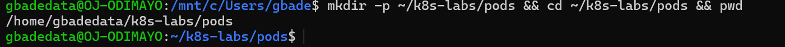
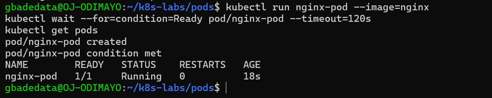
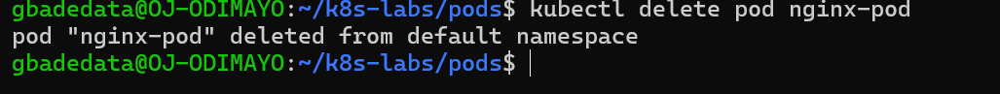
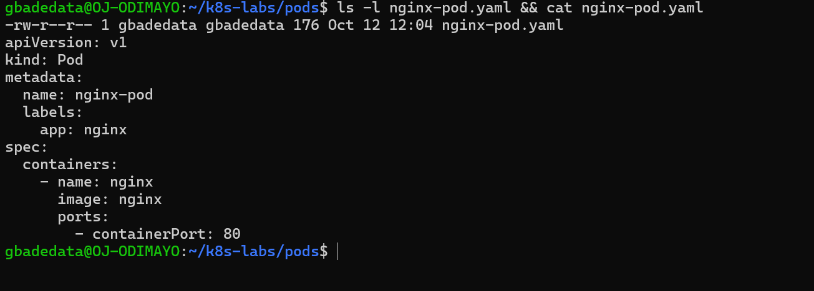
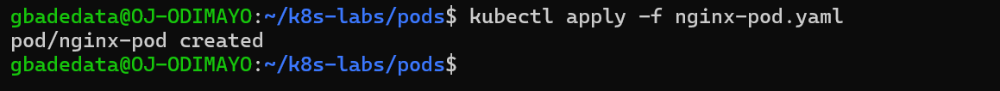
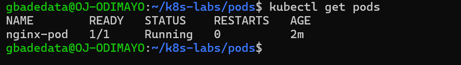
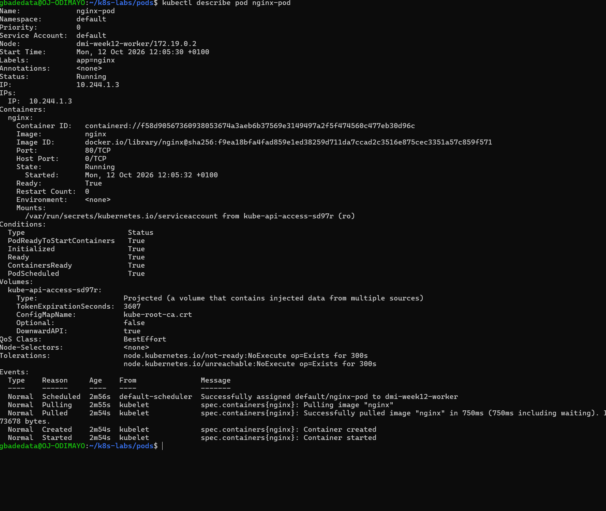
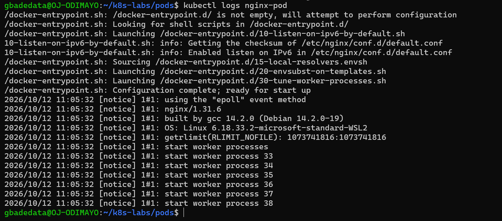
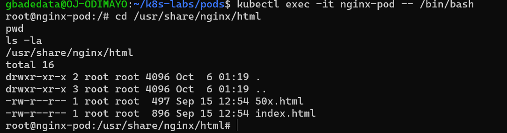

# Assignment 1 — Creating Your First Pod in Kubernetes

Part of the DevOps Micro Internship (DMI) with Agentic AI

---

## Purpose

In this assignment, you will create an NGINX Pod using both imperative and declarative methods. You will practice creating, checking, deleting, describing, viewing logs from, and opening a shell inside a Pod.

---

# Task 1 — Set Up Your Lab Folder

## Goal

Create a clean working directory for all Pod-related files used in this lab.

### Evidence

#### Screenshot 01 — Output of `pwd` showing the current directory ending in `/k8s-labs/pods`

---

# Task 2 — Create a Pod Imperatively

## Goal

Create an NGINX Pod directly from the command line, verify that it is running, and delete it before continuing to the declarative method.

### Evidence

#### Screenshot 02 — Output of `kubectl run nginx-pod --image=nginx` showing the creation message, and `kubectl get pods` showing `nginx-pod` with `1/1` under `READY` and `Running` under `STATUS`, before deletion

---

#### Screenshot 03 — Output of `kubectl delete pod nginx-pod` showing the successful deletion message

---

# Task 3 — Create a Pod Declaratively Using YAML

## Goal

Define the NGINX Pod in a YAML file, apply the manifest, and verify the resulting Pod.

### Evidence

#### Screenshot 04 — The filename `nginx-pod.yaml` and the complete YAML manifest with clear, readable indentation

Manifest file: [`k8s-labs/pods/nginx-pod.yaml`](./k8s-labs/pods/nginx-pod.yaml)

---

#### Screenshot 05 — Output of `kubectl apply -f nginx-pod.yaml` showing the successful creation message

---

#### Screenshot 06 — Output of `kubectl get pods` showing the declarative `nginx-pod` with `1/1` under `READY` and `Running` under `STATUS`

---

### Notes

**1. What is the difference between imperative and declarative Pod creation?**

Imperative creation tells Kubernetes what to do right now. `kubectl run nginx-pod --image=nginx` created the Pod in one command, but nothing on disk recorded what I asked for, so repeating it or reviewing it later depends on remembering the exact command. Kubernetes also chose the details I left out, such as the default `run=nginx-pod` label.

Declarative creation describes the end state in a file. `nginx-pod.yaml` states the Pod name, the `app=nginx` label, the container name, the image and port 80, and `kubectl apply -f` asks Kubernetes to make the cluster match that file. The file can be committed to Git, reviewed and applied again, and applying it unchanged changes nothing. I would use imperative commands for quick tests and troubleshooting, and manifests for anything that has to be repeatable.

---

# Task 4 — Inspect and Access the Pod

## Goal

Inspect the running Pod, view its logs, and open a shell inside the NGINX container.

### Evidence

#### Screenshot 07 — Output of `kubectl describe pod nginx-pod` showing the Pod name, `app=nginx` label, `Running` status, container name, and NGINX image

---

#### Screenshot 08 — Output of `kFilename: `08-pod-logs.png`

If no logs appear, add a caption stating that the command completed without output.

---

#### Screenshot 09 — Container shell opened using `kubectl exec -it nginx-pod -- /bin/bash`, showing `cd /usr/share/nginx/html`, `pwd`, and `ls -la`, with the directory path and default NGINX files visible before exiting

---

### Task 5 — Share Your First Kubernetes Pod on WhatsApp Status

**Goal**

Share your Kubernetes learning progress on WhatsApp Status, including your generated DMI leaderboard progress link.

**Steps**

1. Go to the DMI Leaderboard.
2. Find your name and select **Share your progress**.
3. Click the **WhatsApp icon**.
4. Copy the automatically generated leaderboard message containing your rank and progress link.
5. Open WhatsApp and go to **Updates**.
6. Create a new text Status.
7. Copy and paste the message below.
8. Add the generated leaderboard message in the indicated place.
9. Review and publish your Status.

**WhatsApp Status Message**

I created my first Kubernetes Pod as part of my DevOps learning journey! 🚀

Today, I deployed an NGINX Pod using both imperative kubectl commands and a declarative YAML manifest.

I also checked its status, inspected its details, viewed its logs, and accessed the container shell.

[PASTE YOUR GENERATED LEADERBOARD MESSAGE AND LINK HERE]

#DMIByPravinMishra #DevOps #Kubernetes

**Screenshots Required**

- **Screenshot 10 — `10-whatsapp-status.png`:** Published WhatsApp Status showing your Kubernetes Pod message and generated DMI leaderboard progress link.

**WhatsApp Status:** Not published, by choice.

---

# Submission Instructions

- Add all required screenshots to this submission template.
- Use the specified screenshot numbers and filenames.
- Ensure all screenshots are clear and readable.
- Submit the completed `nginx-pod.yaml` manifest as a separate file.
- Explain the difference between imperative and declarative Pod creation in your own words.
- Do not expose passwords, access tokens, or private keys.

---

# Completion Checklist

- [x] Created `~/k8s-labs/pods` (Screenshot 01)
- [x] Created `nginx-pod` imperatively and confirmed it reached the `Running` state (Screenshot 02)
- [x] Deleted the imperative Pod (Screenshot 03)
- [x] Created `nginx-pod.yaml` with the required manifest (Screenshot 04)
- [x] Applied the YAML manifest (Screenshot 05)
- [x] Confirmed the declarative Pod reached the `Running` state (Screenshot 06)
- [x] Inspected the Pod using `kubectl describe` (Screenshot 07)
- [x] Viewed container logs using `kubectl logs` (Screenshot 08)
- [x] Accessed the container shell and inspected the NGINX files (Screenshot 09)
- [x] Exited the container shell
- [ ] Published the WhatsApp status (Screenshot 10) (not published, by choice)
- [ ] Added Screenshot 10b if the caption was published separately (not applicable)
- [x] Submitted all required screenshots with the correct filenames
- [x] Submitted the `nginx-pod.yaml` file
- [x] Explained the difference between imperative and declarative methods
- [x] No sensitive data exposed

---

## 📌 About DMI & CloudAdvisory

DevOps Micro Internship (DMI) is a project-based DevOps program run by Pravin Mishra (The CloudAdvisory) focused on real-world execution, systems thinking, and career readiness.

It helps learners build strong DevOps foundations with hands-on experience.

---

## 📌 Resources

- 🌐 DMI Official Website: https://dmi.pravinmishra.com?utm_source=github&utm_medium=readme  
- 🎓 University: https://university.pravinmishra.com?utm_source=github&utm_medium=readme  
- 💬 Discord Community: https://discord.pravinmishra.com?utm_source=github&utm_medium=readme  
- 📝 Blog: https://dmi.pravinmishra.com/blog?utm_source=github&utm_medium=readme  
- ▶️ YouTube Playlist: https://www.youtube.com/playlist?list=PLFeSNDtI4Cho  
- 🔗 Pravin Mishra (LinkedIn): https://www.linkedin.com/in/pravin-mishra-aws-trainer/  
- 🏢 CloudAdvisory (LinkedIn): https://www.linkedin.com/company/thecloudadvisory/

---

*This submission is part of DevOps Micro Internship (DMI) — Agentic AI Track.*
