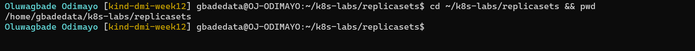
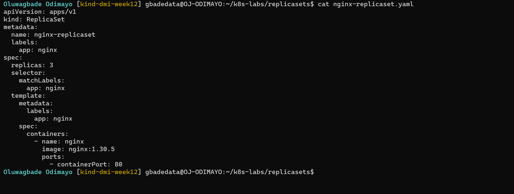
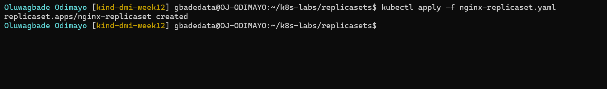
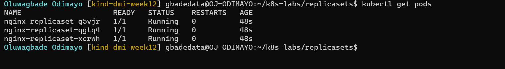
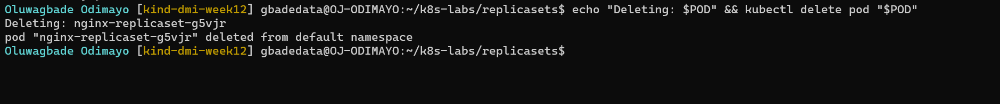
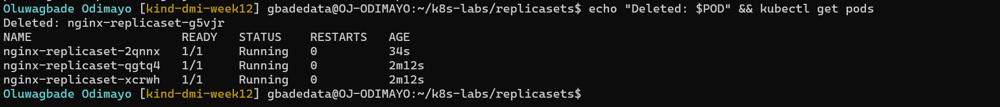
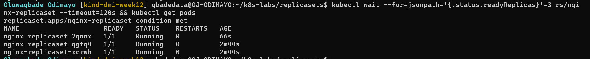
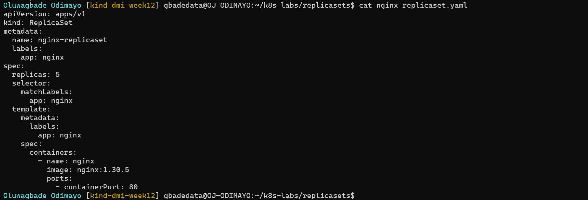
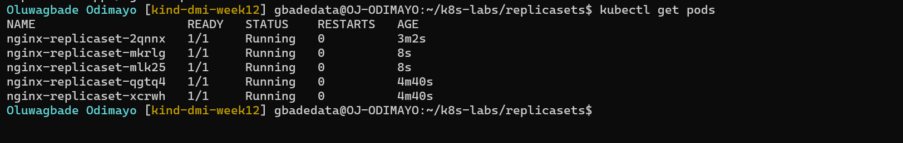

# Assignment 02 — ReplicaSets: Keeping Your Pods Alive

Part of the DevOps Micro Internship (DMI) with Agentic AI

---

## Purpose

In this assignment, you will create three NGINX Pods using a ReplicaSet, test auto-healing by deleting one Pod, and scale the ReplicaSet from three to five Pods.

---

# Task 0 — Pre-check: Remove the Pod from Assignment 01

## Goal

Confirm that you are connected to your learning cluster and remove the previous standalone Pod to prevent the ReplicaSet from adopting it.

### Evidence

No screenshots required.

---

# Task 1 — Set Up Your Working Directory

## Goal

Create and enter a dedicated directory for this ReplicaSet lab.

### Evidence

#### Screenshot 01 — Output of `pwd` showing the working directory ending in `/k8s-labs/replicasets`

---

### Notes

**1. Why is it useful to keep Kubernetes manifests in organized directories?**

Each lab gets its own folder, so the manifests from one exercise never get mixed up with another's. When I run `kubectl apply -f`, I know exactly which file I am applying. The folder also maps one to one onto the copy in my repository (`week-12-kubernetes/k8s-labs/replicasets/`), which makes the work easy to review and run again.

---

**2. What file will you create in this directory for this assignment?**

`nginx-replicaset.yaml`, the ReplicaSet manifest. It starts with `replicas: 3` and is changed to `replicas: 5` in Task 4.

---

# Task 2 — Create and Apply the NGINX ReplicaSet

## Goal

Create a ReplicaSet that maintains three NGINX Pods.

### Evidence

#### Screenshot 02 — Completed `nginx-replicaset.yaml` manifest showing `replicas: 3`

---

#### Screenshot 03 — Output of `kubectl apply -f nginx-replicaset.yaml`

---

#### Screenshot 04 — Output of `kubectl get pods` showing three NGINX Pods with `1/1` under `READY` and `Running` under `STATUS`

---

### Notes

**1. What does `replicas: 3` mean in this manifest?**

It is the desired state: the ReplicaSet should always have three Pods that match its selector. The ReplicaSet controller keeps comparing that number with the Pods that actually exist, and creates or deletes Pods until they match.

---

**2. Why must `selector.matchLabels` match `template.metadata.labels`?**

The selector is how the ReplicaSet counts the Pods it owns, and the template is what it uses to create new ones. If the template's labels did not match the selector, every Pod it created would be missing from its own count, so it would never reach the desired number. The API server rejects a ReplicaSet like that for this reason. Here both are `app: nginx`. The same rule explains Task 0: the selector would also have counted the `nginx-pod` from Assignment 1, because it carried the `app=nginx` label, so I deleted it first.

---

**3. What image and image tag are used for the NGINX container?**

`nginx:1.30.5`, the official NGINX image pinned to the 1.30.5 stable release. Pinning the exact version means every replica, including replacements created later, runs the same build instead of whatever `latest` points to on the day the Pod is created.

---

# Task 3 — Test ReplicaSet Auto-Healing

## Goal

Delete one Pod managed by the ReplicaSet and observe Kubernetes automatically create a replacement.

### Evidence

#### Screenshot 05 — Output of the command deleting one ReplicaSet-managed Pod

---

#### Screenshot 06 — Output of `kubectl get pods` showing the replacement Pod with a different name from the deleted Pod

---

#### Screenshot 07 — Output showing three NGINX Pods with `1/1` under `READY` and `Running` under `STATUS` again

---

### Notes

**1. What happened after you deleted one Pod?**

I deleted `nginx-replicaset-g5vjr`. A new Pod, `nginx-replicaset-2qnnx`, appeared almost immediately with a name I had not seen before and an age of a few seconds, and it reached `1/1 Running` shortly after. The other two Pods were untouched.

---

**2. How does the ReplicaSet know that a replacement Pod is needed?**

The ReplicaSet controller counts the Pods that match its selector, `app=nginx`, and compares the count with `replicas: 3`. When the deleted Pod went away, the count dropped to two, so the controller created one new Pod from the template to close the gap.

---

**3. What proves that auto-healing worked successfully?**

Screenshot 06 shows a Pod I had not seen before (`nginx-replicaset-2qnnx`) with an age of a few seconds, and `nginx-replicaset-g5vjr` is no longer listed. Screenshot 07 shows three Pods at `1/1 Running` again, which is the desired count. I did not create anything myself.

---

# Task 4 — Manually Scale the ReplicaSet

## Goal

Scale the ReplicaSet from three NGINX Pods to five NGINX Pods by changing the YAML manifest.

### Evidence

#### Screenshot 08 — Updated `nginx-replicaset.yaml` showing `replicas: 5`

Manifest file (final, `replicas: 5`): [`k8s-labs/replicasets/nginx-replicaset.yaml`](./k8s-labs/replicasets/nginx-replicaset.yaml)

---

#### Screenshot 09 — Output of `kubectl get pods` showing five NGINX Pods with `1/1` under `READY` and `Running` under `STATUS`

---

### Notes

**1. What change did you make to scale the ReplicaSet?**

I changed `replicas: 3` to `replicas: 5` in `nginx-replicaset.yaml` and ran `kubectl apply -f nginx-replicaset.yaml` again. Nothing else in the file changed.

---

**2. Did you manually create the additional Pods? Explain why or why not.**

No. I only changed the desired count. The ReplicaSet saw five desired and three existing, and created two new Pods from the same template (`nginx-replicaset-mkrlg` and `nginx-replicaset-mlk25`). In my final check they were 67 seconds old, while the other three were several minutes old.

---

**3. What would happen if you changed the replica count from five back to three?**

The ReplicaSet would delete two Pods to bring the count back to three. I would not choose which ones; Kubernetes picks them, preferring Pods that are not yet scheduled or ready, then Pods on nodes that run more of the replicas, then the newest ones.

---

# LinkedIn Requirement

Create a LinkedIn post that includes:

- A short explanation of what a Kubernetes ReplicaSet does.
- What happened when you deleted one NGINX Pod.
- How Kubernetes automatically created a replacement Pod to maintain the desired replica count.
- What you learned by changing the replica count from three to five.
- One screenshot showing either:
  - Three Pods running after the auto-healing test, or
  - Five Pods running after scaling the ReplicaSet.

Do not share sensitive information, cluster credentials, tokens, or kubeconfig details in your post.

### Evidence

#### Screenshot 10 — Published LinkedIn post showing your name, the required explanation, and the attached Pod screenshot

Not published, by choice.

---

### Post Link

Not published, by choice.

---

# Submission Instructions

- Add all required screenshots, numbered 01–10, to this template.
- Full Name must be visible in required screenshots.
- Ensure screenshots are clear and readable.
- Submit the final `nginx-replicaset.yaml` file showing `replicas: 5`. Screenshot 02 provides evidence of the initial manifest with `replicas: 3`.
- Complete the Notes sections in Tasks 1–4 in your own words.
- Include the published LinkedIn post URL.
- Do not expose tokens, passwords, private keys, kubeconfig files, or account IDs.

---

# Completion Checklist

- [x] Completed Task 0 and confirmed that the previous `nginx-pod` is no longer listed
- [x] Created and entered the ReplicaSet working directory (Screenshot 01)
- [x] Created `nginx-replicaset.yaml` with an initial replica count of three (Screenshot 02)
- [x] Applied the ReplicaSet manifest successfully (Screenshot 03)
- [x] Confirmed three NGINX Pods are running (Screenshot 04)
- [x] Deleted one ReplicaSet-managed Pod (Screenshot 05)
- [x] Observed the automatically created replacement Pod (Screenshot 06)
- [x] Confirmed three NGINX Pods are running again (Screenshot 07)
- [x] Changed the replica count from three to five (Screenshot 08)
- [x] Confirmed five NGINX Pods are running (Screenshot 09)
- [x] Submitted the final `nginx-replicaset.yaml` file with `replicas: 5`
- [x] Completed the Notes sections in Tasks 1–4
- [ ] Published the LinkedIn post with the required explanation and Pod screenshot (Screenshot 10) (not published, by choice)
- [ ] Included the published LinkedIn post URL (not published, by choice)
- [x] Included all required screenshots
- [x] No sensitive data exposed

---

## 📌 About DMI & CloudAdvisory

DevOps Micro Internship (DMI) is a project-based DevOps program run by Pravin Mishra (The CloudAdvisory) focused on real-world execution, systems thinking, and career readiness.

It helps learners build strong DevOps foundations with hands-on experience.

---

## 📌 Resources

- 🌐 DMI Official Website: https://dmi.pravinmishra.com?utm_source=github&utm_medium=readme  
- 🎓 University: https://university.pravinmishra.com?utm_source=github&utm_medium=readme  
- 💬 Discord Community: https://discord.pravinmishra.com?utm_source=github&utm_medium=readme  
- 📝 Blog: https://dmi.pravinmishra.com/blog?utm_source=github&utm_medium=readme  
- ▶️ YouTube Playlist: https://www.youtube.com/playlist?list=PLFeSNDtI4Cho  
- 🔗 Pravin Mishra (LinkedIn): https://www.linkedin.com/in/pravin-mishra-aws-trainer/  
- 🏢 CloudAdvisory (LinkedIn): https://www.linkedin.com/company/thecloudadvisory/

---

*This submission is part of DevOps Micro Internship (DMI) — Agentic AI Track.*
