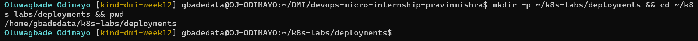
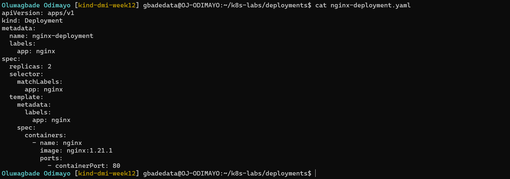
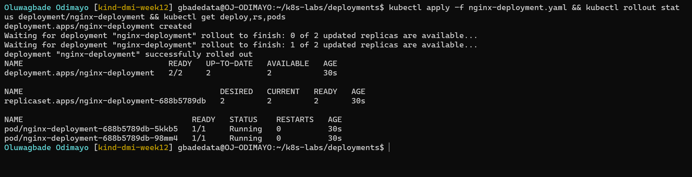
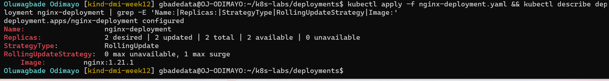
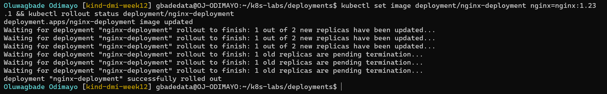
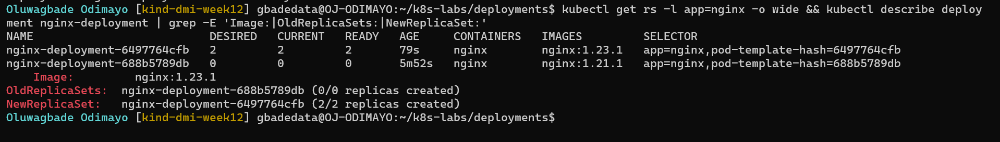
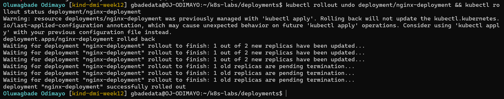
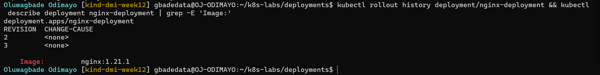
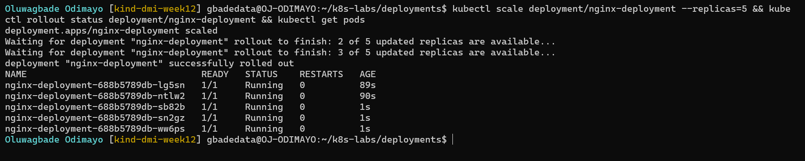
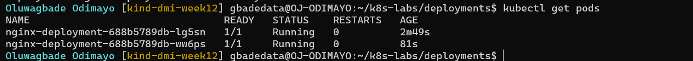

# Assignment 3 — Deployments: From Basics to Rolling Updates

Part of the DevOps Micro Internship (DMI) with Agentic AI

---

## Purpose

Create an NGINX Deployment, configure RollingUpdate, update the container image, roll back to the previous revision, and scale the workload.

---

# Task 0 — Pre-check: Remove the Assignment 02 ReplicaSet

## Goal

Confirm that you are connected to your learning cluster and remove the previous ReplicaSet and its managed Pods before starting this lab.

### Evidence

No screenshots required.

---

# Task 1 — Set Up the Working Directory

## Goal

Create and enter the dedicated Deployment lab directory.

### Evidence

#### Screenshot 01 — Output of `pwd` showing the directory ending in `/k8s-labs/deployments`

---

# Task 2 — Create the Basic Deployment

## Goal

Create a two-replica NGINX Deployment and verify the automatically managed ReplicaSet and Pods.

### Evidence

#### Screenshot 02 — Completed basic `nginx-deployment.yaml` showing two replicas and the initial NGINX image

---

#### Screenshot 03 — Successful apply output and verification output showing the Deployment, its automatically created ReplicaSet, and two Pods with `1/1` under `READY` and `Running` under `STATUS`

---

# Task 3 — Configure the RollingUpdate Strategy

## Goal

Configure RollingUpdate to maintain the desired available replica count during an image update.

### Evidence

#### Screenshot 04 — Updated YAML showing `RollingUpdate`, `maxSurge: 1`, and `maxUnavailable: 0`

Manifest file (final): [`k8s-labs/deployments/nginx-deployment.yaml`](./k8s-labs/deployments/nginx-deployment.yaml)

---

#### Screenshot 05 — Successful apply output and Deployment details showing the configured rolling-update strategy

---

# Task 4 — Perform and Roll Back an Image Update

## Goal

Update NGINX to 1.23.1, observe the rollout, and return to the previous stable revision.

### Evidence

#### Screenshot 06 — Image-update command and rollout status showing successful completion

---

#### Screenshot 07 — ReplicaSet output showing the previous and updated ReplicaSets, and Deployment details showing `nginx:1.23.1`

---

#### Screenshot 08 — Rollback command and rollout status showing successful completion

---

#### Screenshot 09 — Rollout history and Deployment details showing the restored `nginx:1.21.1` image

---

# Task 5 — Scale the Deployment

## Goal

Scale the workload to five replicas and return it to two.

### Evidence

#### Screenshot 10 — Scale-up command and output showing five Pods with `1/1` under `READY` and `Running` under `STATUS`

---

#### Screenshot 11 — Scale-down command and output showing the final two Pods with `1/1` under `READY` and `Running` under `STATUS`

---

# Task 6 — Share Your Kubernetes Deployment Progress on WhatsApp Status

## Goal

Share your Kubernetes Deployment learning progress on WhatsApp Status, including your generated DMI leaderboard progress link.

### Steps

1. Go to the DMI Leaderboard.
2. Find your name and select **Share your progress**.
3. Click the **WhatsApp icon**.
4. Copy the automatically generated leaderboard message containing your rank and progress link.
5. Open WhatsApp and go to **Updates**.
6. Create a new text Status.
7. Copy and paste the message below.
8. Insert the generated leaderboard message in the indicated place.
9. Review and publish your Status.

### WhatsApp Status Message

I practiced Kubernetes Deployments as part of my DevOps learning journey! 🚀

Today, I deployed NGINX, configured rolling updates, updated the container image, and rolled back to the previous version.

I also scaled my Deployment from two Pods to five and back to two!

[PASTE YOUR GENERATED LEADERBOARD MESSAGE AND LINK HERE]

#DMIByPravinMishra #DevOps #Kubernetes

### Evidence

#### Screenshot 12 — Published WhatsApp Status showing your Kubernetes Deployment message and generated DMI leaderboard progress link

Not published, by choice.

A draft or editing screen is not sufficient.

---

# Lab Summary

Write a short note explaining how Deployments manage ReplicaSets, perform rolling updates and rollbacks, and scale Pods.

A Deployment does not run Pods directly. It owns ReplicaSets, and each ReplicaSet owns Pods. When I applied `nginx-deployment.yaml`, the Deployment created one ReplicaSet (`nginx-deployment-688b5789db`), and that ReplicaSet created the two Pods. The suffix is a hash of the Pod template, so every change to the template means a different ReplicaSet.

**Rolling update.** `kubectl set image` changed the template to `nginx:1.23.1`, so the Deployment created a second ReplicaSet (`nginx-deployment-6497764cfb`) and moved the Pods across gradually. With `maxSurge: 1` and `maxUnavailable: 0`, it could add at most one extra Pod at a time and could never drop below two available Pods, so each new Pod had to be ready before an old one was removed. The old ReplicaSet was kept at 0 replicas rather than deleted.

**Rollback.** `kubectl rollout undo` switched the template back to `nginx:1.21.1`. That template already had a ReplicaSet, so the Deployment scaled `688b5789db` back up and `6497764cfb` down to 0, following the same rolling-update rules. The history then listed only revisions 2 and 3: rolling back to revision 1 made it the newest revision, so it was renumbered to 3. CHANGE-CAUSE shows `<none>` because I did not annotate the changes.

**Scaling.** `kubectl scale --replicas=5` and then `--replicas=2` only changed the replica count on the current ReplicaSet. The template did not change, so there was no new ReplicaSet, no new revision, and the image stayed at 1.21.1.

I made the image update, the rollback and the scaling with imperative commands, so the submitted `nginx-deployment.yaml` still describes the intended steady state: two replicas, `nginx:1.21.1`, and the RollingUpdate strategy.

---

# Submission Instructions

- Include all required screenshots, numbered 01–12.
- Ensure screenshots are clear and readable.
- Submit the final `nginx-deployment.yaml` containing two replicas, the initial NGINX image, and the configured RollingUpdate strategy.
- Complete the Lab Summary in your own words.
- Include evidence of your published WhatsApp Status.
- Do not expose passwords, tokens, private keys, or kubeconfig credentials.

---

# Completion Checklist

- [x] Completed Task 0
- [x] Created the deployments directory (Screenshot 01)
- [x] Created the basic two-replica NGINX Deployment manifest (Screenshot 02)
- [x] Applied the Deployment and verified its ReplicaSet and two running Pods (Screenshot 03)
- [x] Added RollingUpdate with `maxSurge: 1` and `maxUnavailable: 0` (Screenshot 04)
- [x] Applied and verified the rolling-update strategy (Screenshot 05)
- [x] Updated NGINX to 1.23.1 and confirmed rollout completion (Screenshot 06)
- [x] Inspected the ReplicaSets and verified the updated image (Screenshot 07)
- [x] Rolled back the update and confirmed rollout completion (Screenshot 08)
- [x] Reviewed rollout history and verified the restored image (Screenshot 09)
- [x] Scaled to five running Pods (Screenshot 10)
- [x] Scaled back to two running Pods (Screenshot 11)
- [ ] Published the WhatsApp Status with the generated leaderboard progress link (Screenshot 12) (not published, by choice)
- [x] Submitted the final `nginx-deployment.yaml`
- [ ] Included screenshots 01–12 (01–11 included; 12 not published, by choice)
- [x] Completed the Lab Summary
- [x] No sensitive data exposed

---

## 📌 About DMI & CloudAdvisory

DevOps Micro Internship (DMI) is a project-based DevOps program run by Pravin Mishra (The CloudAdvisory) focused on real-world execution, systems thinking, and career readiness.

It helps learners build strong DevOps foundations with hands-on experience.

---

## 📌 Resources

- 🌐 DMI Official Website: https://dmi.pravinmishra.com?utm_source=github&utm_medium=readme  
- 🎓 University: https://university.pravinmishra.com?utm_source=github&utm_medium=readme  
- 💬 Discord Community: https://discord.pravinmishra.com?utm_source=github&utm_medium=readme  
- 📝 Blog: https://dmi.pravinmishra.com/blog?utm_source=github&utm_medium=readme  
- ▶️ YouTube Playlist: https://www.youtube.com/playlist?list=PLFeSNDtI4Cho  
- 🔗 Pravin Mishra (LinkedIn): https://www.linkedin.com/in/pravin-mishra-aws-trainer/  
- 🏢 CloudAdvisory (LinkedIn): https://www.linkedin.com/company/thecloudadvisory/

---

*This submission is part of DevOps Micro Internship (DMI) — Agentic AI Track.*
