# Assignment 4 — Auto-Scaling & Auto-Healing: Let Kubernetes React for You

Part of the DevOps Micro Internship (DMI) with Agentic AI

---

## Purpose

Create Deployments, test Pod auto-healing, configure CPU requests and limits, verify Metrics Server, and create a Horizontal Pod Autoscaler.

Optionally generate CPU load to observe how the HPA responds.

---

# Task 0 — Check the Existing Cluster Resources

## Goal

Confirm that you are connected to your learning cluster and inspect existing Deployments and HPAs.

### Evidence

No screenshots required.

---

# Task 1 — Set Up Your Lab Directory

## Goal

Create and enter a dedicated directory for the auto-scaling lab.

### Evidence

#### Screenshot 1 — Terminal showing that you are working inside `~/k8s-labs/autoscaling`

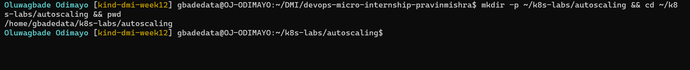

---

### Notes

**1. What is the difference between auto-healing and auto-scaling?**

Auto-healing keeps the number of Pods I asked for. If a Pod dies or is deleted, its controller replaces it and the count goes back to the same number. Auto-scaling changes that number: it adds Pods when load rises and removes them when it falls. Healing protects the desired state; scaling changes the desired state based on demand.

---

**2. Which Kubernetes feature will you use for CPU-based auto-scaling?**

The Horizontal Pod Autoscaler (HPA), using CPU metrics provided by Metrics Server.

---

# Task 2 — Test Auto-Healing with a Deployment

## Goal

Create a Deployment with two replicas, delete one Pod, and observe Kubernetes create a replacement Pod.

### Evidence

#### Screenshot 2 — Completed `autohealing-deployment.yaml` manifest

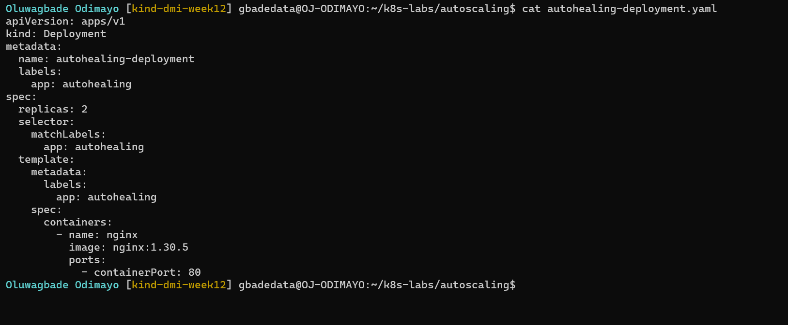

Manifest file: [`k8s-labs/autoscaling/autohealing-deployment.yaml`](./k8s-labs/autoscaling/autohealing-deployment.yaml)

---

#### Screenshot 3 — Output of `kubectl get pods` showing two running Pods before deletion

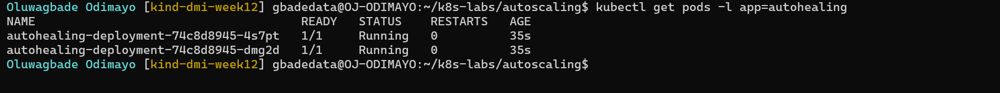

---

#### Screenshot 4 — Output of the `kubectl delete pod` command

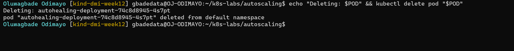

---

#### Screenshot 5 — Output of `kubectl get pods` showing the replacement Pod and two running Pods

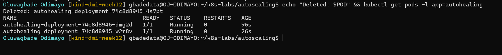

---

### Notes

**1. What happened after you deleted one Pod?**

Kubernetes created a replacement straight away. The deleted Pod disappeared from the list and a new Pod with a different name and an age of a few seconds took its place, so `autohealing-deployment` was back to two running Pods without me doing anything.

---

**2. What Kubernetes resource maintains the desired replica count for this Deployment?**

The ReplicaSet that the Deployment created. `autohealing-deployment` declares `replicas: 2`, and its ReplicaSet is the controller that counts the matching Pods and creates a new one when the count drops.

---

**3. What proves that auto-healing worked?**

Screenshot 5 shows two Pods at `1/1 Running` again, one of them with a new name and a much younger age than the Pod that survived. I never ran a create command, so the replacement could only have come from the ReplicaSet.

---

# Task 3 — Create a Deployment for HPA

## Goal

Create a Deployment with CPU resource requests and limits so that HPA can calculate CPU utilization.

### Evidence

#### Screenshot 6 — Completed `hpa-deployment.yaml` manifest showing CPU requests and limits

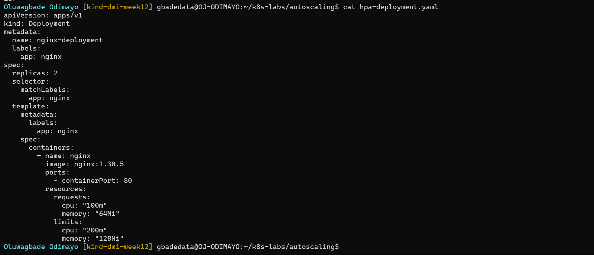

Manifest file: [`k8s-labs/autoscaling/hpa-deployment.yaml`](./k8s-labs/autoscaling/hpa-deployment.yaml)

---

#### Screenshot 7 — Output showing `nginx-deployment` and its running Pods

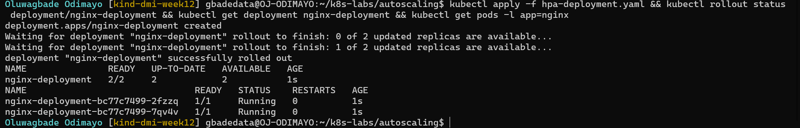

---

### Notes

**1. What does `cpu: "100m"` mean?**

100 millicores, which is one tenth of a CPU core. As a request, it tells the scheduler to reserve that much CPU for the container on whichever node it is placed.

---

**2. What is the difference between a CPU request and a CPU limit?**

A request is the amount the container is guaranteed, and it is what the scheduler uses to choose a node. A limit is the ceiling: a container that tries to use more CPU than its limit is throttled, not killed. In my manifest the request is 100m and the limit is 200m, so each Pod can burst to twice its reserved CPU. Memory behaves differently: going over a memory limit gets the container killed.

---

**3. Why does CPU-based HPA require CPU requests?**

CPU utilization in an HPA is a percentage of the request. With a 100m request, a Pod using 50m is at 50%. Without a request there is nothing to divide by, so the HPA cannot calculate utilization and cannot scale.

---

# Task 4 — Enable and Verify Metrics Server

## Goal

Ensure the cluster can collect resource metrics for the HPA.

### Evidence

#### Screenshot 8 — Output showing Metrics Server running, or `kubectl top pods` displaying Pod metrics

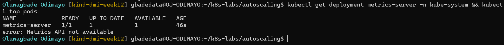

---

### Notes

**1. Why does HPA need Metrics Server?**

The HPA does not measure anything itself. It reads each Pod's current CPU usage from the Metrics API (`metrics.k8s.io`), which Metrics Server provides by collecting usage from the kubelet on every node. kind does not install it, so I installed Metrics Server v0.9.0 myself.

---

**2. What issue can occur if Metrics Server is not working?**

The HPA gets no metrics, so its target shows `<unknown>` and it cannot scale, and `kubectl top` fails. On kind there is a specific version of this problem: Metrics Server cannot verify the kubelets' self-signed serving certificates, so I added `--kubelet-insecure-tls`. That is acceptable for a local lab but not for a production cluster.

---

**3. What does `kubectl top pods` help you check?**

It shows the CPU (in millicores) and memory each Pod is using right now. I use it to confirm that metrics are flowing before relying on the HPA, and to compare real usage with the requests and limits I set.

---

# Task 5 — Create a Horizontal Pod Autoscaler

## Goal

Create an HPA that keeps at least two Pods running and can scale up to five Pods when average CPU utilization exceeds 50%.

### Evidence

#### Screenshot 9 — The imperative command output OR completed `hpa-nginx.yaml` manifest

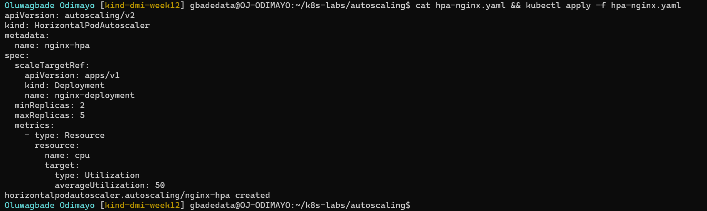

Manifest file: [`k8s-labs/autoscaling/hpa-nginx.yaml`](./k8s-labs/autoscaling/hpa-nginx.yaml)

---

#### Screenshot 10 — Output of `kubectl get hpa` and the relevant `kubectl describe hpa` command

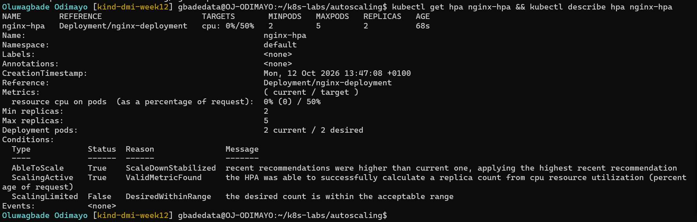

---

### Notes

**1. What does `minReplicas: 2` mean?**

The HPA never scales `nginx-deployment` below two Pods, even with no load, so there is always a second Pod if one fails.

---

**2. What does `maxReplicas: 5` mean?**

The HPA never scales above five Pods, however high the load. It is a cap that protects the cluster's capacity and cost.

---

**3. What does `averageUtilization: 50` mean?**

The HPA aims to keep the average CPU usage across the Deployment's Pods at 50% of their CPU request, which is 50m per Pod. If the average is higher it adds Pods, and if it is lower it removes them, always within the range of 2 to 5.

---

**4. Why should only one HPA manage a Deployment at a time?**

Each HPA calculates its own desired replica count and writes it to the Deployment. Two HPAs on the same Deployment would keep overwriting each other, and the replica count would flap. The same applies to anything else that sets `replicas`, which is why I would not re-apply `hpa-deployment.yaml` with `replicas: 2` while the HPA is in control.

---

# Task 6 — Optional: Generate CPU Load and Observe Scaling

## Goal

Generate CPU load in one NGINX Pod and observe how HPA responds.

### Evidence

If you skip this task, write “Not completed — optional” and leave the remaining Task 6 placeholders blank.

Task status: Completed.

#### Screenshot 11 — Terminal showing the CPU-load command running inside the selected Pod

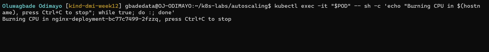

---

#### Screenshot 12 — Output of `kubectl get hpa` and `kubectl get pods` while HPA evaluates or changes the replica count

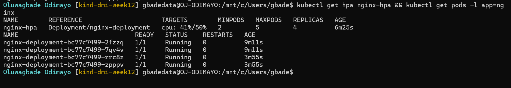

---

### Notes

Complete these answers only if you perform the optional test.

**1. Did the HPA change the number of Pods? Explain what you observed.**

Yes. I ran a busy loop inside one `nginx-deployment` Pod. That Pod went up to its 200m CPU limit, which is 200% of its 100m request, while the other Pod stayed near zero, so the average was about 100%, twice the 50% target. The HPA calculated 2 × 100 / 50 = 4 and scaled the Deployment from 2 to 4 Pods; its event read `New size: 4; reason: cpu resource utilization (percentage of request) above target`. With four Pods the same load averaged 50%, exactly on target, so it stopped at 4 rather than going to the maximum of 5.

---

**2. If scaling did not happen, what are two possible reasons?**

Not applicable: scaling occurred. If it had not, the two most likely reasons would be that Metrics Server was not returning Pod metrics (the HPA target would show `<unknown>`), or that the Pods had no CPU request, so the HPA had nothing to calculate a percentage against. Not waiting long enough is a third: the HPA checks metrics every 15 seconds by default, and Metrics Server needs a scrape or two before it has numbers.

---

**3. Why is automatic scale-down useful after traffic decreases?**

When the load stops, the extra Pods are no longer needed. Scaling down gives their reserved CPU and memory back to the cluster for other workloads, and on a cloud cluster it lets the node autoscaler remove nodes, which saves money. Kubernetes waits for a stabilization window (five minutes by default) before scaling down, so a short dip in traffic does not cause Pods to be removed and added again repeatedly.

---

# LinkedIn Requirement

### Evidence

#### Screenshot 13 — Published LinkedIn post showing your name, the required explanation, and the attached Kubernetes screenshot

Not published, by choice.

#### Linkedin Post Link

Not published, by choice.

---

# Submission Instructions

- Include required Screenshots 1–10 and Screenshot 13.
- Include Screenshots 11–12 only if you complete Task 6.
- Full Name must be visible in required screenshots.
- Ensure screenshots are clear and readable.
- Include the completed `autohealing-deployment.yaml` and `hpa-deployment.yaml` files.
- Include `hpa-nginx.yaml` if you selected the declarative HPA method.
- Complete the Notes sections for Tasks 1–5 in your own words.
- Complete Task 6 notes only if you perform the optional test.
- Do not expose passwords, tokens, private keys, kubeconfig files, or account IDs.

---

# Completion Checklist

- [x] Checked the active context and existing cluster resources
- [x] Created the autoscaling working directory (Screenshot 1)
- [x] Created `autohealing-deployment.yaml` (Screenshot 2)
- [x] Confirmed two auto-healing Pods were running (Screenshot 3)
- [x] Deleted one managed Pod (Screenshot 4)
- [x] Confirmed that the Pod was automatically replaced (Screenshot 5)
- [x] Created `hpa-deployment.yaml` with CPU requests and limits (Screenshot 6)
- [x] Verified `nginx-deployment` and its running Pods (Screenshot 7)
- [x] Verified Metrics Server and confirmed Pod metrics are available (Screenshot 8)
- [x] Created one HPA using the selected method (Screenshot 9)
- [x] Verified minimum replicas of 2, maximum replicas of 5, and a CPU target of 50% (Screenshot 10)
- [x] Completed Notes for Tasks 1–5
- [x] Completed Task 6 evidence and notes, or marked it “Not completed — optional”
- [x] Stopped the CPU-load command and exited the container shell, if Task 6 was completed
- [ ] Published the LinkedIn post with the required explanation and attached screenshot (Screenshot 13) (not published, by choice)
- [x] Included the required manifest files
- [x] No sensitive data exposed

---

## 📌 About DMI & CloudAdvisory

DevOps Micro Internship (DMI) is a project-based DevOps program run by Pravin Mishra (The CloudAdvisory) focused on real-world execution, systems thinking, and career readiness.

It helps learners build strong DevOps foundations with hands-on experience.

---

## 📌 Resources

- 🌐 DMI Official Website: https://dmi.pravinmishra.com?utm_source=github&utm_medium=readme  
- 🎓 University: https://university.pravinmishra.com?utm_source=github&utm_medium=readme  
- 💬 Discord Community: https://discord.pravinmishra.com?utm_source=github&utm_medium=readme  
- 📝 Blog: https://dmi.pravinmishra.com/blog?utm_source=github&utm_medium=readme  
- ▶️ YouTube Playlist: https://www.youtube.com/playlist?list=PLFeSNDtI4Cho  
- 🔗 Pravin Mishra (LinkedIn): https://www.linkedin.com/in/pravin-mishra-aws-trainer/  
- 🏢 CloudAdvisory (LinkedIn): https://www.linkedin.com/company/thecloudadvisory/

---

*This submission is part of DevOps Micro Internship (DMI) — Agentic AI Track.*
