# Assignment 5 — Kubernetes Health Probes (Readiness)

Part of the DevOps Micro Internship (DMI) with Agentic AI

---

## Purpose

In this assignment, you will configure and test a Kubernetes readiness probe. You will create a baseline NGINX Deployment, add an HTTP readiness probe, intentionally break it, observe a stalled rollout, and restore the working configuration.

You will also demonstrate how readiness probes protect rolling updates.

---

# Task 0 — Prepare the Lab Environment

## Goal

Confirm that you are connected to your learning cluster and remove the previous assignment’s HPA and NGINX Deployment before starting this lab.

No screenshot or written notes are required for this pre-check.

---

# Task 1 — Set Up Your Lab Directory

## Goal

Create and enter a dedicated directory for the readiness-probe lab.

### Evidence

#### Screenshot 1 — Terminal showing that you are working inside `~/k8s-labs/health-probes-readiness`

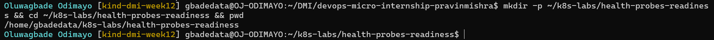

---

### Notes

**1. What is the purpose of a readiness probe?**

A readiness probe tells Kubernetes whether a container is ready to receive traffic. While the probe passes, the Pod is marked Ready and counts as an available replica, so Services can send it requests and a rolling update can move on. While it fails, the Pod keeps running but is marked not ready and kept out of rotation.

**2. Why is a Pod being Running not always enough to confirm it can serve traffic?**

`Running` only means the container process has started. NGINX could still be starting, a dependency could be missing, or the application could be returning errors. A readiness probe checks what users actually need, a successful response, before Kubernetes treats the Pod as able to serve.

---

# Task 2 — Create a Baseline Deployment Without Probes

## Goal

Create a baseline NGINX Deployment with two replicas and no readiness probe.

### Evidence

#### Screenshot 2 — Completed `00-nginx-deploy-baseline.yaml` manifest

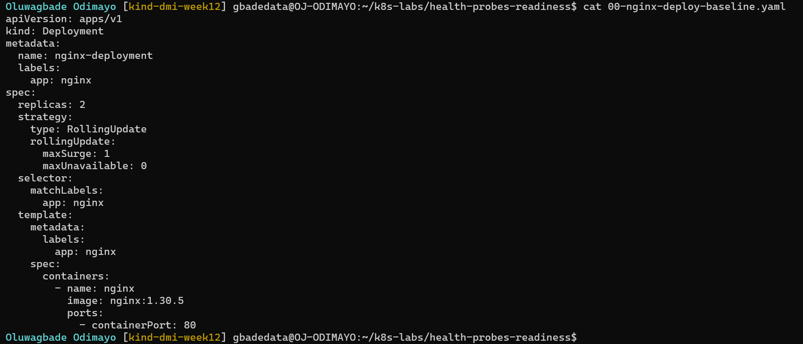

Manifest file: [`k8s-labs/health-probes-readiness/00-nginx-deploy-baseline.yaml`](./k8s-labs/health-probes-readiness/00-nginx-deploy-baseline.yaml)

---

#### Screenshot 3 — Output showing a successful rollout and two running NGINX Pods

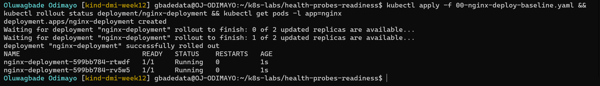

---

#### Screenshot 4 — Relevant output from `kubectl describe deployment nginx-deployment`

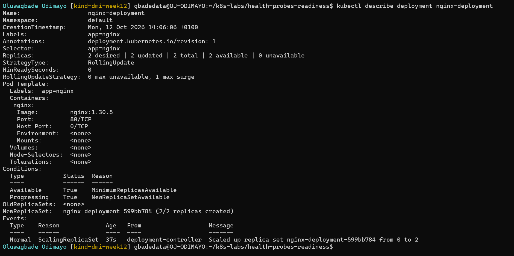

---

### Notes

**1. How many replicas does this Deployment maintain?**

Two (`replicas: 2`).

**2. What does `maxUnavailable: 0` mean during a rolling update?**

During a rolling update, the number of available Pods may never drop below the desired count, which is two here. Combined with `maxSurge: 1`, Kubernetes has to start one new Pod, wait until it is available, and only then remove an old one.

**3. Is a readiness probe configured in this baseline Deployment?**

No. The baseline Pod template has no probes, so Kubernetes treats each Pod as ready as soon as its container starts. The Pod Template in Screenshot 4 has no `Readiness` line.

---

# Task 3 — Add a Readiness Probe

## Goal

Add an HTTP readiness probe so Kubernetes checks whether each NGINX container is ready to accept requests.

### Evidence

#### Screenshot 5 — Completed `01-nginx-deploy-readiness.yaml` manifest showing the readiness probe

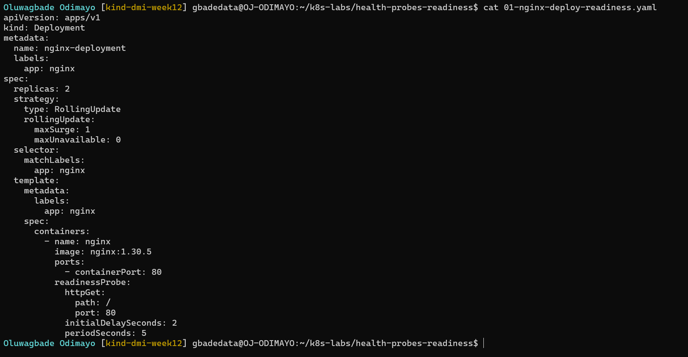

Manifest file: [`k8s-labs/health-probes-readiness/01-nginx-deploy-readiness.yaml`](./k8s-labs/health-probes-readiness/01-nginx-deploy-readiness.yaml)

---

#### Screenshot 6 — Output of the successful rollout and ready Pods

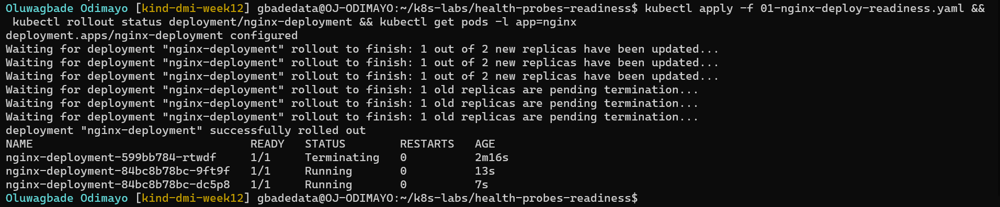

---

#### Screenshot 7 — Pod description showing readiness conditions and readiness probe details

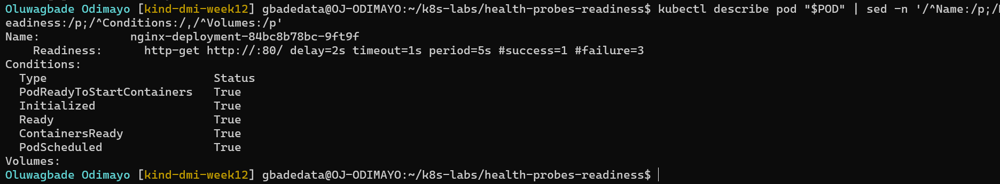

---

### Notes

**1. What path and port does the readiness probe check?**

An HTTP GET to `/` on port 80, the default NGINX page. `kubectl describe pod` showed it as `http-get http://:80/`.

**2. What does `initialDelaySeconds: 2` do?**

Kubernetes waits 2 seconds after the container starts before running the first readiness check, which gives NGINX a moment to start listening.

**3. What does `periodSeconds: 5` do?**

After the first check, Kubernetes runs the probe every 5 seconds for as long as the container runs. Readiness is not checked once at start-up; it is checked continuously.

**4. What must happen before Kubernetes considers this Pod ready?**

The container has to start, the 2-second initial delay has to pass, and the probe has to succeed: NGINX must answer `GET /` on port 80 with a status from 200 to 399. One success is enough (`#success=1` in the probe details). Then the Pod's `Ready` and `ContainersReady` conditions become `True`, as Screenshot 7 shows for `nginx-deployment-84bc8b78bc-9ft9f`. In Screenshot 6 the last old Pod is still `Terminating` because it was only removed after both new Pods were ready.

---

# Task 4 — Break and Restore Readiness

## Goal

Intentionally fail the readiness probe, observe the NotReady behavior, and then restore the working probe configuration.

### Evidence

#### Screenshot 8 — `02-nginx-readiness-broken.yaml` showing `/does-not-exist`

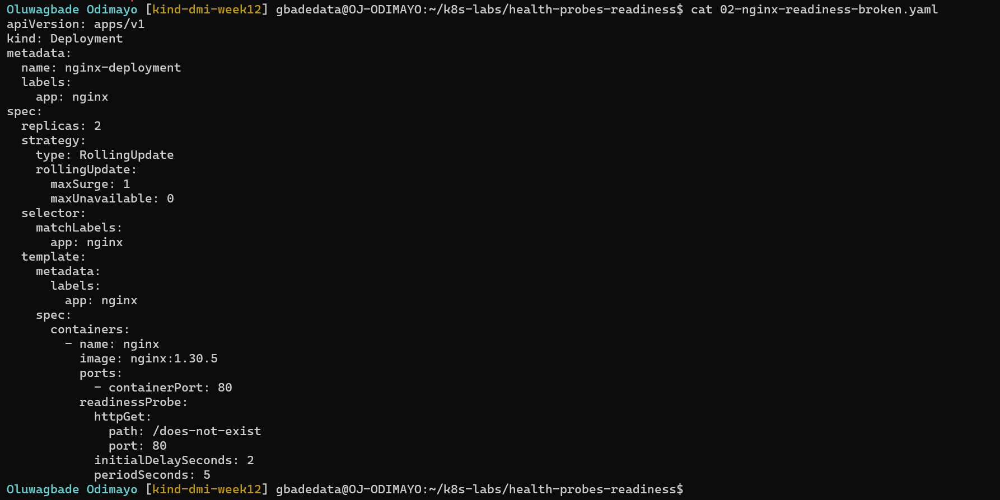

Manifest file: [`k8s-labs/health-probes-readiness/02-nginx-readiness-broken.yaml`](./k8s-labs/health-probes-readiness/02-nginx-readiness-broken.yaml)

---

#### Screenshot 9 — Output showing the rollout timeout or incomplete rollout

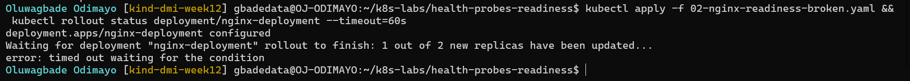

---

#### Screenshot 10 — Pod details showing `Ready: False` or readiness-probe failure events

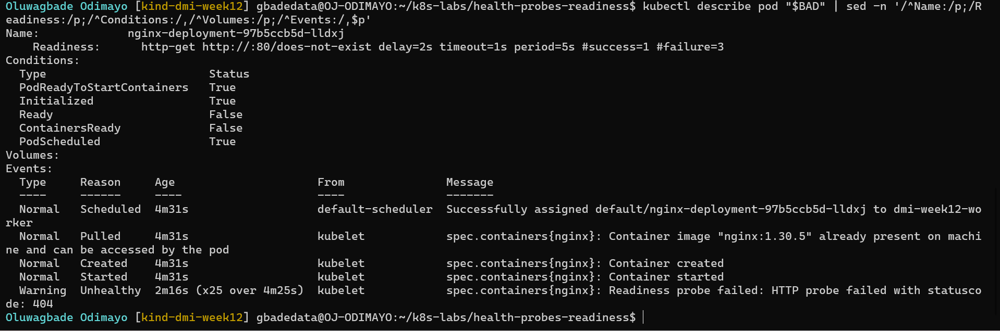

---

#### Screenshot 11 — Output showing successful rollout and ready Pods after the fix

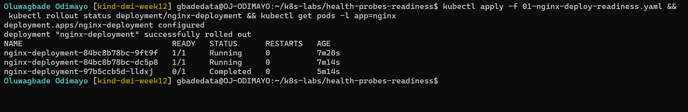

---

### Notes

**1. Why did the readiness probe fail?**

The probe asked NGINX for `/does-not-exist`, a page that does not exist, so NGINX returned 404. Kubernetes treats any status outside 200 to 399 as a failure, and the event read `Readiness probe failed: HTTP probe failed with statuscode: 404`. NGINX itself was healthy; the check was wrong.

**2. What happened to the Pod readiness status?**

The new Pod, `nginx-deployment-97b5ccb5d-lldxj`, stayed `Running` but at `0/1` READY, with its `Ready` and `ContainersReady` conditions `False`. It never became an available replica.

**3. Why did the rollout fail to complete?**

With `maxSurge: 1` and `maxUnavailable: 0`, the Deployment could create one new Pod but could not remove an old Pod until the new one was ready. The new Pod never became ready, so the rollout stopped at 1 of 2 new replicas and `kubectl rollout status` timed out after 60 seconds. The two old Pods kept running the whole time.

**4. How did you restore the Deployment successfully?**

I re-applied `01-nginx-deploy-readiness.yaml`, which has the correct path `/`. That template matched the ReplicaSet I had already rolled out, so the Deployment switched back to it (its two Pods were still running) and scaled the broken ReplicaSet down to zero, removing the unready Pod. The rollout completed (Screenshot 11). The rollout history shows this as revision 4 replacing revision 2, because the same template was reused rather than recreated.

---

# Task 5 — See How Readiness Protects Rolling Updates

## Goal

Observe how readiness prevents a bad new Pod from replacing healthy Pods during a rolling update.

### Evidence

#### Screenshot 12 — Successful update command and rollout status

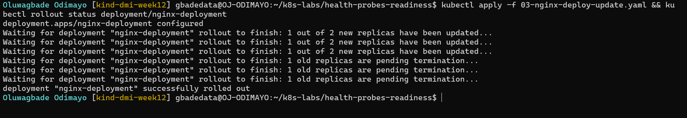

Manifest file: [`k8s-labs/health-probes-readiness/03-nginx-deploy-update.yaml`](./k8s-labs/health-probes-readiness/03-nginx-deploy-update.yaml)

---

#### Screenshot 13 — ReplicaSets and Pods after the successful rolling update

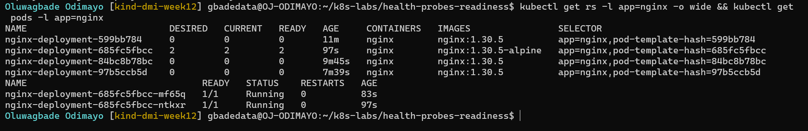

---

#### Screenshot 14 — Completed `04-readiness-broken-patch.yaml`

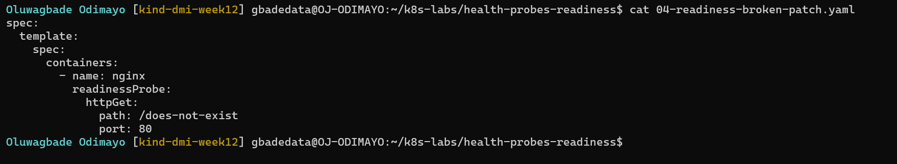

Manifest file: [`k8s-labs/health-probes-readiness/04-readiness-broken-patch.yaml`](./k8s-labs/health-probes-readiness/04-readiness-broken-patch.yaml)

---

#### Screenshot 15 — Output showing the expected stalled rollout or timeout

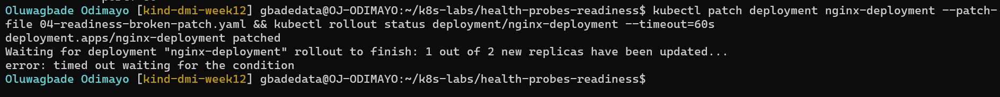

---

#### Screenshot 16 — Deployment or Pod output showing the effect of the broken readiness probe

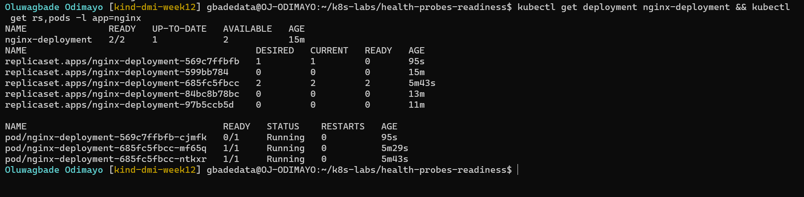

---

#### Screenshot 17 — Successful rollout status after restoring the fixed configuration

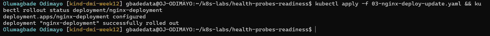

---

### Notes

**1. What happened during the successful rolling update?**

I applied `03-nginx-deploy-update.yaml`, which changes the image from `nginx:1.30.5` to `nginx:1.30.5-alpine`. The Deployment created a new ReplicaSet (`nginx-deployment-685fc5fbcc`) and replaced the Pods one at a time; each new Pod had to pass its readiness probe before an old Pod was removed. The rollout finished with two ready Alpine Pods (Screenshots 12 and 13).

**2. Why did Kubernetes create a new ReplicaSet?**

The image is part of the Pod template. Any change to the template produces a new template hash, so the Deployment creates a new ReplicaSet for it and keeps the old ones at zero replicas, which is what makes rollbacks possible.

**3. Why were the new Pods unable to replace the existing healthy Pods after readiness was broken?**

The patch changed the readiness path to `/does-not-exist`, which created another ReplicaSet (`nginx-deployment-569c7ffbfb`). Its first Pod, `nginx-deployment-569c7ffbfb-cjmfk`, failed readiness with a 404, so it never counted as available. Kubernetes only removes an old Pod once a new one is available, so the two healthy Alpine Pods stayed in place.

**4. How does `maxUnavailable: 0` protect availability during this rollout?**

It means the number of available Pods can never drop below two during the rollout. Kubernetes had to add a new Pod first and wait for it to be ready before touching an old one, and because the new Pod never became ready, no healthy Pod was removed. The two Pods serving before the bad patch, `nginx-deployment-685fc5fbcc-mf65q` and `nginx-deployment-685fc5fbcc-ntkxr`, were still the ones running at the end of the lab, after both the stalled rollout and the recovery.

---

# Task 6 — Share Your Readiness-Probe Learning on LinkedIn

## Goal

Share what you learned about Kubernetes readiness probes and how they protect rolling updates.

### Evidence

#### Screenshot 18 — Published LinkedIn post

Not published, by choice.

#### Linkedin post link

Not published, by choice.

---

# Submission Instructions

- Add all required screenshots numbered 1–18.
- Ensure your full name is visible in required screenshots.
- Use clear, readable screenshots showing the relevant manifest or output.
- Include the completed baseline and readiness-probe manifests in your repository.
- Answer all Notes questions for Tasks 1–5 in your own words.
- Include evidence of the intentional readiness failure and successful recovery.
- Do not expose tokens, passwords, kubeconfig files, account IDs, or other sensitive information.

---

# Completion Checklist

- [x] Learning cluster confirmed and previous assignment resources removed where applicable
- [x] Readiness-probe lab directory created (Screenshot 1)
- [x] Baseline Deployment created successfully (Screenshot 2)
- [x] Two baseline Pods running and successful rollout verified (Screenshot 3)
- [x] Baseline Deployment details reviewed (Screenshot 4)
- [x] Readiness probe added successfully (Screenshot 5)
- [x] Successful readiness rollout verified (Screenshot 6)
- [x] Pod readiness conditions and probe details inspected (Screenshot 7)
- [x] Broken readiness configuration created (Screenshot 8)
- [x] Stalled rollout or timeout observed (Screenshot 9)
- [x] NotReady status or readiness-probe failure events captured (Screenshot 10)
- [x] Working readiness configuration restored (Screenshot 11)
- [x] Successful image update completed (Screenshot 12)
- [x] ReplicaSets and Pods inspected after the update (Screenshot 13)
- [x] Broken-readiness patch created (Screenshot 14)
- [x] Stalled rollout observed after the patch (Screenshot 15)
- [x] Effect of broken readiness captured (Screenshot 16)
- [x] Final recovery completed (Screenshot 17)
- [ ] LinkedIn post published (Screenshot 18) (not published, by choice)
- [x] Notes for Tasks 1–5 completed
- [x] Required manifests included
- [x] All screenshots are clear and readable
- [x] No sensitive data exposed

---

## 📌 About DMI & CloudAdvisory

DevOps Micro Internship (DMI) is a project-based DevOps program run by Pravin Mishra (The CloudAdvisory) focused on real-world execution, systems thinking, and career readiness.

It helps learners build strong DevOps foundations with hands-on experience.

---

## 📌 Resources

- 🌐 DMI Official Website: https://dmi.pravinmishra.com?utm_source=github&utm_medium=readme  
- 🎓 University: https://university.pravinmishra.com?utm_source=github&utm_medium=readme  
- 💬 Discord Community: https://discord.pravinmishra.com?utm_source=github&utm_medium=readme  
- 📝 Blog: https://dmi.pravinmishra.com/blog?utm_source=github&utm_medium=readme  
- ▶️ YouTube Playlist: https://www.youtube.com/playlist?list=PLFeSNDtI4Cho  
- 🔗 Pravin Mishra (LinkedIn): https://www.linkedin.com/in/pravin-mishra-aws-trainer/  
- 🏢 CloudAdvisory (LinkedIn): https://www.linkedin.com/company/thecloudadvisory/

---

*This submission is part of DevOps Micro Internship (DMI) — Agentic AI Track.*
