# Assignment 6 — Kubernetes Health Probes (Liveness)

Part of the DevOps Micro Internship (DMI) with Agentic AI

---

## Purpose

In this assignment, you will configure and test a Kubernetes liveness probe. You will create a baseline NGINX Deployment, add an HTTP liveness probe, intentionally make it fail, observe container restarts, and restore the working configuration.

---

# Task 0 — Prepare the Lab Environment

## Goal

Confirm that you are connected to your learning cluster and remove the previous HPA and NGINX Deployment before starting this lab.

No screenshot or written notes are required for this pre-check.

---

# Task 1 — Set Up Your Lab Directory

## Goal

Create and enter a dedicated directory for the liveness-probe lab.

### Evidence

#### Screenshot 1 — Terminal showing that you are working inside `~/k8s-labs/health-probes-liveness`

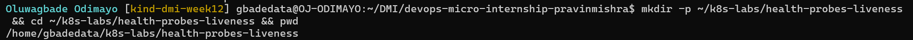

---

### Notes

**1. What problem does a liveness probe solve?**

A container can keep running while the application inside it has stopped working, for example a process that is deadlocked or stuck in a bad state and no longer answers requests. Without a probe, Kubernetes only sees that the process is alive. A liveness probe checks whether the application still responds, and if it fails repeatedly, the kubelet kills the container and starts a new one automatically.

**2. What is the key difference between a readiness probe and a liveness probe?**

Readiness decides whether a Pod receives traffic: a failing readiness probe takes the Pod out of rotation but leaves it running. Liveness decides whether a container should keep running: a failing liveness probe gets the container restarted. Readiness asks whether it can serve right now; liveness asks whether it is broken badly enough to need a restart.

---

# Task 2 — Create a Baseline Deployment Without Probes

## Goal

Create a baseline NGINX Deployment with two replicas and no health probes.

### Evidence

#### Screenshot 2 — Completed `00-nginx-deploy-baseline.yaml` manifest

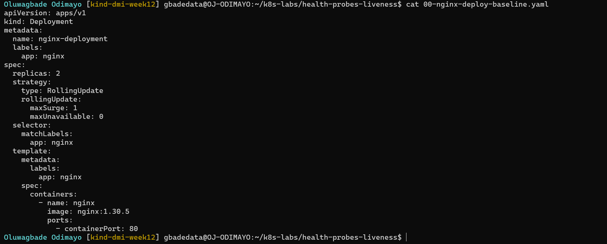

Manifest file: [`k8s-labs/health-probes-liveness/00-nginx-deploy-baseline.yaml`](./k8s-labs/health-probes-liveness/00-nginx-deploy-baseline.yaml)

---

#### Screenshot 3 — Output showing a successful rollout and two running NGINX Pods

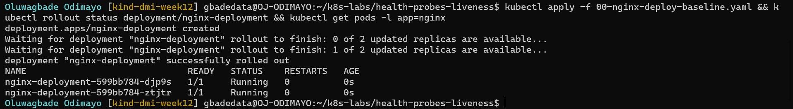

---

#### Screenshot 4 — Relevant output from `kubectl describe deployment nginx-deployment`

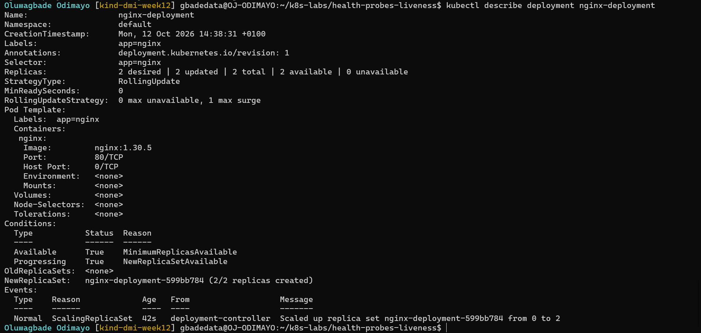

---

### Notes

**1. How many replicas does this Deployment maintain?**

Two (`replicas: 2`).

**2. Are any health probes configured in the baseline Deployment?**

No. The Pod Template in Screenshot 4 has no `Liveness` or `Readiness` lines, so Kubernetes only restarts a container if its process exits.

**3. Why is a baseline useful before adding a liveness probe?**

It shows how the Deployment behaves with no health checks, so any change after I add the liveness probe can be put down to the probe. It also proves that NGINX starts and runs normally with this image and configuration. When the probe later failed, I knew the application had been healthy and the probe was the thing that changed.

---

# Task 3 — Add a Liveness Probe

## Goal

Add an HTTP liveness probe so Kubernetes can periodically check whether the NGINX container is still responsive.

### Evidence

#### Screenshot 5 — Completed `01-nginx-deploy-liveness.yaml` manifest showing the liveness probe

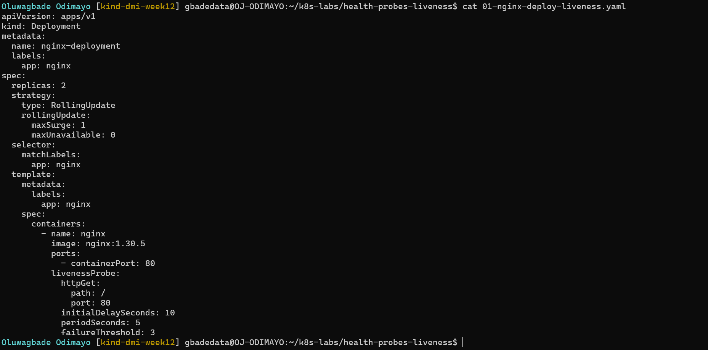

Manifest file: [`k8s-labs/health-probes-liveness/01-nginx-deploy-liveness.yaml`](./k8s-labs/health-probes-liveness/01-nginx-deploy-liveness.yaml)

---

#### Screenshot 6 — Output showing successful rollout and running Pods

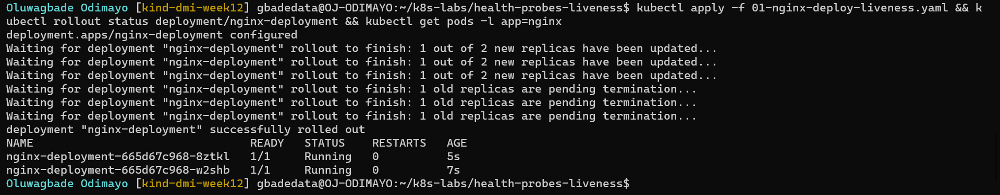

---

#### Screenshot 7 — Pod description showing liveness-probe details

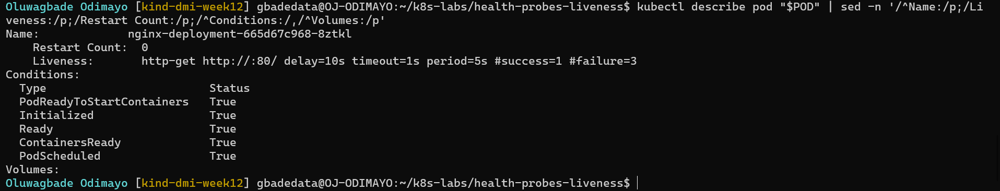

---

### Notes

**1. What path and port does the liveness probe check?**

An HTTP GET to `/` on port 80. `kubectl describe pod` showed it as `http-get http://:80/`.

**2. What does `initialDelaySeconds: 10` do?**

The kubelet waits 10 seconds after the container starts before the first liveness check. That gives the application time to start, so a slow start-up is not mistaken for a failure and the container is not restarted before it has had a chance to come up.

**3. What does `failureThreshold: 3` mean?**

The probe has to fail three times in a row before Kubernetes restarts the container. With `periodSeconds: 5`, that is about 15 seconds of consecutive failures, so a single slow or dropped response does not cause a restart.

**4. Does a successful liveness probe control whether a Pod receives traffic? Explain briefly.**

No. Liveness only decides whether the container is restarted; whether a Pod receives traffic is decided by readiness. This Deployment has no readiness probe, so Kubernetes treats each Pod as ready as soon as its container starts, whatever the liveness result.

---

# Task 4 — Trigger and Observe a Liveness Restart

## Goal

Intentionally make the liveness probe fail and observe Kubernetes restart the unhealthy container.

### Evidence

#### Screenshot 8 — `02-nginx-liveness-broken.yaml` showing `/does-not-exist`

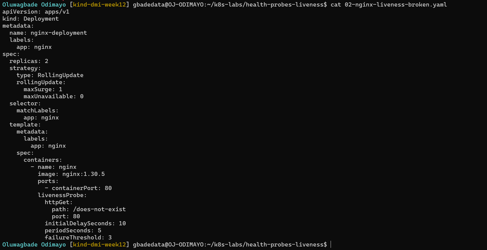

Manifest file: [`k8s-labs/health-probes-liveness/02-nginx-liveness-broken.yaml`](./k8s-labs/health-probes-liveness/02-nginx-liveness-broken.yaml)

---

#### Screenshot 9 — Pod output showing an increased RESTARTS count

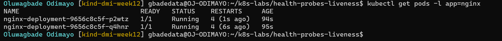

---

#### Screenshot 10 — Pod description showing liveness-probe failure events or restart details

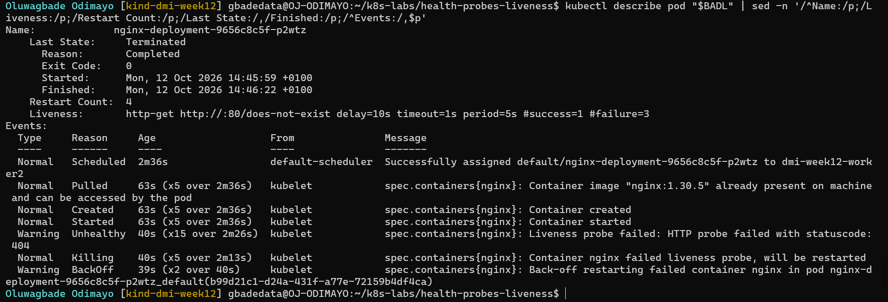

---

#### Screenshot 11 — Output showing stable running Pods after applying the fixed configuration

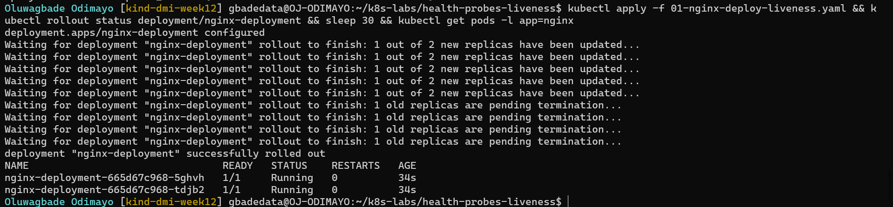

---

### Notes

**1. Why did the liveness probe fail?**

The probe requested `/does-not-exist`, so NGINX returned 404 and the kubelet logged `Liveness probe failed: HTTP probe failed with statuscode: 404`. NGINX itself was healthy; the probe was checking a page that does not exist.

**2. What happened after Kubernetes detected repeated liveness-probe failures?**

After three consecutive failures the kubelet logged `Container nginx failed liveness probe, will be restarted`, stopped the container and started a new one in the same Pod. The new container failed in exactly the same way, so the cycle repeated: `nginx-deployment-9656c8c5f-p2wtz` was killed five times in about two and a half minutes, each container lived about 23 seconds (the 10-second delay plus three failed checks), and the kubelet began adding back-off delays between restarts. Its `Last State` showed `Completed` with exit code 0 because NGINX shut down cleanly when it was stopped, so the exit code alone would hide that the restart was forced. The rollout itself still reported success: with no readiness probe, the new Pods counted as available as soon as they started, so the Deployment replaced both healthy Pods with Pods that then began failing. Liveness does not protect a rollout; readiness does.

**3. What does the RESTARTS column prove?**

It counts how many times the container inside the Pod has been restarted. Screenshot 9 shows 4 restarts on both Pods within about 95 seconds, the latest only seconds earlier. The Pod names and ages stayed the same, which proves Kubernetes was restarting the container inside the existing Pod rather than replacing the Pod.

**4. How did you restore the Deployment to a stable state?**

I re-applied `01-nginx-deploy-liveness.yaml`, which checks `/` again. The Deployment switched back to that template's ReplicaSet (`nginx-deployment-665d67c968`) and replaced the restarting Pods. I waited 30 seconds after the rollout, past the 10-second delay and the first checks, and both new Pods were `1/1 Running` with 0 restarts (Screenshot 11).

---

# Task 5 — Optional: Observe a Restart Loop

## Goal

Observe why overly aggressive or incorrectly configured liveness probes can create restart loops.

Complete this section only if you attempt Task 5. Otherwise, mark it as “Not attempted.”

**Task status:** Completed

### Evidence

#### Optional Screenshot — Pod output showing the RESTARTS count increasing during the restart-loop observation

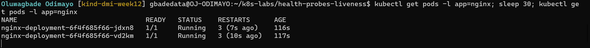

Manifest file: [`k8s-labs/health-probes-liveness/03-nginx-liveness-aggressive.yaml`](./k8s-labs/health-probes-liveness/03-nginx-liveness-aggressive.yaml)

No specific restart count or CrashLoopBackOff status is required.

---

### Notes — Answer Only If Attempted

**1. What is a restart loop?**

A restart loop is when a container is restarted, fails in the same way, and is restarted again, over and over, without ever becoming healthy. Kubernetes adds a growing back-off delay between restarts, which shows as `CrashLoopBackOff`, but it keeps trying, so the application never serves reliably.

**2. Why can an aggressive liveness probe be harmful?**

In my test the container needed 15 seconds before NGINX started listening (simulated with `sleep 15`), but the probe started checking after 2 seconds, ran every 2 seconds, and restarted the container after a single failure. Every check got `connection refused`, so the kubelet killed the container before NGINX could ever start. Both Pods were stuck: RESTARTS went from 3 to 4 within 30 seconds, and with no readiness probe the rollout had already replaced the healthy Pods. Nothing was wrong with the application; the probe itself caused the outage. Under heavy load, an aggressive probe can also restart containers that are only slow, adding start-up work exactly when the system is already struggling.

**3. Why should liveness checks be lightweight and carefully tuned?**

A liveness check runs against every container every few seconds for its whole life, so it should be cheap: a simple endpoint that proves the process can respond, not a full dependency check. If it depended on a database or another service, an outage there would get healthy containers restarted for a problem a restart cannot fix. The timings should match how the application really behaves: an initial delay (or a startup probe) longer than the slowest start-up, a timeout above normal response times, and a failure threshold high enough that one slow response does not cause a restart.

---

# Task 6 — Share Your Liveness-Probe Learning on LinkedIn

## Goal

Share what you learned about Kubernetes liveness probes, container restarts, and the difference between readiness and liveness.

### Evidence

#### Screenshot 12 — Published LinkedIn post

Not published, by choice.

#### Linkedin post URL

Not published, by choice.

---

# Submission Instructions

- Add all required screenshots numbered 1–12.
- Include the optional Task 5 screenshot only if you attempt that task.
- Ensure your full name is visible in required screenshots.
- Use clear, readable screenshots showing the relevant manifest or output.
- Include the completed baseline and liveness-probe manifests in your repository.
- Answer all Notes questions for Tasks 1–4 in your own words.
- If you attempt Task 5, complete its Notes and restore the working configuration afterward.
- Do not expose tokens, passwords, kubeconfig files, account IDs, or other sensitive information.

---

# Completion Checklist

- [x] Learning cluster confirmed and previous assignment resources removed where applicable
- [x] Liveness-probe lab directory created (Screenshot 1)
- [x] Baseline Deployment manifest completed (Screenshot 2)
- [x] Successful rollout and two baseline Pods verified (Screenshot 3)
- [x] Baseline Deployment details reviewed (Screenshot 4)
- [x] Liveness probe added successfully (Screenshot 5)
- [x] Successful liveness-probe rollout verified (Screenshot 6)
- [x] Liveness-probe details inspected (Screenshot 7)
- [x] Broken liveness configuration created (Screenshot 8)
- [x] Increased container restart count observed (Screenshot 9)
- [x] Liveness-probe failure events or restart details captured (Screenshot 10)
- [x] Working liveness configuration restored and stable Pods verified (Screenshot 11)
- [x] Optional Task 5 evidence and Notes completed, if attempted
- [x] Working configuration restored after Task 5, if attempted
- [ ] LinkedIn post published (Screenshot 12) (not published, by choice)
- [x] Notes for Tasks 1–4 completed
- [x] Required manifests included
- [x] All required screenshots are clear and readable
- [x] No sensitive data exposed

---

## 📌 About DMI & CloudAdvisory

DevOps Micro Internship (DMI) is a project-based DevOps program run by Pravin Mishra (The CloudAdvisory) focused on real-world execution, systems thinking, and career readiness.

It helps learners build strong DevOps foundations with hands-on experience.

---

## 📌 Resources

- 🌐 DMI Official Website: https://dmi.pravinmishra.com?utm_source=github&utm_medium=readme  
- 🎓 University: https://university.pravinmishra.com?utm_source=github&utm_medium=readme  
- 💬 Discord Community: https://discord.pravinmishra.com?utm_source=github&utm_medium=readme  
- 📝 Blog: https://dmi.pravinmishra.com/blog?utm_source=github&utm_medium=readme  
- ▶️ YouTube Playlist: https://www.youtube.com/playlist?list=PLFeSNDtI4Cho  
- 🔗 Pravin Mishra (LinkedIn): https://www.linkedin.com/in/pravin-mishra-aws-trainer/  
- 🏢 CloudAdvisory (LinkedIn): https://www.linkedin.com/company/thecloudadvisory/

---

*This submission is part of DevOps Micro Internship (DMI) — Agentic AI Track.*
