# Assignment 7 — Kubernetes Services (ClusterIP)

Part of the DevOps Micro Internship (DMI) with Agentic AI

---

## Purpose

In this assignment, you will create and test a Kubernetes ClusterIP Service. You will connect it to a healthy NGINX Deployment, access it using DNS and its ClusterIP, break and restore its selector, and observe how readiness affects Service routing.

---

# Task 0 — Prepare the Lab Environment

## Goal

Confirm your learning-cluster context and remove previous lab resources where applicable before starting this assignment.

No screenshot or written notes are required for this pre-check.

---

# Task 1 — Set Up Your Lab Directory

## Goal

Create and enter a dedicated directory for the ClusterIP Service lab.

### Evidence

#### Screenshot 1 — Terminal showing that you are working inside `~/k8s-labs/services/clusterip`

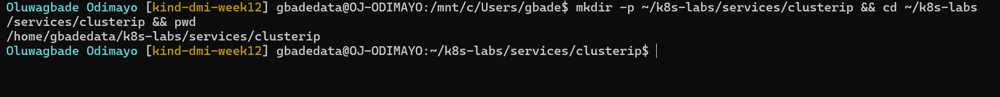

---

### Notes

**1. Why is it not reliable to communicate with an application using a Pod IP address?**

Pod IPs are not stable. Every Pod gets a new IP when it is created, so whenever a Pod is replaced (after a crash, a rollout, scaling or a node problem) the address changes. A client that stored a Pod IP would break on the next replacement, and it would only ever reach that one Pod, with no load balancing across the replicas.

**2. What Kubernetes resource provides a stable internal address for a group of Pods?**

A Service. It gets a stable virtual IP (the ClusterIP) and a DNS name, and keeps track of which Pods currently match its selector.

---

# Task 2 — Create a Healthy NGINX Deployment

## Goal

Create an NGINX Deployment with labels, readiness probes, and liveness probes that can act as the backend for a Service.

### Evidence

#### Screenshot 2 — Completed `00-nginx-deploy.yaml` manifest

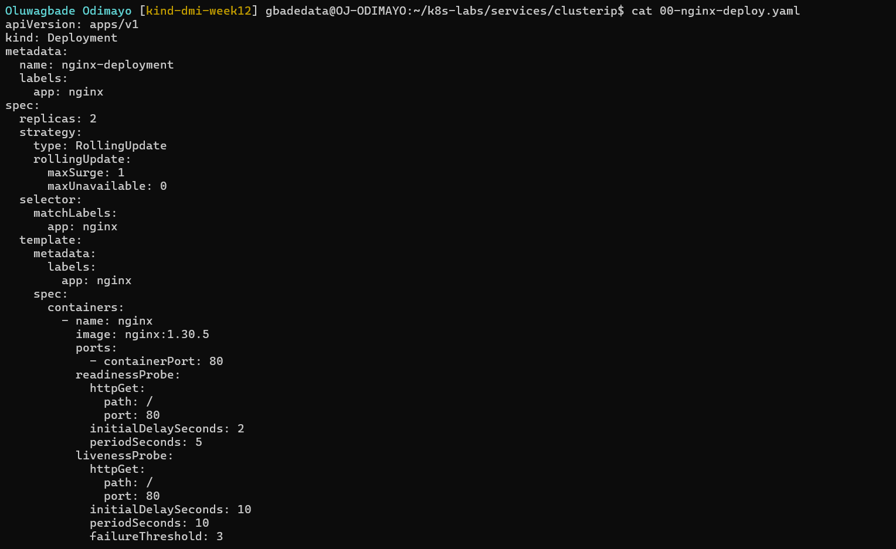

Manifest file: [`k8s-labs/services/clusterip/00-nginx-deploy.yaml`](./k8s-labs/services/clusterip/00-nginx-deploy.yaml)

---

#### Screenshot 3 — Output showing successful rollout and two ready NGINX Pods

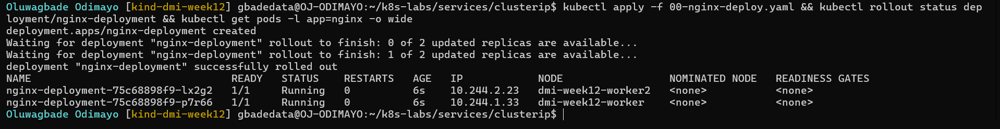

---

### Notes

**1. Which label will the Service use to find these Pods?**

`app: nginx`. The Service selector is `app: nginx`, which matches the labels in the Deployment's Pod template.

**2. Why is readiness important before connecting Pods to a Service?**

A Service only sends traffic to Pods that are ready. Without a readiness probe, a Pod counts as ready as soon as its container starts, even if NGINX cannot serve yet. With the probe, a Pod only joins the Service's ready backends after it has answered `GET /` successfully, so requests never reach a Pod that cannot handle them.

**3. What port does the NGINX container listen on?**

Port 80 (`containerPort: 80`).

---

# Task 3 — Create a ClusterIP Service

## Goal

Create a stable internal Service that routes traffic to the NGINX Pods.

### Evidence

#### Screenshot 4 — Completed `01-nginx-svc-clusterip.yaml` manifest

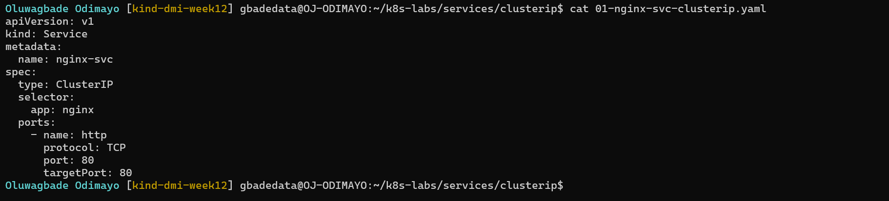

Manifest file: [`k8s-labs/services/clusterip/01-nginx-svc-clusterip.yaml`](./k8s-labs/services/clusterip/01-nginx-svc-clusterip.yaml)

---

#### Screenshot 5 — Output showing the ClusterIP Service, endpoints, or EndpointSlices

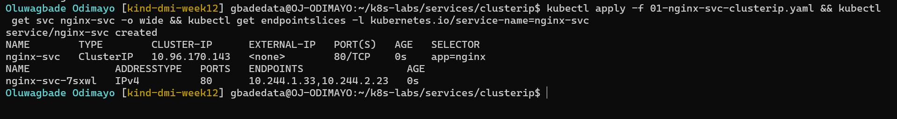

---

### Notes

**1. What is the purpose of a ClusterIP Service?**

It gives a group of Pods one stable internal virtual IP and DNS name that other workloads in the cluster can use, and spreads requests across the ready Pods behind it. It is only reachable from inside the cluster, which suits internal services such as an API that only a frontend calls. My `nginx-svc` was given `10.96.170.143`.

**2. What is the difference between `port` and `targetPort`?**

`port` is the port the Service itself listens on, the one clients connect to (`nginx-svc:80`). `targetPort` is the port on the Pods that the traffic is forwarded to, which must match the port the container listens on. Both are 80 here, but they do not have to be: a Service could listen on 80 and forward to a container on 8080.

**3. Why must the Service selector match the Pod labels?**

The selector is how the Service finds its backends: the EndpointSlice controller adds every Pod whose labels match it. If they do not match, the Service has no endpoints and every request fails, which is exactly what happened in Task 5.

**4. What information do EndpointSlices contain?**

The actual backends of the Service: each Pod's IP address, the port, the node it runs on, a reference to the Pod (`targetRef`), and its conditions (`ready`, `serving` and `terminating`). kube-proxy reads them to decide where traffic sent to the ClusterIP can go.

---

# Task 4 — Access the Service from Inside the Cluster

## Goal

Create a client Pod and access the NGINX Service using DNS and its ClusterIP.

### Evidence

#### Screenshot 6 — Output showing the `tester` Pod running

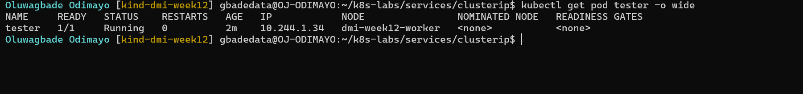

---

#### Screenshot 7 — Successful Service request using DNS name and ClusterIP

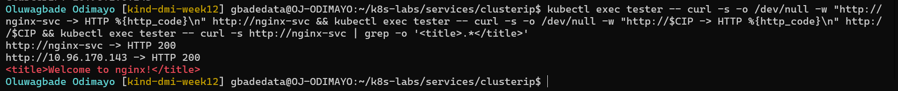

---

#### Screenshot 8 — Successful DNS lookup for the Service

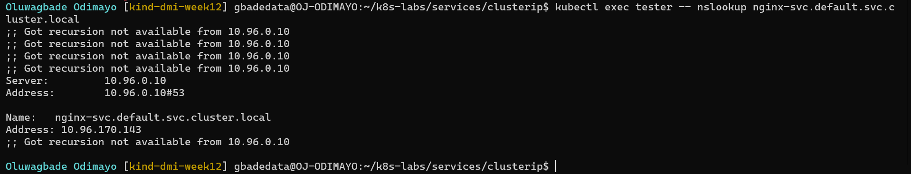

---

### Notes

**1. Why should an application use `nginx-svc` instead of a Pod IP address?**

The name stays the same however many times the Pods behind it are replaced, scaled or moved. Kubernetes DNS resolves `nginx-svc` to the Service's ClusterIP, and the Service forwards to whichever Pods are ready at that moment, so the application never needs to know or track Pod IPs.

**2. What does the DNS name `nginx-svc.default.svc.cluster.local` represent?**

It is the full DNS name of the Service: `nginx-svc` (the Service name) in the `default` namespace, under `svc` (the subdomain for Services) in the cluster domain `cluster.local`. Inside the same namespace the short name `nginx-svc` also works, because the Pod's DNS search list adds the rest. My lookup returned `10.96.170.143`, the Service's ClusterIP, not a Pod IP.

**3. Why can the client access the Service even if the backend Pod IPs change?**

The client only ever talks to the ClusterIP, which does not change for the life of the Service. When Pods are replaced, the EndpointSlice is updated with the new Pod IPs and kube-proxy updates its forwarding rules on every node, so traffic sent to the same ClusterIP reaches the new Pods.

---

# Task 5 — Break and Restore the Label-Selector Contract

## Goal

Break the Service selector, observe that usable endpoints disappear, and then restore the correct selector.

### Evidence

#### Screenshot 9 — `02-nginx-svc-selector-broken.yaml` showing the incorrect selector

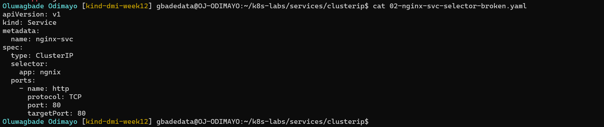

Manifest file: [`k8s-labs/services/clusterip/02-nginx-svc-selector-broken.yaml`](./k8s-labs/services/clusterip/02-nginx-svc-selector-broken.yaml)

---

#### Screenshot 10 — Empty endpoints or EndpointSlice output after applying the broken selector

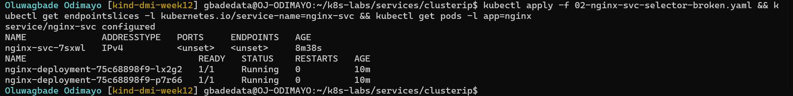

---

#### Screenshot 11 — Failed request output from the `tester` Pod

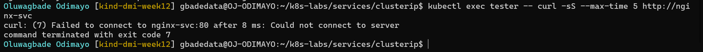

---

#### Screenshot 12 — Restored endpoints and successful Service request

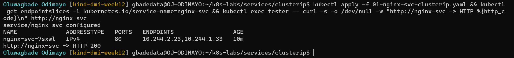

---

### Notes

**1. Why did the Service endpoints become empty?**

I changed the selector to `app: ngnix`, a one-letter typo. No Pod has that label, so the EndpointSlice controller found no matching Pods and the slice showed `<unset>`, even though both NGINX Pods were still `1/1 Running`.

**2. What caused the request from the client Pod to fail?**

DNS still resolved `nginx-svc` to the ClusterIP, but the Service had no backends, so there was nowhere to forward the connection and curl failed to connect to `nginx-svc` on port 80. The Pods were healthy; the Service simply could not find them.

**3. How did you restore connectivity to the NGINX Pods?**

I re-applied `01-nginx-svc-clusterip.yaml` with the correct selector, `app: nginx`. The EndpointSlice was filled with both Pod IPs again straight away, and the request returned HTTP 200 (Screenshot 12).

---

# Task 6 — Observe How Readiness Affects Service Routing

## Goal

Observe how a new Pod that fails readiness is excluded from ready Service backends while the existing healthy Pod continues serving traffic.

### Evidence

#### Screenshot 13 — Output showing the Deployment scaled to one ready Pod

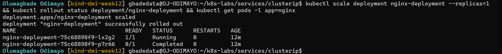

---

#### Screenshot 14 — Completed `03-readiness-broken.yaml` patch file

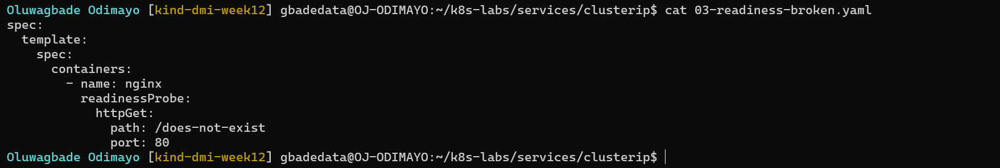

Manifest file: [`k8s-labs/services/clusterip/03-readiness-broken.yaml`](./k8s-labs/services/clusterip/03-readiness-broken.yaml)

---

#### Screenshot 15 — Output showing the expected incomplete rollout or NotReady Pod

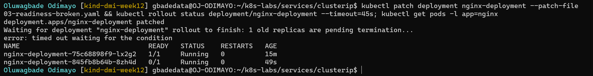

---

#### Screenshot 16 — EndpointSlice output showing the healthy Pod with `ready: true` and the new NotReady Pod with `ready: false`

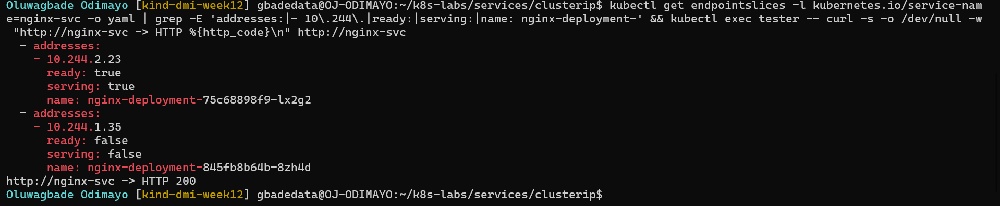

---

#### Screenshot 17 — Service EndpointSlice output showing ready backends after restoring the Deployment

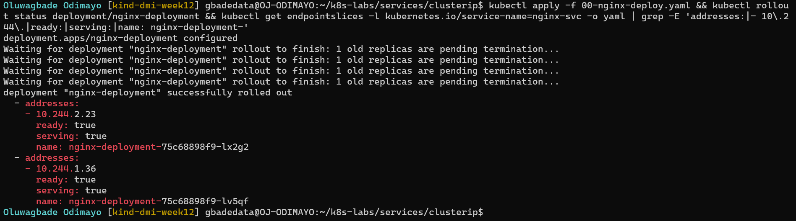

---

### Notes

**1. Why was the new NotReady Pod excluded from ready Service backends?**

The new Pod, `nginx-deployment-845fb8b64b-8zh4d`, failed its readiness probe with a 404 because the patch pointed it at `/does-not-exist`. It still matched the selector, so it appeared in the EndpointSlice, but with `ready: false`. kube-proxy only routes to ready endpoints, so it received no traffic.

**2. What is the relationship between readiness probes and Service routing?**

The readiness probe sets the Pod's Ready condition, and the EndpointSlice copies that into each endpoint's `ready` field. kube-proxy only sends Service traffic to ready endpoints, so a Pod is added to or removed from rotation automatically as its readiness probe passes or fails.

**3. Why does this behavior protect users from unhealthy application instances?**

Users only reach instances that have proved they can respond. During the broken rollout, requests to `nginx-svc` still returned HTTP 200 because they all went to the healthy Pod, `nginx-deployment-75c68898f9-lx2g2`. Without readiness, the broken Pod would have received a share of the traffic and those users would have seen errors.

---

# Task 7 — Share Your ClusterIP Service Learning on LinkedIn

## Goal

Share what you learned about ClusterIP Services, Kubernetes DNS, selectors, and readiness-aware Service routing.

### Evidence

#### Screenshot 18 — Published LinkedIn post

Not published, by choice.

#### Linkedin post link

Not published, by choice.

---

# Submission Instructions

- Add all required screenshots numbered 1–18.
- Ensure your full name is visible in required screenshots.
- Use clear, readable screenshots showing the relevant manifest or output.
- Include the completed NGINX Deployment and ClusterIP Service manifests in your repository.
- Answer all Notes questions for Tasks 1–6 in your own words.
- Include evidence of the intentional failures and successful recovery.
- Do not expose tokens, passwords, kubeconfig files, account IDs, or other sensitive information.

---

# Completion Checklist

- [x] Learning-cluster context confirmed and previous lab resources removed where applicable
- [x] ClusterIP lab directory created (Screenshot 1)
- [x] Healthy NGINX Deployment manifest completed (Screenshot 2)
- [x] Successful rollout and two ready NGINX Pods verified (Screenshot 3)
- [x] ClusterIP Service manifest completed (Screenshot 4)
- [x] Service and backend endpoints or EndpointSlices verified (Screenshot 5)
- [x] Client Pod created and running (Screenshot 6)
- [x] Service accessed using DNS name and ClusterIP (Screenshot 7)
- [x] Service DNS resolution verified (Screenshot 8)
- [x] Broken selector manifest created (Screenshot 9)
- [x] Empty endpoints observed (Screenshot 10)
- [x] Failed Service request captured (Screenshot 11)
- [x] Original selector restored and connectivity verified (Screenshot 12)
- [x] Deployment scaled to one ready Pod (Screenshot 13)
- [x] Broken readiness patch created (Screenshot 14)
- [x] Incomplete rollout or NotReady Pod observed (Screenshot 15)
- [x] Readiness effect on Service backends verified (Screenshot 16)
- [x] Deployment restored and ready Service backends verified (Screenshot 17)
- [ ] LinkedIn post published (Screenshot 18) (not published, by choice)
- [x] Notes for Tasks 1–6 completed
- [x] Required manifests included
- [x] All required screenshots are clear and readable
- [x] No sensitive data exposed

---

## 📌 About DMI & CloudAdvisory

DevOps Micro Internship (DMI) is a project-based DevOps program run by Pravin Mishra (The CloudAdvisory) focused on real-world execution, systems thinking, and career readiness.

It helps learners build strong DevOps foundations with hands-on experience.

---

## 📌 Resources

- 🌐 DMI Official Website: https://dmi.pravinmishra.com?utm_source=github&utm_medium=readme  
- 🎓 University: https://university.pravinmishra.com?utm_source=github&utm_medium=readme  
- 💬 Discord Community: https://discord.pravinmishra.com?utm_source=github&utm_medium=readme  
- 📝 Blog: https://dmi.pravinmishra.com/blog?utm_source=github&utm_medium=readme  
- ▶️ YouTube Playlist: https://www.youtube.com/playlist?list=PLFeSNDtI4Cho  
- 🔗 Pravin Mishra (LinkedIn): https://www.linkedin.com/in/pravin-mishra-aws-trainer/  
- 🏢 CloudAdvisory (LinkedIn): https://www.linkedin.com/company/thecloudadvisory/

---

*This submission is part of DevOps Micro Internship (DMI) — Agentic AI Track.*
