# Assignment 8 — Kubernetes Services (NodePort)

Part of the DevOps Micro Internship (DMI) with Agentic AI

---

## Purpose

Create a healthy NGINX Deployment, expose it through a NodePort Service, test access using a node IP and NodePort, and observe how the Service behaves when a backend Pod is replaced.

---

# Task 1 — Set Up Your Lab Directory

## Goal

Create and enter a dedicated directory for the NodePort Service lab.

### Evidence

#### Screenshot 1 — Terminal showing that you are working inside `~/k8s-labs/services/nodeport`

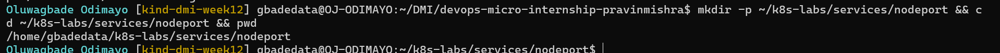

### Notes

**1. What is the difference between ClusterIP and NodePort?**

A ClusterIP Service is only reachable from inside the cluster, through its virtual IP and DNS name. A NodePort Service does everything a ClusterIP Service does (it still gets a ClusterIP) and also opens the same port, from the 30000 to 32767 range, on every node, so traffic sent to any node's IP on that port reaches the Service from outside the cluster.

**2. What does a NodePort Service allow users to do?**

It lets clients outside the cluster reach the application by connecting to `<node IP>:<nodePort>`, without needing a cloud load balancer. It is useful for labs, on-premises clusters and quick tests, and it is what a LoadBalancer Service builds on.

---

# Task 2 — Create a Healthy NGINX Deployment

## Goal

Create a healthy NGINX Deployment that can act as the backend for the NodePort Service.

### Evidence

#### Screenshot 2 — Completed `00-nginx-deploy.yaml` manifest

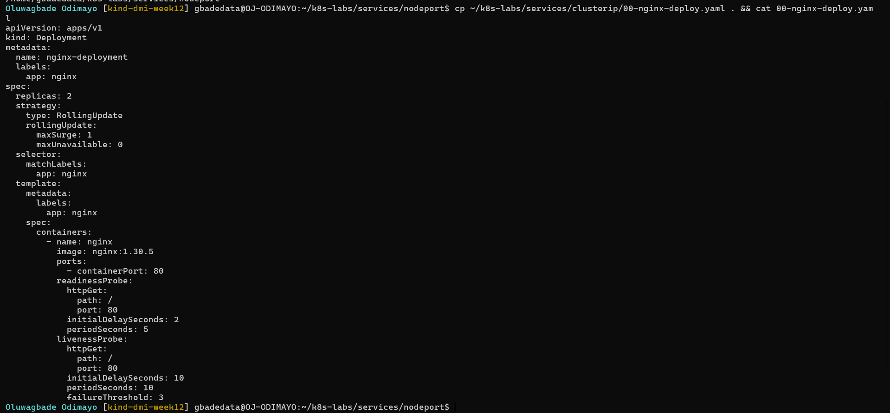

Manifest file: [`k8s-labs/services/nodeport/00-nginx-deploy.yaml`](./k8s-labs/services/nodeport/00-nginx-deploy.yaml)

---

#### Screenshot 3 — Output showing successful rollout and two ready NGINX Pods

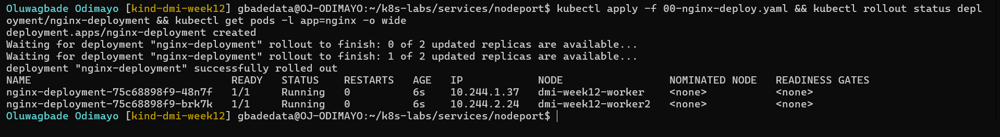

### Notes

**1. Which label will the NodePort Service use to find the NGINX Pods?**

`app: nginx`, the label in the Deployment's Pod template and the selector in `nginx-nodeport`.

**2. Why must the Pods be ready before they can receive Service traffic?**

kube-proxy only forwards Service traffic to endpoints that are ready. A Pod whose readiness probe has not passed yet could answer with errors or not at all, so Kubernetes keeps it out of rotation until it has proved it can serve.

**3. What port does the NGINX container listen on?**

Port 80 (`containerPort: 80`).

---

# Task 3 — Create the NodePort Service

## Goal

Create a NodePort Service that exposes the NGINX application through a port on every cluster node.

### Evidence

#### Screenshot 4 — Completed `01-nginx-svc-nodeport.yaml` manifest

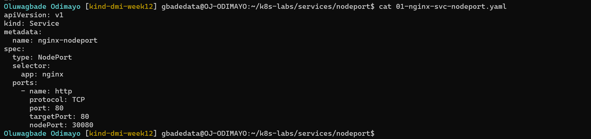

Manifest file: [`k8s-labs/services/nodeport/01-nginx-svc-nodeport.yaml`](./k8s-labs/services/nodeport/01-nginx-svc-nodeport.yaml)

---

#### Screenshot 5 — Output showing the NodePort Service and its endpoints or EndpointSlices

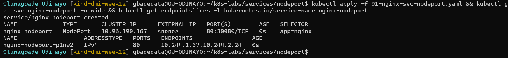

### Notes

**1. What is the purpose of `type: NodePort`?**

It tells Kubernetes to expose the Service on a static port on every node, as well as on its internal ClusterIP. kube-proxy on each node then forwards traffic arriving on that port to the Service's ready Pods, whichever node they run on.

**2. What is the difference between `port`, `targetPort`, and `nodePort`?**

`port` (80) is the port the Service listens on inside the cluster, at its ClusterIP. `targetPort` (80) is the container port the traffic is finally delivered to on the Pods. `nodePort` (30080) is the port opened on every node for traffic from outside the cluster. From outside, the path is node IP:30080, then the Service, then Pod:80.

**3. What NodePort was assigned or selected in your environment?**

`30080`. I set it explicitly in the manifest instead of letting Kubernetes pick a random port from the 30000 to 32767 range, because I created the kind cluster with a port mapping from `127.0.0.1:30080` on my machine to port 30080 on the control-plane node, and that mapping only works with a fixed NodePort. `kubectl get svc` showed `80:30080/TCP`.

**4. Why do Service endpoints need ready Pods?**

Endpoints are where the Service actually sends traffic. If an endpoint is not ready, the Pod behind it cannot serve the request and the client gets an error. Using only ready endpoints means the Service always routes to Pods that have passed their readiness probe.

---

# Task 4 — Find a Node IP and Test the NodePort

## Goal

Find a reachable node IP and access the NodePort Service.

### Evidence

#### Screenshot 6 — Output of `kubectl get nodes -o wide`

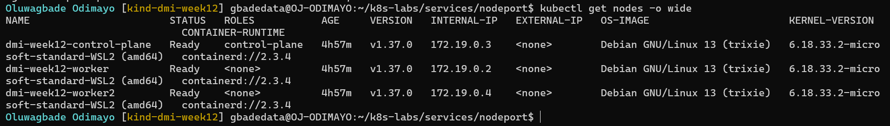

---

#### Screenshot 7 — Output showing the `tester` Pod running

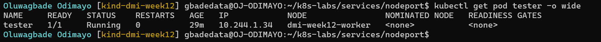

---

#### Screenshot 8 — Successful NodePort response from the laptop or the `tester` Pod

If neither route is supported by your environment, include the failed request output and ready endpoint evidence, and explain the limitation in your Notes.

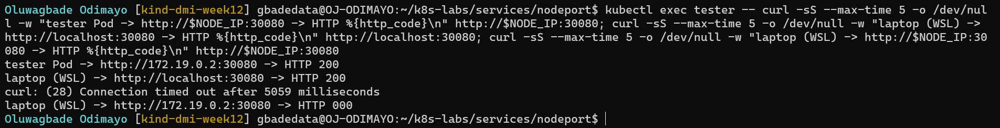

### Notes

**1. Which node IP and NodePort did you test?**

I tested the worker node `dmi-week12-worker` at `172.19.0.2` on NodePort `30080`, from the `tester` Pod and from my laptop. I also tested `localhost:30080` from my laptop.

**2. Was your laptop able to reach the NodePort directly? Explain your result.**

Not through the node IP, and the difference between the routes is the lesson. From WSL on my laptop, `http://172.19.0.2:30080` timed out after 5 seconds (`curl: (28) Connection timed out after 5059 milliseconds`). The kind nodes are Docker containers on Docker Desktop's internal network, inside its own VM, and my WSL environment has no route to that network. `http://localhost:30080` returned HTTP 200, but only because I created the cluster with a port mapping that forwards `127.0.0.1:30080` on my machine to port 30080 on the control-plane node container. kube-proxy on that node then forwarded the request to the Pods on the worker nodes, which also shows the NodePort is open on every node. From the `tester` Pod, inside the cluster network, `172.19.0.2:30080` returned HTTP 200 directly. The NodePort worked on every route that could reach a node; my laptop simply could not reach the node IP.

**3. Why can external NodePort access behave differently in Minikube, kind, Docker Desktop, and cloud clusters?**

A NodePort is only as reachable as the node IPs are. Minikube and kind run their nodes inside a VM or Docker containers, so the node IPs sit on a private network that the host may not be able to route to: depending on the driver, Minikube may need `minikube service` to open a tunnel, and kind needs a port mapping defined when the cluster is created. Docker Desktop adds its own VM, so container network IPs are not reachable from the host or WSL, which is exactly what my timeout showed; only published ports work. In a cloud cluster the nodes have real network addresses, but firewalls or security groups must allow the NodePort range, and nodes often have no public IP at all, which is why LoadBalancer Services are normally used there instead.

---

# Task 5 — Optional: Test the Label-Selector Contract

## Goal

Break the Service selector, observe that usable endpoints disappear, and restore the correct selector.

Complete the Evidence and Notes below only if you attempted this optional task.

### Evidence

#### Screenshot 9 — `02-nginx-svc-selector-broken.yaml` showing the incorrect selector

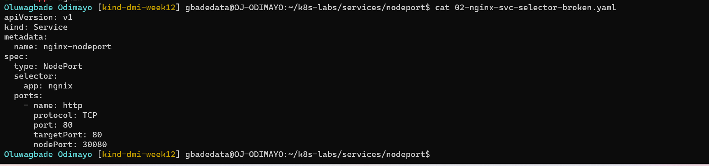

Manifest file: [`k8s-labs/services/nodeport/02-nginx-svc-selector-broken.yaml`](./k8s-labs/services/nodeport/02-nginx-svc-selector-broken.yaml)

---

#### Screenshot 10 — Empty endpoints or EndpointSlice output after applying the broken selector

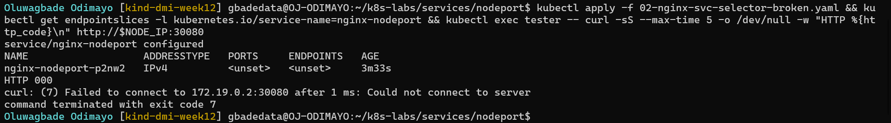

---

#### Screenshot 11 — Restored endpoints or EndpointSlices after applying the original Service manifest

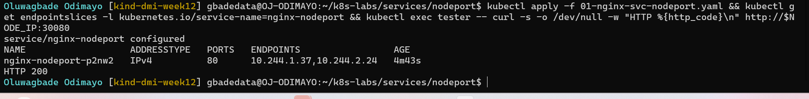

### Notes

**1. Why did the Service endpoints become empty?**

I changed the selector to `app: ngnix`. No Pod carries that label, so the EndpointSlice controller removed both Pods from `nginx-nodeport`'s EndpointSlice, even though the Pods were still running and ready.

**2. Why is NodePort only useful when matching ready Pods exist?**

The NodePort only gets traffic as far as the Service. From there, kube-proxy forwards it to the Service's ready endpoints, so with no matching ready Pods there is nothing to forward to: the port is open on every node, but every connection fails. My request from the `tester` Pod to `172.19.0.2:30080` failed while the selector was broken.

**3. How did you restore the backend connectivity?**

I re-applied `01-nginx-svc-nodeport.yaml` with the correct selector, `app: nginx`. The EndpointSlice was filled with both Pod IPs again, and the request to `172.19.0.2:30080` returned HTTP 200 (Screenshot 11).

---

# Task 6 — Observe Resilience During Pod Churn

## Goal

Delete one NGINX Pod and observe its replacement while the Service continues routing traffic to available Pods.

### Evidence

#### Screenshot 12 — Output of the Pod deletion command

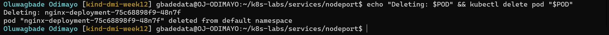

---

#### Screenshot 13 — Output showing the replacement Pod and two running, ready Pods

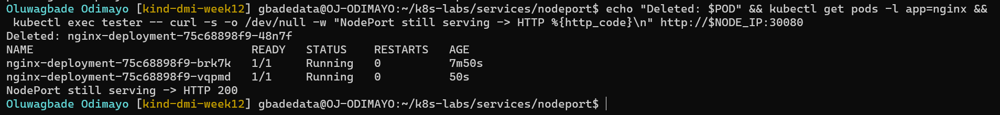

### Notes

**1. What happened after you deleted one Pod?**

I deleted `nginx-deployment-75c68898f9-48n7f`. The Deployment immediately created a replacement, `nginx-deployment-75c68898f9-vqpmd`, which passed its readiness probe and joined the Service. `nginx-deployment-75c68898f9-brk7k` kept running the whole time, so there were two ready Pods again within seconds.

**2. Which Kubernetes resource created the replacement Pod?**

The ReplicaSet owned by `nginx-deployment` (`nginx-deployment-75c68898f9`). It saw one Pod instead of the desired two and created a new one from the Pod template.

**3. Why can the NodePort Service continue working during Pod churn?**

Clients only ever address the node IP and NodePort, never a Pod. kube-proxy forwards to whatever ready endpoints the EndpointSlice currently lists: the deleted Pod was removed from the endpoints as it terminated, `brk7k` kept serving, and the replacement was added once it was ready. Straight after the deletion, the request from the `tester` Pod to `172.19.0.2:30080` still returned HTTP 200.

---

# Task 7 — Share Your NodePort Learning on LinkedIn

## Goal

Share what you learned about NodePort Services, backend Pods, and network access in your Kubernetes environment.

### Evidence

#### Screenshot 14 — Published LinkedIn post about your NodePort Service lab

Not published, by choice.

#### Linkedin post link

Not published, by choice.

---

# Submission Instructions

- Include the completed YAML manifests created during the lab.
- Add all required screenshots: Screenshots 1–8 and 12–14.
- Include Screenshots 9–11 only if you attempted optional Task 5.
- Complete the Notes for Tasks 1–4 and Task 6.
- Complete Task 5 Notes only if you attempted that task.
- Use clear, readable screenshots showing the relevant commands and outputs.
- Ensure your full name is visible in the required screenshots.
- If NodePort access is restricted by your environment, include the failed request output, ready endpoint evidence, and an explanation.
- Do not expose passwords, access tokens, private keys, kubeconfig contents, or account IDs.

---

# Completion Checklist

- [x] Created and entered `~/k8s-labs/services/nodeport` (Screenshot 1)
- [x] Created and applied the NGINX Deployment manifest (Screenshot 2)
- [x] Confirmed successful rollout and two ready NGINX Pods (Screenshot 3)
- [x] Created the NodePort Service manifest (Screenshot 4)
- [x] Verified the Service and its endpoints or EndpointSlices (Screenshot 5)
- [x] Recorded the assigned or selected NodePort
- [x] Identified a node IP (Screenshot 6)
- [x] Confirmed that the `tester` Pod is running (Screenshot 7)
- [x] Tested NodePort access, or documented the environment limitation with evidence (Screenshot 8)
- [x] Optional: Tested and restored the Service selector (Screenshots 9–11)
- [x] Deleted one NGINX Pod (Screenshot 12)
- [x] Confirmed the replacement Pod and two running, ready Pods (Screenshot 13)
- [x] Completed all required Notes
- [ ] Published the LinkedIn post (Screenshot 14) (not published, by choice)
- [x] No sensitive data exposed

---

## 📌 About DMI & CloudAdvisory

DevOps Micro Internship (DMI) is a project-based DevOps program run by Pravin Mishra (The CloudAdvisory) focused on real-world execution, systems thinking, and career readiness.

It helps learners build strong DevOps foundations with hands-on experience.

---

## 📌 Resources

- 🌐 DMI Official Website: https://dmi.pravinmishra.com?utm_source=github&utm_medium=readme  
- 🎓 University: https://university.pravinmishra.com?utm_source=github&utm_medium=readme  
- 💬 Discord Community: https://discord.pravinmishra.com?utm_source=github&utm_medium=readme  
- 📝 Blog: https://dmi.pravinmishra.com/blog?utm_source=github&utm_medium=readme  
- ▶️ YouTube Playlist: https://www.youtube.com/playlist?list=PLFeSNDtI4Cho  
- 🔗 Pravin Mishra (LinkedIn): https://www.linkedin.com/in/pravin-mishra-aws-trainer/  
- 🏢 CloudAdvisory (LinkedIn): https://www.linkedin.com/company/thecloudadvisory/

---

*This submission is part of DevOps Micro Internship (DMI) — Agentic AI Track.*
