# Assignment 09 — Kubernetes Services: LoadBalancer on AKS

Part of the DevOps Micro Internship (DMI) with Agentic AI

---

## Purpose

Deploy a healthy NGINX application to Azure Kubernetes Service (AKS), expose it publicly using a LoadBalancer Service, observe readiness behavior, and scale the application behind the same public endpoint.

---

# Task 1 — Create or Connect to an AKS Cluster

## Goal

Create a small AKS cluster for this lab, or connect to an existing approved AKS lab cluster.

### Evidence

#### Screenshot 1 — Output of `kubectl get nodes` showing ready AKS node(s)

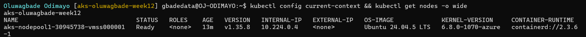

### Notes

**1. Why does this lab use a cloud-capable Kubernetes environment such as AKS for the LoadBalancer Service?**

A LoadBalancer Service only gets a real address if something outside Kubernetes creates a load balancer for it. On a local cluster, such as the kind cluster I used for Assignments 1 to 8, nothing does that, so the Service stays at `EXTERNAL-IP <pending>` unless an add-on emulates one. On AKS, the Azure cloud provider watches LoadBalancer Services and creates the Azure networking for them, so the Service gets a public IP that anyone on the internet can reach, which is what this lab needs to test.

**2. What Azure resources can Kubernetes provision when a LoadBalancer Service is created?**

I listed the resources in my cluster's node resource group (`MC_rg-oluwagbade-week12-aks_aks-oluwagbade-week12_ukwest`) while the Service existed. Creating `nginx-lb` produced: a Standard public IP, `kubernetes-afac256c46f734c02b60189db7015140` (`20.68.109.180`); a frontend IP configuration and a load-balancing rule, `afac256c46f734c02b60189db7015140-TCP-80` (TCP, port 80 to 80, floating IP enabled), on the cluster's existing Standard Load Balancer named `kubernetes`; and an inbound network security group rule, `k8s-azure-lb_allow_IPv4_...`, that allows traffic to `20.68.109.180`. The load balancer itself and a separate public IP for outbound traffic were created with the cluster.

**3. Why is it important to delete unused AKS resources after the lab?**

They cost money for as long as they exist: the node is billed by the hour (about £0.15 an hour for my `Standard_D4als_v6` in UK West), and public IPs, load-balancer rules and managed disks are billed even when nothing uses them. A public endpoint left running is also something anyone can reach and probe, and an idle node holds vCPU quota that my subscription has only a little of. After capturing the evidence I deleted the `nginx-lb` Service and the Deployment, which released `20.68.109.180` and removed its load-balancing and security rules. I kept the cluster for Assignments 10 and 11, stopping it when I am not using it, and I will delete its resource group when Assignment 11 is done.

---

# Task 2 — Set Up Your Lab Directory

## Goal

Create and enter a dedicated directory for the LoadBalancer Service manifests.

### Evidence

#### Screenshot 2 — Terminal showing the output of `pwd` confirming that you are working inside `~/k8s-labs/services/loadbalancer`

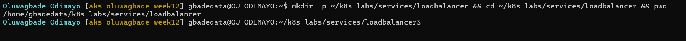

### Notes

**1. Why is it useful to keep Kubernetes manifests organized in dedicated directories?**

Each lab gets its own folder, so I always know which file `kubectl apply -f` is applying, and the Deployment, Service and patch for this lab stay together. The folder also maps one to one onto the copy in my repository (`week-12-kubernetes/k8s-labs/services/loadbalancer/`), which makes the work easy to review and run again.

**2. What are the names of the main Deployment and LoadBalancer Service YAML files you will create in this assignment?**

`00-nginx-deploy.yaml` (the Deployment) and `01-nginx-svc-loadbalancer.yaml` (the LoadBalancer Service), plus `02-readiness-broken.yaml`, the patch used in Task 5.

---

# Task 3 — Deploy a Healthy NGINX Application

## Goal

Create a healthy NGINX Deployment with readiness and liveness probes.

### Evidence

#### Screenshot 3 — Completed `00-nginx-deploy.yaml` manifest

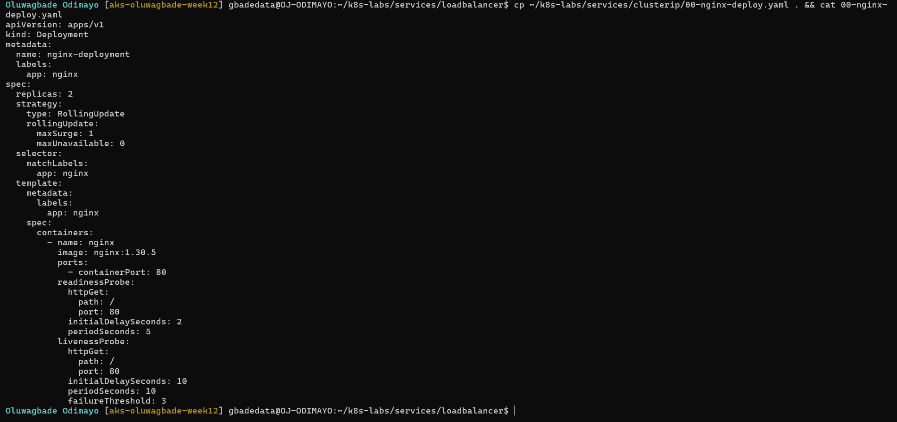

Manifest file: [`k8s-labs/services/loadbalancer/00-nginx-deploy.yaml`](./k8s-labs/services/loadbalancer/00-nginx-deploy.yaml)

---

#### Screenshot 4 — Output showing successful rollout and two ready NGINX Pods

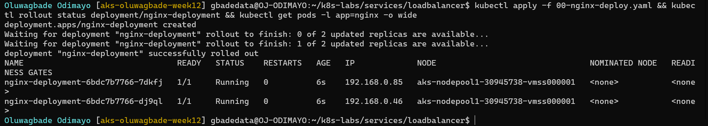

### Notes

**1. Why must Pods be ready before they should receive public traffic?**

Once the Service has a public IP, anyone on the internet can send it requests. A Pod that has started but is not ready (still starting, or broken) would return errors to real users. Kubernetes only routes Service traffic to ready endpoints, so readiness is what keeps public traffic away from Pods that cannot serve it.

**2. What is the role of the readiness probe in this Deployment?**

It checks `GET /` on port 80, first after 2 seconds and then every 5 seconds. While it passes, the Pod is a ready endpoint of `nginx-lb` and receives traffic from the load balancer; when it fails, the Pod is taken out of rotation but keeps running. With `maxUnavailable: 0` it also controls the rolling update: an old Pod is only removed once a new one is ready.

**3. What is the role of the liveness probe in this Deployment?**

It checks `GET /` on port 80 every 10 seconds, starting 10 seconds after the container starts. If it fails three times in a row, the kubelet restarts the container, which recovers an NGINX process that has hung. It does not decide whether the Pod receives traffic; that is the readiness probe's job.

---

# Task 4 — Create and Test the LoadBalancer Service

## Goal

Create a public LoadBalancer Service and verify that the NGINX application is reachable from the internet.

### Evidence

#### Screenshot 5 — Completed `01-nginx-svc-loadbalancer.yaml` manifest

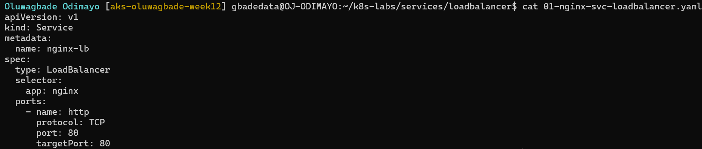

Manifest file: [`k8s-labs/services/loadbalancer/01-nginx-svc-loadbalancer.yaml`](./k8s-labs/services/loadbalancer/01-nginx-svc-loadbalancer.yaml)

---

#### Screenshot 6 — Output showing the Service with an assigned EXTERNAL-IP

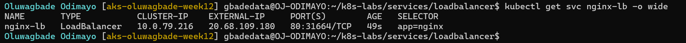

---

#### Screenshot 7 — Successful curl output from the public IP

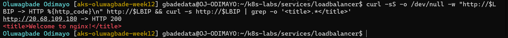

### Notes

**1. What does `type: LoadBalancer` instruct AKS to do?**

It tells AKS to expose the Service outside the cluster through an Azure Load Balancer. The Azure cloud provider allocates a public IP, adds a frontend and a load-balancing rule for the Service port to the cluster's `kubernetes` load balancer, and opens the port in the node network security group. The Service still gets a ClusterIP (`10.0.79.216`) and a NodePort (`31664`), like the simpler Service types it builds on.

**2. What public IP was assigned to your Service?**

`20.68.109.180`.

**3. How does the public request eventually reach the NGINX Pods?**

The request goes to `20.68.109.180:80`, a frontend IP on the Azure Standard Load Balancer. Its rule forwards TCP port 80 to the cluster node, and because floating IP is enabled, the packet arrives still addressed to `20.68.109.180:80`. The network security group rule lets it in. On the node, Cilium, which replaces kube-proxy on this cluster (there are no kube-proxy Pods in `kube-system`), matches the Service's external IP and sends the request to one of the ready endpoints listed in the EndpointSlice, for example `192.168.0.46` or `192.168.0.85`, where NGINX answers on port 80.

**4. Why should you wait for EXTERNAL-IP before testing the Service?**

Until Azure has created the public IP and the load-balancer rule, the Service shows `EXTERNAL-IP <pending>` and there is no address to test, so an early test fails for a reason that has nothing to do with the application. My wait loop polled every 5 seconds and the IP appeared after about half a minute.

---

# Task 5 — Observe How Readiness Protects Public Traffic

## Goal

Intentionally break readiness and observe how Kubernetes excludes unready Pods from ready Service backends while existing healthy Pods continue serving public traffic.

### Evidence

#### Screenshot 8 — Completed `02-readiness-broken.yaml` patch file

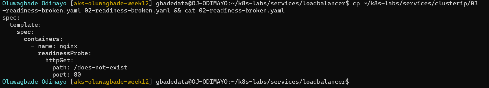

Manifest file: [`k8s-labs/services/loadbalancer/02-readiness-broken.yaml`](./k8s-labs/services/loadbalancer/02-readiness-broken.yaml)

---

#### Screenshot 9 — Output showing the expected incomplete rollout or readiness failure

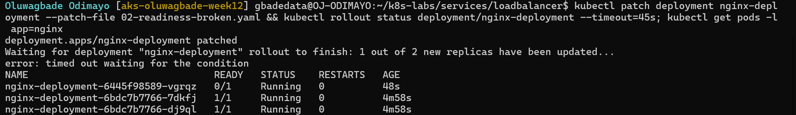

---

#### Screenshot 10 — EndpointSlice output showing ready healthy backends and the effect of the readiness failure

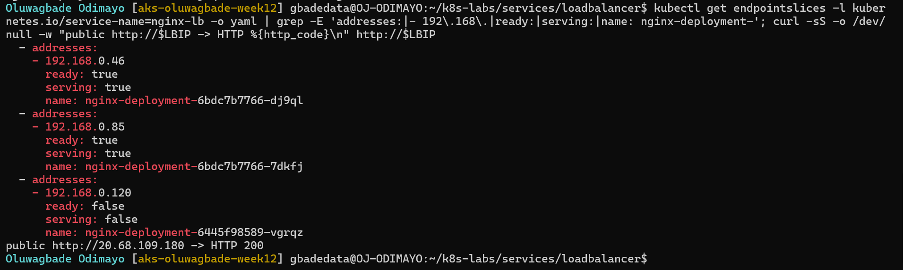

---

#### Screenshot 11 — Successful public curl response after recovery

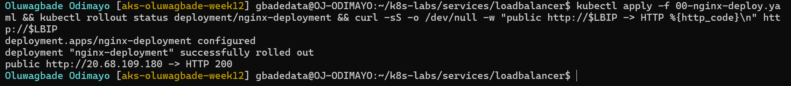

### Notes

**1. Why did the rollout not complete?**

The patch changed the readiness path to `/does-not-exist`, which created a new ReplicaSet (`nginx-deployment-6445f98589`). Its first Pod, `nginx-deployment-6445f98589-vgrqz`, got a 404 from every readiness check (`Readiness probe failed: HTTP probe failed with statuscode: 404`), so it never became ready. With `maxSurge: 1` and `maxUnavailable: 0`, the Deployment cannot remove an old Pod until a new one is available, so it stopped at 1 of 2 new replicas and `kubectl rollout status` timed out after 45 seconds.

**2. Why can the public endpoint still work while new Pods fail readiness?**

The two original Pods, `nginx-deployment-6bdc7b7766-dj9ql` and `nginx-deployment-6bdc7b7766-7dkfj`, stayed ready, and the EndpointSlice listed them with `ready: true` and the new Pod with `ready: false`. Cilium only sends Service traffic to ready endpoints, so every request through the public IP reached a healthy Pod; my request to `http://20.68.109.180` returned HTTP 200 while the rollout was stuck.

**3. What would happen if Kubernetes routed traffic to Pods before they were ready?**

Some requests would reach Pods that cannot serve them yet: Pods still starting, or Pods with a real fault. Users would see errors or timeouts on a share of their requests even though healthy Pods were available, and during a bad rollout that share would grow as broken Pods replaced working ones.

**4. How did you restore the Deployment successfully?**

I re-applied `00-nginx-deploy.yaml`, which has the correct readiness path `/`. That template matched the original ReplicaSet (`nginx-deployment-6bdc7b7766`), whose Pods were still running, so the Deployment switched back to it and scaled the broken ReplicaSet down to zero, removing `vgrqz`. The rollout completed and the public IP returned HTTP 200 (Screenshot 11).

---

# Task 6 — Scale the Deployment Behind the Load Balancer

## Goal

Scale the NGINX Deployment and confirm that more ready Pods become available behind the same public endpoint.

### Evidence

#### Screenshot 12 — Two ready NGINX Pods verified initially; four ready Pods verified after scaling

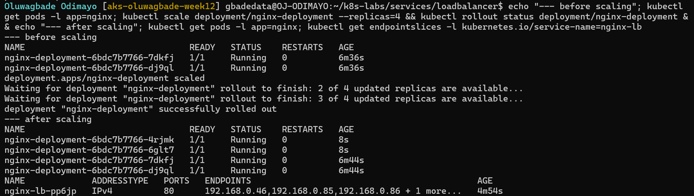

---

#### Screenshot 13 — Successful public curl response after scaling

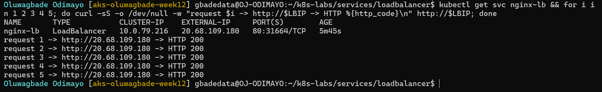

### Notes

**1. What changed after scaling the Deployment from two to four replicas?**

The ReplicaSet created two more Pods, `nginx-deployment-6bdc7b7766-4rjmk` (`192.168.0.126`) and `nginx-deployment-6bdc7b7766-6glt7` (`192.168.0.86`). Once they passed their readiness probes, they were added to the Service's EndpointSlice (`nginx-lb-pp6jp`), which then listed four backends. All four run on the cluster's single node.

**2. Did the public IP change after scaling? Explain why or why not.**

No. It stayed `20.68.109.180`. The public IP belongs to the Service, as a frontend on the Azure load balancer, not to any Pod. Scaling only changed the Service's endpoints inside the cluster; nothing about the load balancer or its rule changed.

**3. Why does scaling behind a LoadBalancer Service not require users to change the URL or IP they use?**

Users only ever use the Service's public IP. When Pods are added or removed, Kubernetes updates the EndpointSlice and Cilium updates its list of backends on the node, while the Azure load balancer configuration stays the same. Capacity can change without clients noticing: after scaling to four Pods, five requests in a row to the same IP returned HTTP 200.

---

# Task 7 — Share Your LoadBalancer Lab on LinkedIn

## Goal

Share what you learned about exposing an NGINX application publicly through a LoadBalancer Service on AKS.

### Evidence

#### Screenshot 14 — Published LinkedIn post about your LoadBalancer lab on AKS

Not published, by choice.

#### LinkedIn post link

Not published, by choice.

---

# Submission Instructions

- Include the completed YAML files:
  - `00-nginx-deploy.yaml`
  - `01-nginx-svc-loadbalancer.yaml`
  - `02-readiness-broken.yaml`
- Add all required screenshots, numbered 1–14, under their corresponding Evidence sections.
- Use clear, readable screenshots showing the relevant commands, configuration, and outputs.
- Ensure your full name is visible in the required screenshots.
- Complete the Notes for Tasks 1–6 in your own words.
- Capture all required evidence before cleaning up Azure resources.
- Plan or complete Azure cleanup according to your lab ownership and reuse arrangements.
- Do not expose passwords, tokens, private keys, cluster credentials, kubeconfig contents, subscription IDs, account IDs, or infrastructure details you are not permitted to share.

---

# Completion Checklist

- [x] Created or connected to an approved AKS lab cluster
- [x] Confirmed ready AKS node(s) (Screenshot 1)
- [x] Created and entered the LoadBalancer lab directory (Screenshot 2)
- [x] Created the NGINX Deployment manifest (Screenshot 3)
- [x] Verified successful rollout and two ready NGINX Pods initially (Screenshot 4)
- [x] Created the LoadBalancer Service manifest (Screenshot 5)
- [x] Verified the assigned external IP (Screenshot 6)
- [x] Verified successful public access using curl (Screenshot 7)
- [x] Created the broken readiness patch (Screenshot 8)
- [x] Observed the expected incomplete rollout or readiness failure (Screenshot 9)
- [x] Inspected EndpointSlices during the readiness failure (Screenshot 10)
- [x] Restored the healthy Deployment and verified public access (Screenshot 11)
- [x] Scaled the Deployment to four ready Pods and verified updated Service backends (Screenshot 12)
- [x] Verified public access after scaling (Screenshot 13)
- [x] Completed the Notes for Tasks 1–6
- [ ] Published the LinkedIn post (Screenshot 14) (not published, by choice)
- [x] Included all required YAML files and screenshots
- [x] Planned or completed Azure cleanup
- [x] No sensitive data exposed

---

## 📌 About DMI & CloudAdvisory

DevOps Micro Internship (DMI) is a project-based DevOps program run by Pravin Mishra (The CloudAdvisory) focused on real-world execution, systems thinking, and career readiness.

It helps learners build strong DevOps foundations with hands-on experience.

---

## 📌 Resources

- 🌐 DMI Official Website: https://dmi.pravinmishra.com?utm_source=github&utm_medium=readme  
- 🎓 University: https://university.pravinmishra.com?utm_source=github&utm_medium=readme  
- 💬 Discord Community: https://discord.pravinmishra.com?utm_source=github&utm_medium=readme  
- 📝 Blog: https://dmi.pravinmishra.com/blog?utm_source=github&utm_medium=readme  
- ▶️ YouTube Playlist: https://www.youtube.com/playlist?list=PLFeSNDtI4Cho  
- 🔗 Pravin Mishra (LinkedIn): https://www.linkedin.com/in/pravin-mishra-aws-trainer/  
- 🏢 CloudAdvisory (LinkedIn): https://www.linkedin.com/company/thecloudadvisory/

---

*This submission is part of DevOps Micro Internship (DMI) — Agentic AI Track.*
