# Assignment 10 — Capstone: Deploy the Book Review App to Kubernetes

Part of the DevOps Micro Internship (DMI) with Agentic AI

---

## Purpose

Deploy the Book Review App as a production-style three-tier application using Kubernetes manifests or Helm charts, with an accessible frontend, an internal backend, and a managed or persistent MySQL database.

---

## Submission Details

**Full Name:** Oluwagbade Odimayo

**Kubernetes Platform:** Azure Kubernetes Service (AKS), Kubernetes v1.35.8, UK West: one Standard_D4als_v6 node, Azure CNI Overlay with the Cilium dataplane, which enforces NetworkPolicy

**Namespace:** book-review

**Frontend URL or IP:** http://51.141.108.62 (live while the cluster is kept for Assignment 11)

**Access Method:** Public LoadBalancer: the Kubernetes `LoadBalancer` Service `frontend` on port 80, backed by an Azure Standard Load Balancer

**GitHub Manifests or Helm Chart URL:** YAML manifests in [`week-12-kubernetes/k8s-labs/book-review`](https://github.com/gbadedata/devops-micro-internship-pravinmishra/tree/main/week-12-kubernetes/k8s-labs/book-review). Images `gbadedata/book-review-backend:00dd4a5` and `gbadedata/book-review-frontend:00dd4a5`, built from [gbadedata/book-review-app@00dd4a5](https://github.com/gbadedata/book-review-app/tree/00dd4a53732f8e84ee322059487d29fdaf53f696) (frontend image: [`frontend/Dockerfile.k8s`](https://github.com/gbadedata/book-review-app/blob/00dd4a53732f8e84ee322059487d29fdaf53f696/frontend/Dockerfile.k8s))

**Architecture Diagram:** [Screenshot 3](./screenshots/a10-03-architecture-diagram.png)

---

# Task 1 — Prepare the Kubernetes Cluster and Project

## Goal

Prepare the cluster, application source, container images, and tooling needed for the deployment.

### Evidence

#### Screenshot 1 — Active Kubernetes context and Ready nodes

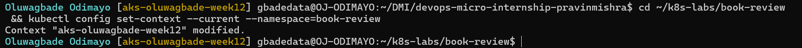

---

#### Screenshot 2 — If using Helm: Output of `helm version`

Required only if you choose Helm. Skip this screenshot if using YAML manifests.

Not applicable: using YAML manifests.

---

# Task 2 — Design the Three-Tier Kubernetes Architecture

## Goal

Document the workloads, networking, configuration, storage, and permitted communication paths before deployment.

### Evidence

#### Screenshot 3 — Completed Kubernetes architecture diagram

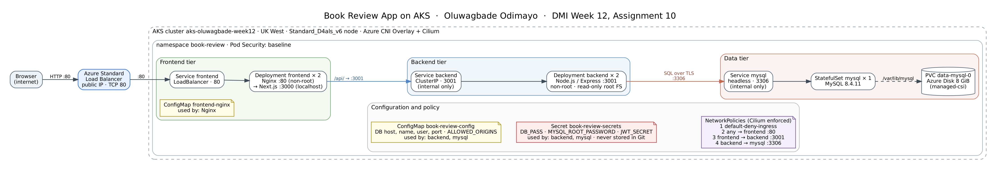

---

# Task 3 — Create ConfigMaps and Secrets

## Goal

Provide application configuration and credentials without embedding sensitive values in images or committing them to Git.

### Evidence

#### Screenshot 4 — ConfigMap configuration or describe output showing non-sensitive values

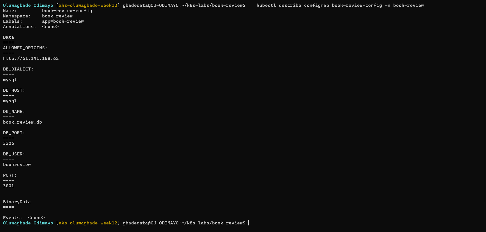

Manifest: [`k8s-labs/book-review/01-configmap.yaml`](./k8s-labs/book-review/01-configmap.yaml)

---

#### Screenshot 5 — Secret references or describe output showing names and keys without sensitive values

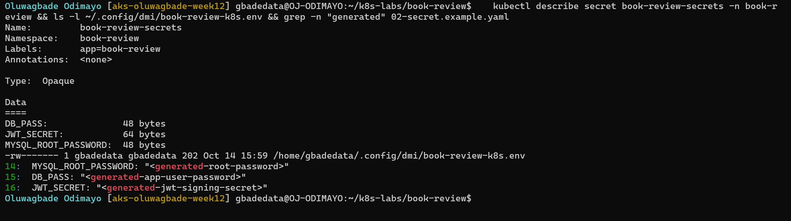

Placeholder example in Git: [`k8s-labs/book-review/02-secret.example.yaml`](./k8s-labs/book-review/02-secret.example.yaml). The real Secret was created with `kubectl create secret generic --from-env-file` from a local file that is never committed.

---

# Task 4 — Deploy and Configure the MySQL Data Tier

## Goal

Provide persistent MySQL storage and allow the backend to connect without exposing the database publicly.

### Evidence

#### Screenshot 6 — Managed MySQL status or MySQL StatefulSet and PVC status

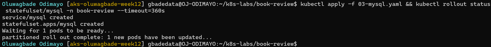

Manifest: [`k8s-labs/book-review/03-mysql.yaml`](./k8s-labs/book-review/03-mysql.yaml)

---

#### Screenshot 7 — Successful database connectivity or schema verification with credentials hidden

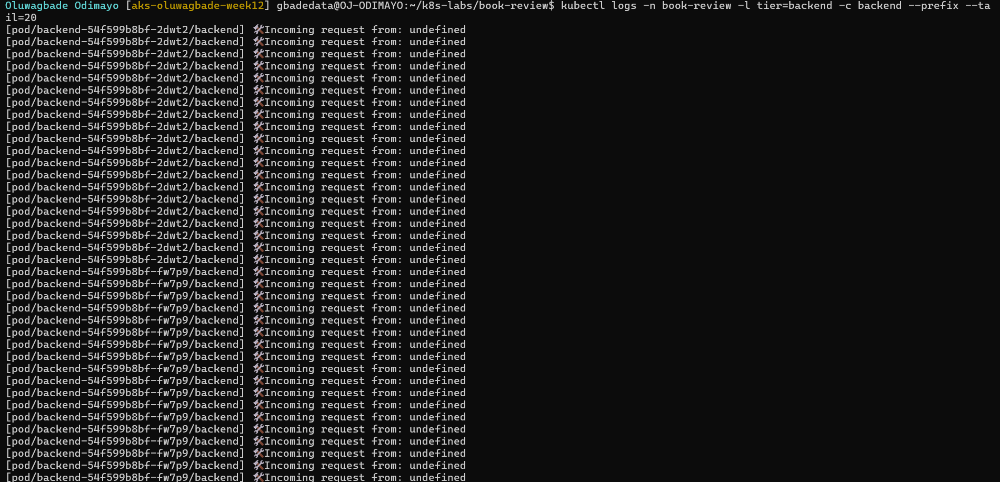

Captured after the backend's first start, because the backend creates the tables and the sample data. The password comes from the Pod's environment and is never typed or shown.

---

# Task 5 — Deploy the Backend Application Tier

## Goal

Run one or two Node.js/Express backend replicas on port 3001 and expose them through an internal ClusterIP Service.

### Evidence

#### Screenshot 8 — Backend Deployment, ready Pods, and internal Service

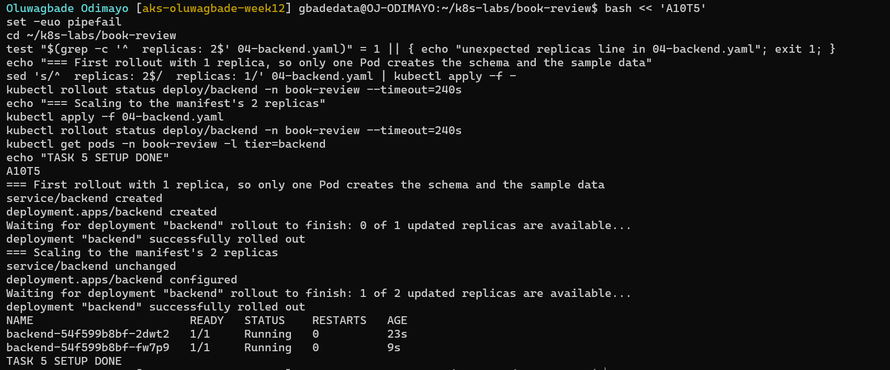

Manifest: [`k8s-labs/book-review/04-backend.yaml`](./k8s-labs/book-review/04-backend.yaml)

---

#### Screenshot 9 — Backend startup logs and database connectivity evidence

If the application does not log successful database connections, provide a successful database-backed request alongside the startup logs.

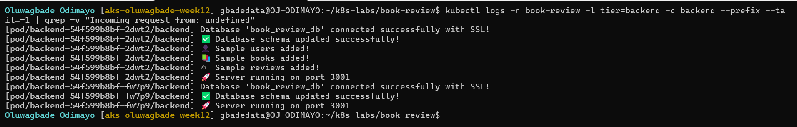

The kubelet's health probes call `/` every few seconds without an Origin header, so the app logs them as `Incoming request from: undefined`; those lines are filtered out with `grep -v` to show the startup lines.

---

# Task 6 — Deploy the Frontend and Configure Nginx

## Goal

Run the Next.js frontend behind Nginx on port 80 and proxy API requests to the internal backend Service.

### Evidence

#### Screenshot 10 — Frontend Deployment and Ready Pods

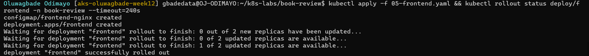

Manifest: [`k8s-labs/book-review/05-frontend.yaml`](./k8s-labs/book-review/05-frontend.yaml)

---

#### Screenshot 11 — Nginx reverse-proxy configuration showing the internal backend Service name and port 3001

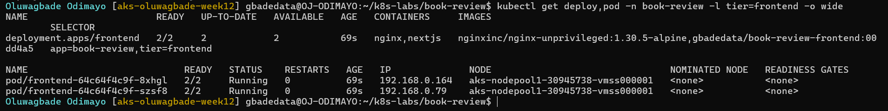

---

# Task 7 — Configure External and Internal Networking

## Goal

Expose the frontend and enforce the intended communication path between application tiers.

### Evidence

#### Screenshot 12 — Frontend LoadBalancer or Ingress configuration and assigned endpoint, or documented local access method

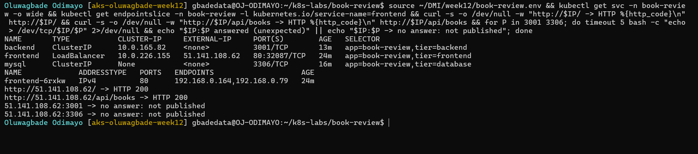

Manifest: [`k8s-labs/book-review/06-frontend-service.yaml`](./k8s-labs/book-review/06-frontend-service.yaml)

---

#### Screenshot 13 — Internal backend Service and NetworkPolicy or equivalent restriction, with access-test evidence

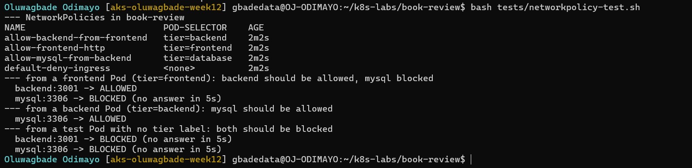

Manifest: [`k8s-labs/book-review/07-networkpolicies.yaml`](./k8s-labs/book-review/07-networkpolicies.yaml). Test script: [`k8s-labs/book-review/tests/networkpolicy-test.sh`](./k8s-labs/book-review/tests/networkpolicy-test.sh)

---

# Task 8 — Validate the Application End to End

## Goal

Prove that the frontend, backend, and MySQL database work together and collect operational evidence.

### Evidence

#### Screenshot 14 — `kubectl get all` output for the book-review namespace

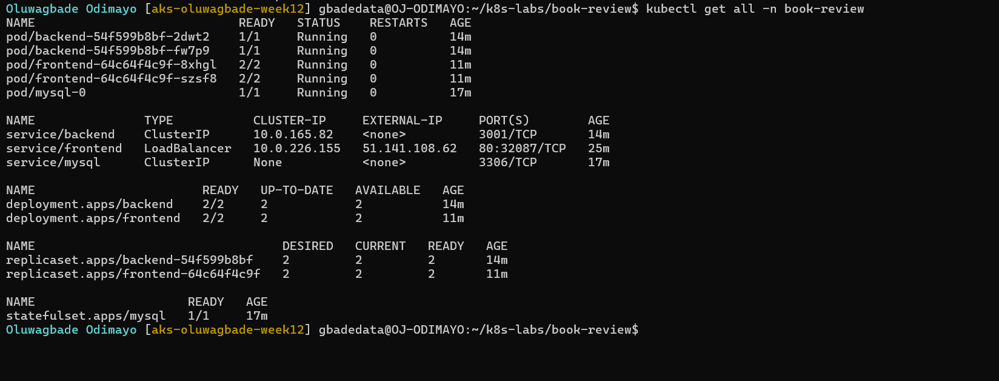

---

#### Screenshot 15 — Functional Book Review App in the browser with the URL visible, including evidence of a successful user flow

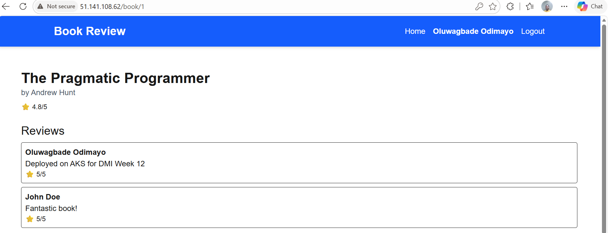

---

#### Screenshot 16 — Frontend or Nginx container logs

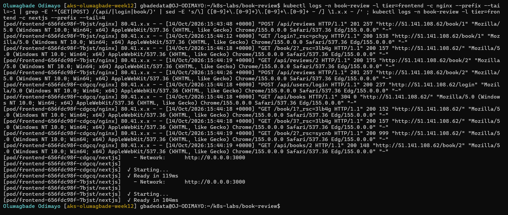

The last two parts of my home IP address are masked in the access log.

---

#### Screenshot 17 — Backend logs and evidence of a successful database-backed operation

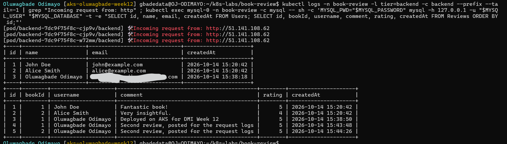

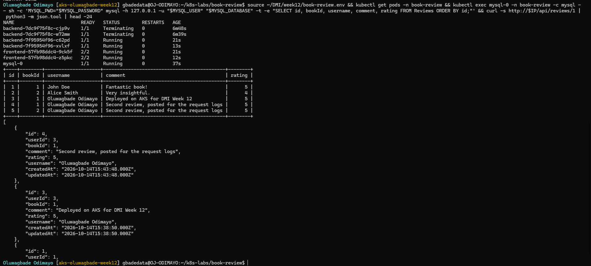

The first image shows the backend handling the browser's requests and the rows they wrote. Reviews 4 and 5 were posted just before it was captured, because my first restart test had already replaced the Pods whose logs held the requests for review 3. The second image is the persistence check: after deleting `mysql-0` and restarting both Deployments, all five reviews are still in MySQL, including review 3, which was posted before the first restart, and the public URL still returns them.

---

#### Screenshot 18 — Optional: Kubernetes dashboard

Not attempted.

Multiple images may be included under a screenshot number when needed to demonstrate the complete user flow.

---

# Task 9 — Optional: Implement Production Improvements

## Goal

Add selected improvements without breaking the required three-tier architecture.

### Evidence

#### Screenshot 19 — Optional: Evidence of selected Helm, HPA, probe, or TLS improvements

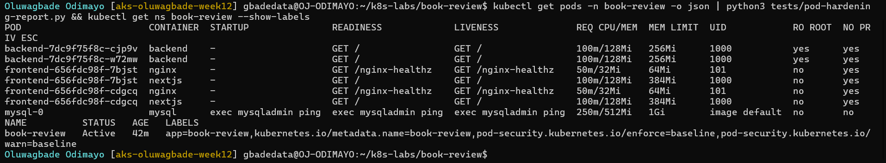

Report script: [`k8s-labs/book-review/tests/pod-hardening-report.py`](./k8s-labs/book-review/tests/pod-hardening-report.py)

---

# Task 10 — Publish Your Book Review App Deployment on LinkedIn

## Goal

Explain your three-tier architecture, demonstrate the working application, and share what you learned.

### Evidence

#### Screenshot 20 — Published LinkedIn post about your Book Review App deployment on Kubernetes

Not published, by choice.

### LinkedIn Post URL

Not published, by choice.

---

# Final Summary

## What Worked

Describe the application components and user flows you successfully deployed and tested.

All three tiers run on AKS in the `book-review` namespace and work together end to end. MySQL 8.4 runs as a StatefulSet with an 8 GiB Azure Disk behind a headless Service. Two backend replicas (Node.js/Express on port 3001) sit behind an internal ClusterIP Service. Two frontend replicas each run Nginx on port 80 in front of the Next.js server, and Nginx proxies `/api/` to `backend.book-review.svc.cluster.local:3001`. The only public entry point is the `frontend` LoadBalancer Service at http://51.141.108.62. Settings come from a ConfigMap and the credentials from a Secret created from a local file that is never committed.

In the browser I registered, logged in and posted reviews. The backend logged the requests and the rows appeared in MySQL (Screenshots 15 to 17). I then deleted the MySQL Pod and restarted both Deployments, twice, and every review was still there, including the one posted before the first restart. NetworkPolicies, enforced by Cilium, allow only internet to frontend:80, frontend to backend:3001 and backend to mysql:3306; the test in Screenshot 13 confirmed the allowed paths and that a Pod without a tier label is blocked from both the backend and MySQL. Ports 3001 and 3306 do not answer on the public IP (Screenshot 12).

## Issues and Fixes

Describe the main issues encountered, their causes, and how you resolved them.

1. **Docker in WSL could not reach Docker Desktop.** After Docker Desktop was reset, `/var/run/docker.sock` was missing in Ubuntu, so the image build stopped at its first check. Turning on WSL integration for Ubuntu-24.04 in Docker Desktop fixed it. Docker Hub then rejected a password login, so I used the browser-based `docker login` flow.
2. **The frontend would have called `localhost:3001` from the browser.** `NEXT_PUBLIC_API_URL` is baked into the JavaScript at build time, and the code used `||`, so an empty value fell back to `http://localhost:3001`. I changed it to `??` in both places, so an empty value means same-origin `/api` calls that Nginx proxies, added Next.js standalone output and a production `frontend/Dockerfile.k8s`, and checked the built image for any remaining `localhost:3001` before pushing.
3. **Next.js 15.2.9 had a critical security advisory.** I upgraded to 15.5.27 and ran `npm audit fix` for the production dependencies: no critical advisories remain. One moderate and one high remain in a PostCSS copy bundled inside Next.js, which only Next.js 16 fixes.
4. **The backend logs were full of `Incoming request from: undefined`.** The app logs every request, and the kubelet's health probes call `/` every 5 to 10 seconds without an Origin header. I filtered them out with `grep -v` for Screenshot 9; a separate, unlogged health endpoint in the app would be the lasting fix.
5. **I lost request logs to my own restart test.** My first log captures were taken before the browser test, and the restart then replaced the Pods that held the request lines. I posted two more reviews, captured Screenshots 16 and 17 straight away, and repeated the restart test for the persistence check.

I also designed around these problems before they could happen:

- A new Azure Disk contains `lost+found`, and MySQL refuses to initialise a non-empty data directory, so the volume is mounted with `subPath: mysql`.
- Two backend replicas starting together would both find empty tables and insert the sample data twice, so the first rollout used one replica and then scaled to two. Screenshot 7 shows exactly 2 users, 3 books and 2 reviews.
- The backend accepts only the browser origin listed in `ALLOWED_ORIGINS`, so I created the LoadBalancer Service first and put its IP in the ConfigMap before the backend started.
- Kubernetes sets `HOSTNAME` to the Pod name and the Next.js server binds to `HOSTNAME`, so the `nextjs` container sets `HOSTNAME=0.0.0.0`.
- Non-root Nginx (UID 101) cannot bind port 80 by default, so the Pod sets the `net.ipv4.ip_unprivileged_port_start=0` sysctl, which the baseline Pod Security standard allows.
- The MySQL probes connect over TCP to 127.0.0.1, so they cannot pass during first-time initialisation, when the temporary server listens only on a socket.

## Tools and Sources Used

List the documentation and tools that helped you complete the assignment.

- Azure Kubernetes Service, Azure CLI, kubectl, Docker Desktop with WSL 2, and Docker Hub for the images
- Kubernetes documentation: [StatefulSets](https://kubernetes.io/docs/concepts/workloads/controllers/statefulset/), [Network Policies](https://kubernetes.io/docs/concepts/services-networking/network-policies/), [Pod Security Standards](https://kubernetes.io/docs/concepts/security/pod-security-standards/), [probes](https://kubernetes.io/docs/tasks/configure-pod-container/configure-liveness-readiness-startup-probes/) and [sysctls](https://kubernetes.io/docs/tasks/administer-cluster/sysctl-cluster/)
- Microsoft Learn: [Azure CNI powered by Cilium](https://learn.microsoft.com/azure/aks/azure-cni-powered-by-cilium) and [the Azure Disk CSI driver](https://learn.microsoft.com/azure/aks/azure-disk-csi)
- [Next.js standalone output](https://nextjs.org/docs/app/api-reference/config/next-config-js/output), the [MySQL image documentation](https://hub.docker.com/_/mysql) and [nginx-unprivileged](https://github.com/nginx/docker-nginx-unprivileged)
- Claude (AI assistant) for planning, the manifests and test scripts, and checking the evidence

## Optional Improvements

Describe any optional improvements implemented, or write “Not attempted.”

Implemented, with the evidence in Screenshot 19:

- Readiness and liveness probes on every container, plus a startup probe for MySQL, and rolling updates with `maxUnavailable: 0`.
- CPU and memory requests and a memory limit on every container.
- Non-root app containers (UID 1000 for the backend and Next.js, UID 101 for Nginx) with privilege escalation disabled, all capabilities dropped and the `RuntimeDefault` seccomp profile; the backend also has a read-only root filesystem.
- Pod Security `baseline` enforced on the namespace, and the NetworkPolicies from Task 7.

Not attempted: Helm, HPA, TLS, Ingress and the Kubernetes dashboard.

## Cleanup or Reuse Plan

State which resources were removed or why the environment is being retained.

Removed. The AKS cluster `aks-oluwagbade-week12` (resource group `rg-oluwagbade-week12-aks`, UK West) stayed up through Assignment 11, which used the same cluster. I stopped it on 14 October 2026 once both assignments were submitted, and deleted the whole resource group on 15 October 2026 after grading. That removed the cluster, its node, the Azure Disk and the public IP, so http://51.141.108.62 no longer answers. I also deleted the local Secret values file and the Assignment 11 read-only kubeconfig. The Docker Hub images stay public; they contain no secrets.

---

# Submission Instructions

- Include your Kubernetes manifests or Helm chart in the linked repository.
- Submit Secret examples containing placeholders only.
- Include Screenshot 1, Screenshots 3–17, and Screenshot 20.
- Include Screenshot 2 only if using Helm.
- Screenshots 18–19 are optional.
- Keep screenshot numbering consistent with the guidelines.
- Use clear, readable screenshots showing relevant configuration, commands, and outputs.
- Make your full name visible in required screenshots.
- Complete the submission details and Final Summary.
- Include your published LinkedIn post URL.
- Capture required evidence before cleanup.
- Do not expose passwords, tokens, JWT secrets, actual Secret values, kubeconfig contents, cloud credentials, or confidential account information.

---

# Completion Checklist

- [x] Selected and configured a supported Kubernetes platform
- [x] Confirmed the context and Ready nodes (Screenshot 1)
- [x] Created and selected the book-review namespace
- [x] Inspected the application repository
- [x] Prepared images accessible to the cluster
- [ ] Confirmed Helm if using charts (Screenshot 2, conditional) (not applicable: YAML manifests)
- [x] Created the architecture diagram (Screenshot 3)
- [x] Created ConfigMaps and Secrets (Screenshots 4–5)
- [x] Excluded actual Secret values from Git and screenshots
- [x] Provisioned private managed MySQL or persistent Kubernetes MySQL (Screenshot 6)
- [x] Initialized the required database and schema
- [x] Verified database connectivity or schema (Screenshot 7)
- [x] Deployed one or two backend replicas listening on port 3001
- [x] Created the backend ClusterIP Service (Screenshot 8)
- [x] Verified backend-to-database connectivity (Screenshot 9)
- [x] Deployed one or two frontend replicas behind Nginx (Screenshot 10)
- [x] Configured API proxying through the internal backend Service (Screenshot 11)
- [x] Configured and documented frontend access (Screenshot 12)
- [x] Enforced backend access restrictions (Screenshot 13)
- [x] Confirmed that the backend and database are not publicly exposed
- [x] Captured resource status for book-review (Screenshot 14)
- [x] Tested application functionality and database writes (Screenshots 15 and 17)
- [x] Verified saved data after application restart
- [x] Captured frontend and backend logs (Screenshots 16–17)
- [x] Included optional dashboard or improvement evidence if attempted (Screenshots 18–19) (Screenshot 19; the dashboard was not attempted)
- [ ] Published the LinkedIn post (Screenshot 20) (not published, by choice)
- [ ] Included the LinkedIn post URL (not published, by choice)
- [x] Documented issues, fixes, and useful sources
- [x] Recorded cleanup status or reuse plans
- [x] No sensitive data exposed

---

## 📌 About DMI & CloudAdvisory

DevOps Micro Internship (DMI) is a project-based DevOps program run by Pravin Mishra (The CloudAdvisory) focused on real-world execution, systems thinking, and career readiness.

It helps learners build strong DevOps foundations with hands-on experience.

---

## 📌 Resources

- 🌐 DMI Official Website: https://dmi.pravinmishra.com?utm_source=github&utm_medium=readme  
- 🎓 University: https://university.pravinmishra.com?utm_source=github&utm_medium=readme  
- 💬 Discord Community: https://discord.pravinmishra.com?utm_source=github&utm_medium=readme  
- 📝 Blog: https://dmi.pravinmishra.com/blog?utm_source=github&utm_medium=readme  
- ▶️ YouTube Playlist: https://www.youtube.com/playlist?list=PLFeSNDtI4Cho  
- 🔗 Pravin Mishra (LinkedIn): https://www.linkedin.com/in/pravin-mishra-aws-trainer/  
- 🏢 CloudAdvisory (LinkedIn): https://www.linkedin.com/company/thecloudadvisory/

---

*This submission is part of DevOps Micro Internship (DMI) — Agentic AI Track.*
