# Assignment 11 — AI-Assisted Kubernetes Incident Triage

Part of the DevOps Micro Internship (DMI) with Agentic AI

---

## Purpose

Configure a read-only Bash triage script for your Book Review App, connect it to Claude Code through `/k8s-triage`, simulate one controlled failure, recover the application manually, and verify recovery.

**Workflow: Gather → Analyze → Human Act → Verify**

---

## Submission Details

**Full Name:** Oluwagbade Odimayo

**Kubernetes Platform:** Azure Kubernetes Service (AKS), Kubernetes v1.35.8, UK West: the Assignment 10 cluster running the Book Review App

**Selected Workload:** `backend` (container `backend`, selector `app=book-review,tier=backend`, Service `backend`)

**Namespace:** `book-review`

**GitHub Repository URL:** https://github.com/gbadedata/devops-micro-internship-pravinmishra/tree/main/week-12-kubernetes/assignment-11-k8s-triage

**Simulated Incident:** Invalid image: `gbadedata/book-review-backend:0.0.0-does-not-exist`, a tag that does not exist

**Baseline Status:** HEALTHY (PASS 6, WARN 0, FAIL 0, exit code 0)

**Recovery Status:** WARN with no FAIL (PASS 5, WARN 1, FAIL 0, exit code 1). The WARN is historical Warning events from the deleted failed Pod, explained under Task 8

---

# Task 1 — Discover the Application and Capture a Healthy Baseline

## Goal

Identify the actual application configuration and prove that the selected workload is healthy before incident simulation.

### Evidence

#### Screenshot 1 — Healthy Pods and ready Service backends

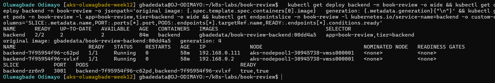

---

#### Screenshot 2 — Workspace directory structure

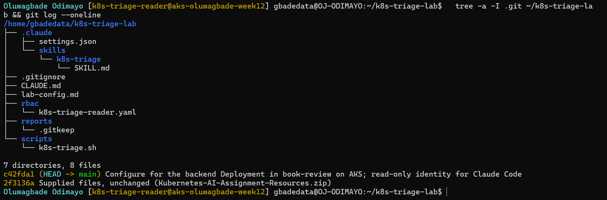

### Notes

**1. What proves the selected Pods are ready, not merely running?**

The READY column shows 1/1 for both Pods, which means the backend container's readiness probe (HTTP GET `/` on port 3001) is passing and the Pod's Ready condition is true. STATUS `Running` only says the container process started; a Pod can be Running and still 0/1. The EndpointSlice confirms it from the Service side, listing both Pods `ready=true`.

**2. What proves the Service has ready backends?**

The `backend` Service's EndpointSlice `backend-zr6n9` on port 3001 lists both Pods, `backend-7f95954f96-c62pd` and `backend-7f95954f96-xvlxf`, with READY `true,true` (Screenshot 1). A Service only sends traffic to endpoints marked ready.

**3. Why must the original image be recorded before incident simulation?**

Recovery means putting back exactly what worked. Once the drill changes the Deployment, its spec shows the broken tag, so the working value has to be known beforehand. I recorded `gbadedata/book-review-backend:00dd4a5` (and its digest, in `lab-config.md`) before the incident, and CLAUDE.md gave it to Claude, which is why its suggested recovery command could name the exact image instead of guessing.

---

# Task 2 — Configure CLAUDE.md

## Goal

Define the project configuration, incident workflow, and safety boundary for Claude Code.

### Evidence

#### Screenshot 3 — CLAUDE.md showing application configuration, workflow, safety rules, and output rules

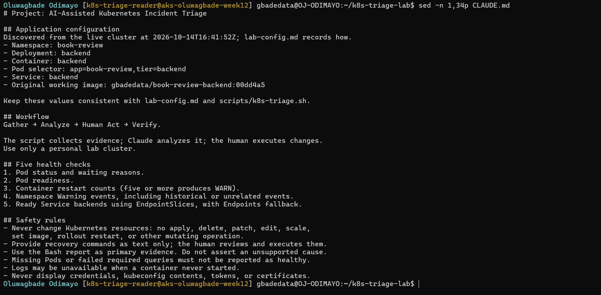

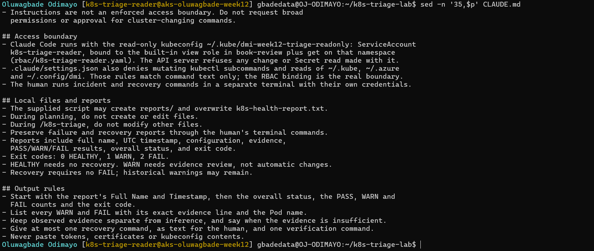

### Notes

**1. Why does Claude need project-specific cluster rules?**

Claude doesn't know which cluster, namespace, Deployment, selector, Service and image this lab is about. My kubeconfig holds more than one cluster, and the namespace also runs the frontend and MySQL. CLAUDE.md pins the six values, the Gather, Analyze, Human Act and Verify workflow, the safety rules and the output format, so every analysis is about the right workload and follows the same rules.

**2. Why must a human execute recovery commands?**

A recovery command changes a live system, and someone has to be accountable for it. The human can check what the report doesn't show, such as the right cluster, the right image and the timing, and can stop if something looks wrong. Claude's analysis can be incomplete or wrong, and an automated fix can make an incident worse. Here Claude suggested the command as text and I ran it myself, in a separate terminal with my own credentials.

**3. Which rule prevents an unsupported diagnosis?**

"Use the Bash report as primary evidence. Do not assert an unsupported cause." It is backed by the output rule to keep observed evidence separate from inference and say when the evidence is insufficient, and by step 5 of SKILL.md. Claude applied it in the baseline run: it pointed out that the report does not record the running image, so it could not confirm that `00dd4a5` was deployed.

---

# Task 3 — Plan the Read-Only Triage Workflow

## Goal

Ask Claude Code to explain the five health checks before running the supplied script.

### Evidence

#### Screenshot 4 — Claude Code showing the five-check read-only plan

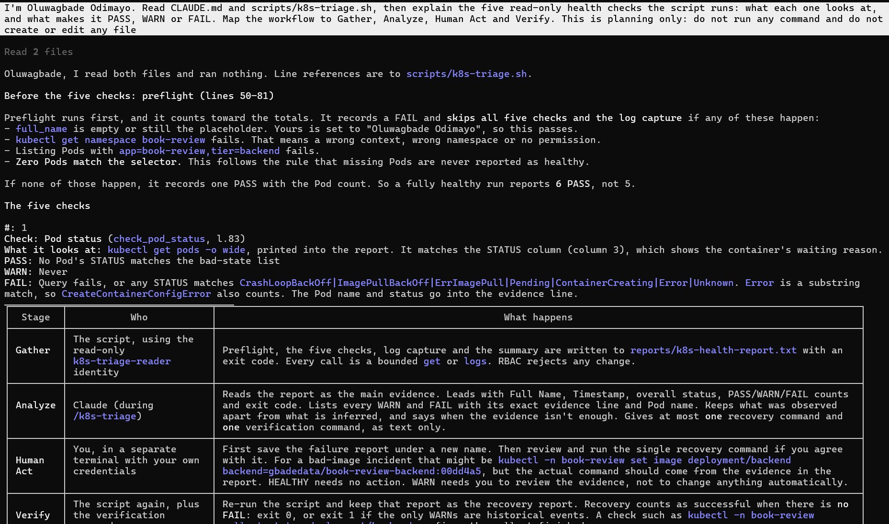

### Notes

**1. Which part represents the Gather phase?**

Running `scripts/k8s-triage.sh`: preflight, the five checks and the log capture collect evidence with read-only `kubectl get` and `logs` calls and write it to `reports/k8s-health-report.txt` with an exit code. Claude's plan labelled this Gather and assigned it to the script, running with the read-only `k8s-triage-reader` identity.

**2. How did you verify that Claude did not change anything?**

I switched to plan mode inside the session, so Claude could read files but not run commands or edit anything. Afterwards `git status --short` in the workspace was empty, and the `backend` Deployment's generation was still 4, the value recorded in Screenshot 1. Claude Code's session transcript shows exactly two tool calls for that step: reading `CLAUDE.md` and `scripts/k8s-triage.sh`.

**3. Why is planning before coding useful for incident triage?**

It makes sure I understand what each check measures and what PASS, WARN and FAIL mean before I read a report under pressure. The plan pointed out that preflight adds a sixth PASS, and that a recovery can end with exit code 1 when the only warnings are historical events, which is exactly what happened later. It also confirmed that the script is read-only before it ran against the cluster.

---

# Task 4 — Configure and Validate the Bash Script

## Goal

Configure the supplied triage script for the selected workload and validate its syntax.

### Evidence

#### Screenshot 5 — Script configuration variables and checks array

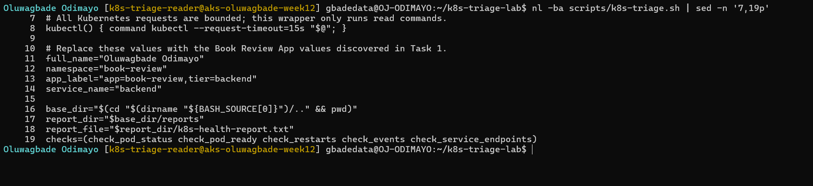

---

#### Screenshot 6 — Functions for status, readiness, restarts, events, and Service backends

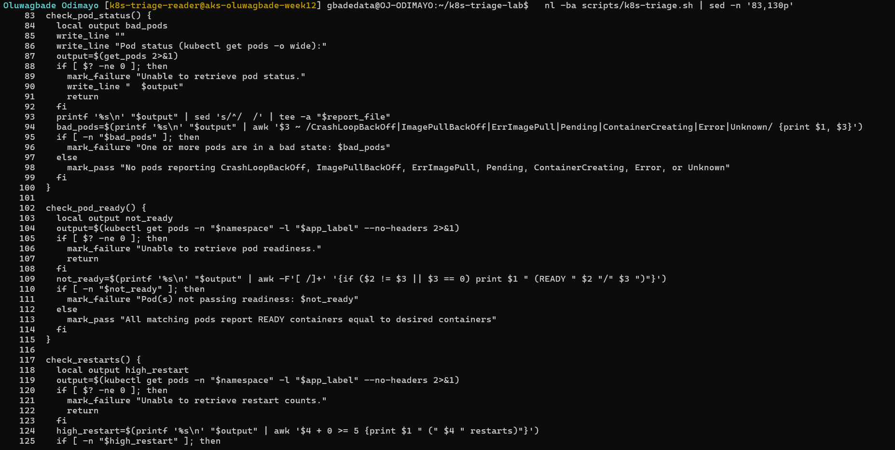

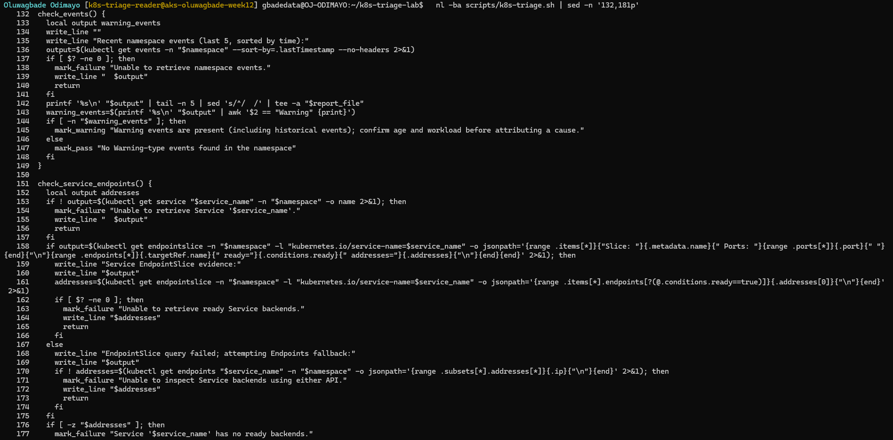

---

#### Screenshot 7 — Preflight, summary, and exit-code logic

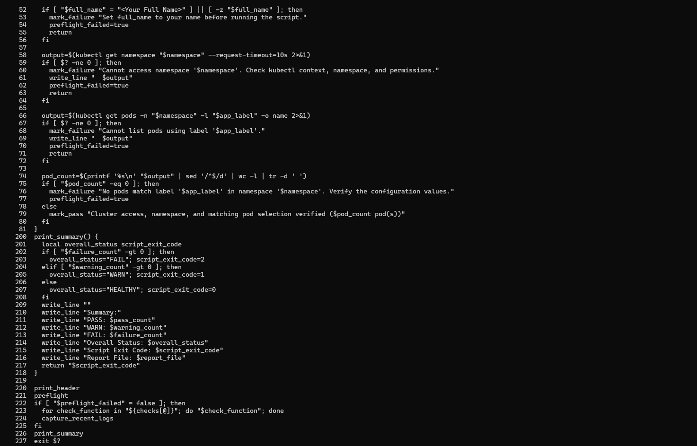

---

#### Screenshot 8 — Successful syntax validation and executable permission

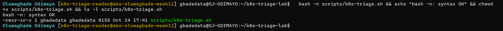

### Notes

**1. Why must the script fail when no Pods match the configured selector?**

With no matching Pods, every per-Pod check has nothing to inspect and would pass on an empty list, so a wrong selector, a wrong namespace or a deleted workload would be reported as HEALTHY. Preflight treats zero Pods as FAIL, skips the checks and exits 2, following the rule that missing Pods must never be reported as healthy.

**2. How does the readiness check detect a running but unready Pod?**

It splits the READY column (ready containers / total containers) for each matching Pod and flags any Pod whose ready count differs from the total, or whose total is 0. STATUS can say Running while READY is 0/1. In the incident it reported `backend-645fcc9476-r92gc (READY 0/1)`.

**3. Why are Service backends checked separately from Pod health?**

They answer different questions. The Pod checks say whether the rollout and its Pods are healthy; the Service check says whether users can still be served, by counting ready endpoints in the EndpointSlice. They can disagree: in my incident the Pod checks failed while the Service still had two ready backends, and the reverse (healthy Pods behind a selector that matches nothing) would leave the Service with no backends.

**4. What do exit codes 0, 1, and 2 represent?**

0 means HEALTHY (no WARN and no FAIL), 1 means WARN (warnings only: review the evidence), and 2 means FAIL (at least one failed check, including preflight). The skill, other scripts or CI can act on the code without parsing the report.

---

# Task 5 — Run the Healthy Baseline Report

## Goal

Run the script on the healthy application and confirm that it contains no failed checks.

### Evidence

#### Screenshot 9 — Baseline report showing your full name and all checks

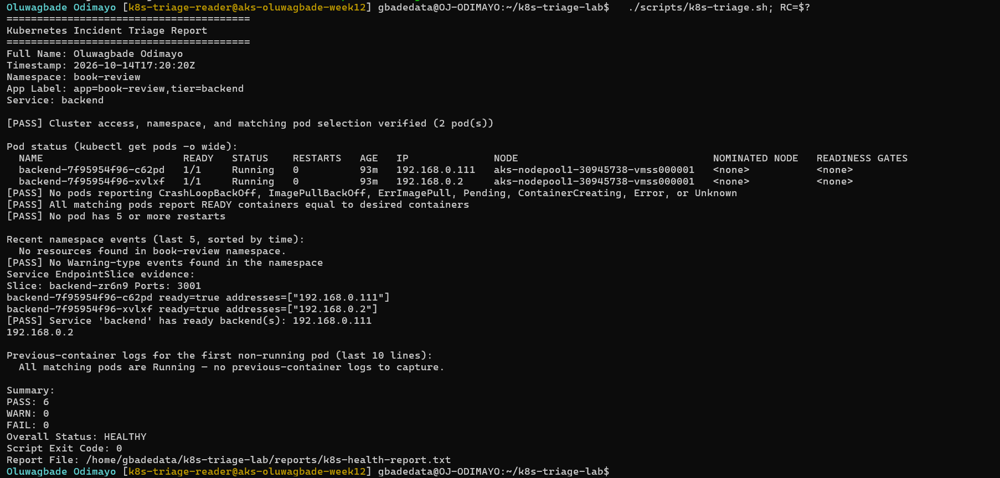

---

#### Screenshot 10 — Captured exit code and final summary

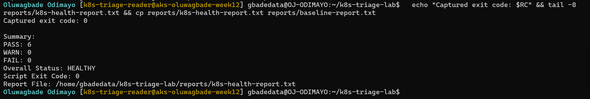

### Notes

**1. What is the baseline status?**

HEALTHY: PASS 6, WARN 0, FAIL 0, exit code 0 (`reports/baseline-report.txt`, 17:20:20 UTC). Both Pods were 1/1 Running with 0 restarts, and there were no Warning events in the namespace.

**2. Which evidence proves the Service has a ready backend?**

The Service EndpointSlice evidence in the report: slice `backend-zr6n9` on port 3001 lists `backend-7f95954f96-c62pd ready=true` (192.168.0.111) and `backend-7f95954f96-xvlxf ready=true` (192.168.0.2), followed by `[PASS] Service 'backend' has ready backend(s): 192.168.0.111 192.168.0.2`.

**3. What is the difference between a warning and a failure?**

A WARN is something to review that does not by itself mean the workload is broken, such as 5 or more restarts or Warning events that may be old or about another object; it gives exit code 1 and calls for evidence review, not automatic changes. A FAIL means a check shows the workload is not healthy, or that evidence could not be gathered: a bad Pod state, an unready Pod, no ready backends, a failed query or no matching Pods. It gives exit code 2 and needs action.

---

# Task 6 — Configure and Run the Claude Code Skill

## Goal

Connect the Bash script to a manually invoked Claude Code evidence-analysis workflow.

### Evidence

#### Screenshot 11 — SKILL.md showing frontmatter and safety rules

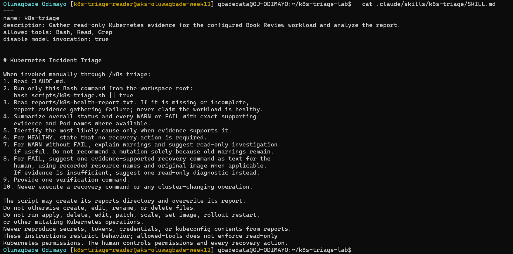

---

#### Screenshot 12 — Baseline `/k8s-triage` analysis

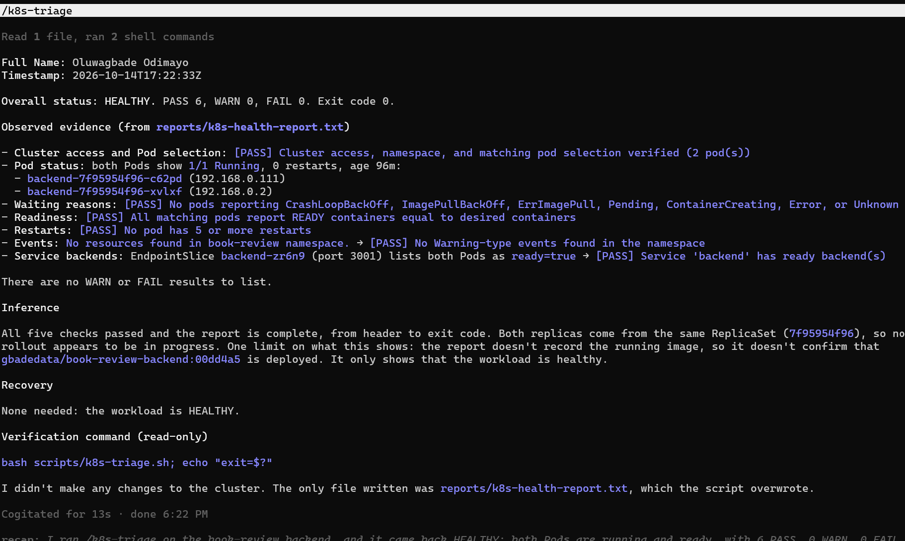

### Notes

**1. What does Bash do in this workflow?**

Bash gathers the evidence. The script runs fixed, read-only `kubectl` queries, applies fixed PASS, WARN and FAIL rules, writes the report with my name and a UTC timestamp, and returns an exit code. The same cluster state always gives the same verdict.

**2. What does Claude do in this workflow?**

Claude analyses the report. It reads CLAUDE.md and the report, explains each WARN and FAIL with the exact evidence line and Pod name, keeps observation separate from inference, names the most likely cause only when the evidence supports it, and suggests at most one recovery command as text plus one verification command. It does not act on the cluster.

**3. Why are instructions alone insufficient to guarantee read-only access?**

Instructions are text the model tries to follow, not a control. SKILL.md itself says `allowed-tools: Bash` allows any shell command and does not enforce read-only Kubernetes access, and Claude Code's deny rules only match command text, so a different spelling of the same command gets past them. My run showed the gap in a harmless way: the skill says to run only the script, but Claude also ran `cat`, `tail` and `grep` on the report file. The real boundary is RBAC: Claude's kubeconfig uses a ServiceAccount with the `view` role, so the API server refuses any change or Secret read, whatever Claude tries ([`reports/readonly-identity-check.txt`](./assignment-11-k8s-triage/reports/readonly-identity-check.txt)).

---

# Task 7 — Simulate One Controlled Incident

## Goal

Create one controlled failure, save its evidence, and let Claude analyze it without executing recovery.

### Evidence

#### Screenshot 13 — Failed or unready Pod evidence and current Service backends

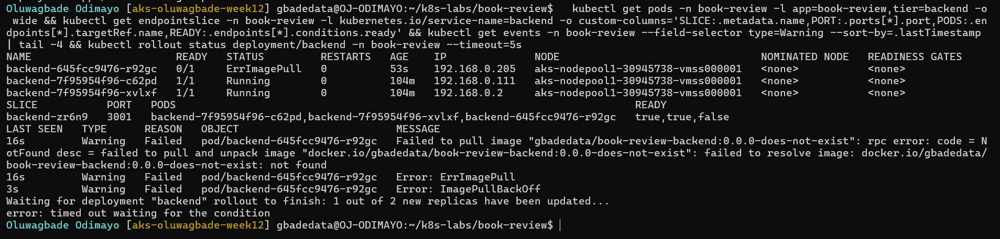

---

#### Screenshot 14 — Failed `/k8s-triage` analysis with evidence and a suggested manual recovery command

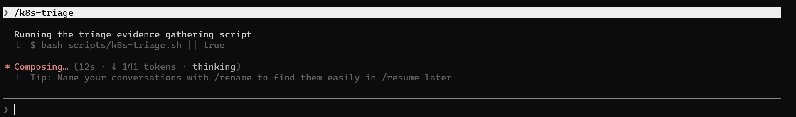

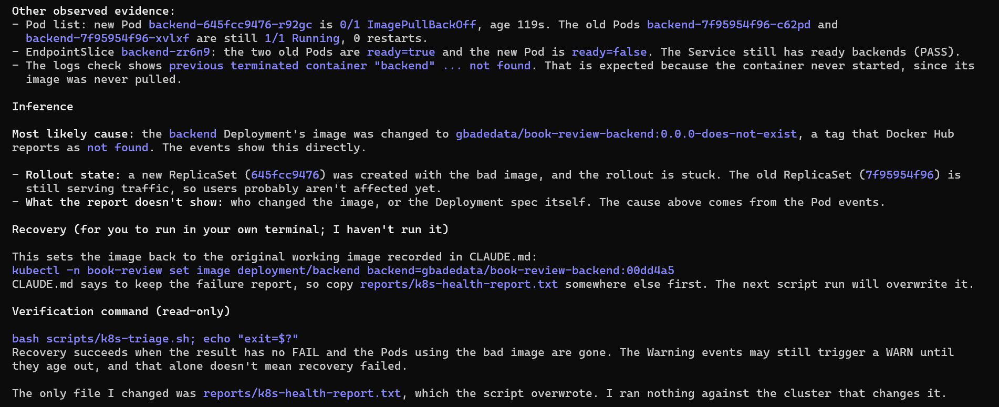

---

#### Screenshot 15 — Saved `incident-failure-report.txt`

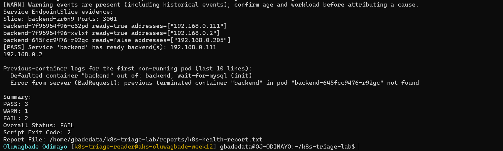

### Notes

**1. Which failure did you choose?**

An invalid image. I set the backend container's image to `gbadedata/book-review-backend:0.0.0-does-not-exist` with `kubectl set image`, from my own terminal, at about 17:30 UTC.

**2. Which checks failed, and what evidence proved it?**

Two checks failed: Pod status (`[FAIL] One or more pods are in a bad state: backend-645fcc9476-r92gc ImagePullBackOff`) and readiness (`[FAIL] Pod(s) not passing readiness: backend-645fcc9476-r92gc (READY 0/1)`). The events check gave a WARN, and its current events proved the cause: `Failed to pull image "gbadedata/book-review-backend:0.0.0-does-not-exist": ... not found`, then `ErrImagePull` and `ImagePullBackOff`. Overall FAIL, exit code 2.

**3. Did Claude execute recovery? Why is that important?**

No. In that run its transcript shows a single command, `bash scripts/k8s-triage.sh || true`. It gave `kubectl -n book-review set image deployment/backend backend=gbadedata/book-review-backend:00dd4a5` as text and said it had not run it. That matters because the decision and the accountability stay with a person, who can check the suggestion first. Even if Claude had tried, its read-only identity would have been refused.

**4. Why might the Service retain ready backends during the incident?**

The Deployment uses RollingUpdate with maxSurge 1 and maxUnavailable 0, so it adds one new Pod and removes old Pods only after new ones become ready. The new Pod never became ready, so both old Pods kept running and stayed in the EndpointSlice as `ready=true`, with the new Pod listed `ready=false`. Users kept being served; only the rollout was stuck, at 1 of 2 new replicas.

---

# Task 8 — Recover Manually and Verify

## Goal

Restore the healthy configuration yourself and verify recovery using a second triage report.

### Evidence

#### Screenshot 16 — Recovered Pods and ready Service backends

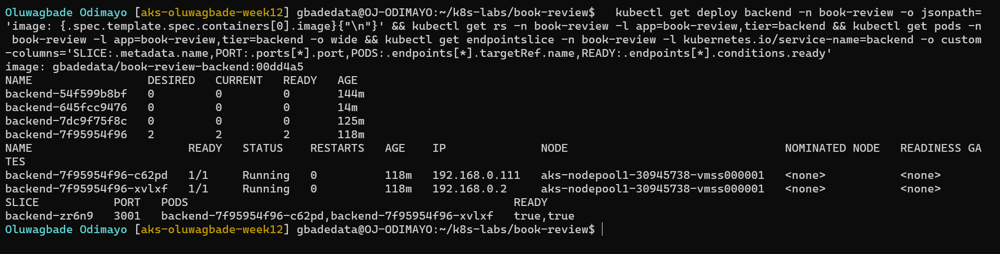

---

#### Screenshot 17 — Recovered `/k8s-triage` analysis

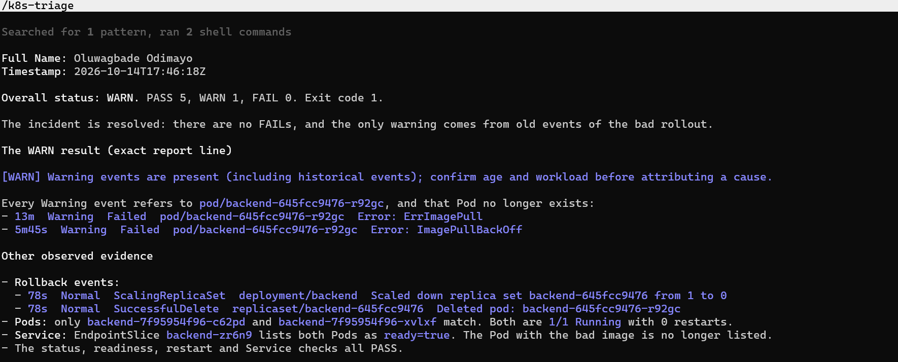

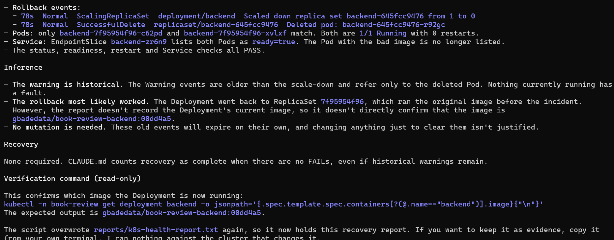

---

#### Screenshot 18 — Reports directory showing failure and recovery reports

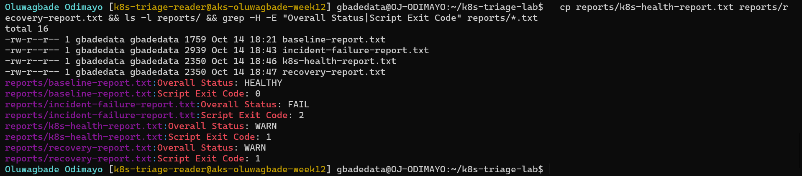

---

#### Screenshot 19 — `incident-summary.md` with all required sections

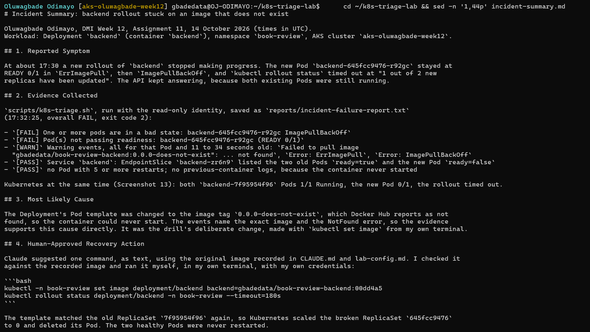

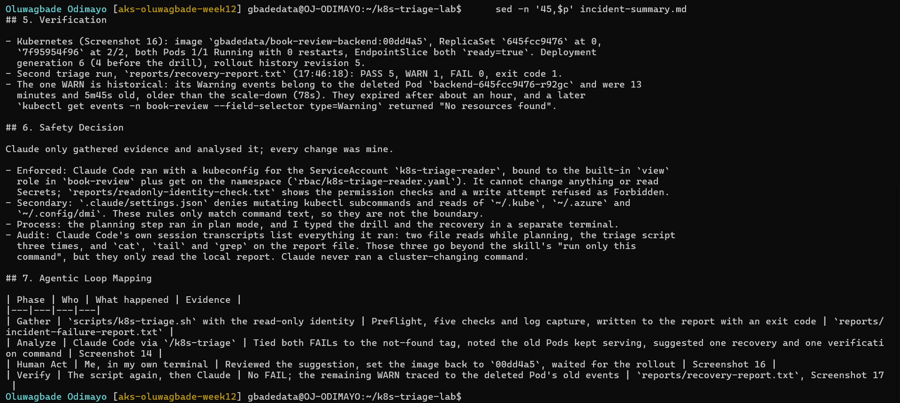

### Notes

**1. What manual recovery action did you execute?**

In my own terminal I ran the command Claude suggested, after checking it against the recorded original image: `kubectl -n book-review set image deployment/backend backend=gbadedata/book-review-backend:00dd4a5`, then `kubectl rollout status deployment/backend -n book-review --timeout=180s`. Kubernetes reused the old ReplicaSet `7f95954f96`, scaled the broken ReplicaSet `645fcc9476` to 0 and deleted its Pod.

**2. What proves the workload recovered?**

The Deployment's image is `gbadedata/book-review-backend:00dd4a5` again, ReplicaSet `645fcc9476` is at 0 and `7f95954f96` at 2/2, both Pods are 1/1 Running with 0 restarts, and the EndpointSlice lists both `ready=true` (Screenshot 16). The recovery report has no FAIL: PASS 5, WARN 1, FAIL 0, exit code 1.

**3. Why is the second triage run necessary?**

The recovery command only shows that the API accepted a change, and `rollout status` only covers the rollout. The second run repeats the same five checks after the change and records them in `recovery-report.txt`, so before and after are measured the same way. It showed no FAIL, and that the only remaining WARN came from the deleted Pod's old events.

**4. Why should AI not automatically restart every failing production workload?**

A restart doesn't fix a wrong image or a broken configuration; here, restarting would only have produced another ImagePullBackOff, and the right fix was restoring the image. Automatic restarts can hide the real cause, cut capacity, interrupt work in progress or loop. Production changes need someone accountable who understands the context, such as change windows and dependencies, and the evidence can be incomplete. In this incident the Service was still serving from the old Pods, so there was time to diagnose properly instead of acting blindly.

### Remaining WARN Results

Explain any WARN results remaining after recovery, or write “None.”

One WARN remains in `reports/recovery-report.txt`: the events check found the Warning events `Error: ErrImagePull` (13 minutes old) and `Error: ImagePullBackOff` (5m45s old) for `backend-645fcc9476-r92gc`. That Pod no longer existed: the same report shows its ReplicaSet scaled to 0 and the Pod deleted 78 seconds earlier, and only the two healthy Pods match the selector. The warnings are historical, not a current fault, so no action was needed. Kubernetes keeps events for about an hour, and a later `kubectl get events -n book-review --field-selector type=Warning` returned "No resources found". No FAIL remained.

---

# Task 9 — Publish Your Kubernetes Incident-Triage Workflow on LinkedIn

## Goal

Share the incident-triage workflow you completed and explain the role of human control.

### Evidence

#### Screenshot 20 — Published LinkedIn post about your Kubernetes incident-triage workflow

Not published, by choice.

### LinkedIn Post URL

Not published, by choice.

---

# Required Project Files

Include these files in your project repository:

- `CLAUDE.md`
- `lab-config.md`
- `scripts/k8s-triage.sh`
- `.claude/skills/k8s-triage/SKILL.md`
- `reports/incident-failure-report.txt`
- `reports/recovery-report.txt`
- `incident-summary.md`

All seven are in [`assignment-11-k8s-triage/`](./assignment-11-k8s-triage/): [`CLAUDE.md`](./assignment-11-k8s-triage/CLAUDE.md), [`lab-config.md`](./assignment-11-k8s-triage/lab-config.md), [`scripts/k8s-triage.sh`](./assignment-11-k8s-triage/scripts/k8s-triage.sh), [`.claude/skills/k8s-triage/SKILL.md`](./assignment-11-k8s-triage/.claude/skills/k8s-triage/SKILL.md), [`reports/incident-failure-report.txt`](./assignment-11-k8s-triage/reports/incident-failure-report.txt), [`reports/recovery-report.txt`](./assignment-11-k8s-triage/reports/recovery-report.txt) and [`incident-summary.md`](./assignment-11-k8s-triage/incident-summary.md). Also there: [`reports/baseline-report.txt`](./assignment-11-k8s-triage/reports/baseline-report.txt), [`reports/readonly-identity-check.txt`](./assignment-11-k8s-triage/reports/readonly-identity-check.txt), [`rbac/k8s-triage-reader.yaml`](./assignment-11-k8s-triage/rbac/k8s-triage-reader.yaml) and [`.claude/settings.json`](./assignment-11-k8s-triage/.claude/settings.json), which make up the read-only boundary.

Your `incident-summary.md` must contain:

1. Reported Symptom
2. Evidence Collected
3. Most Likely Cause
4. Human-Approved Recovery Action
5. Verification
6. Safety Decision
7. Agentic Loop Mapping

---

# Final Summary

## Evidence and Cause

Summarize the evidence and the supported cause of the incident.

The failure report (17:32:25 UTC) had two FAILs for the new Pod `backend-645fcc9476-r92gc`: `ImagePullBackOff` and READY 0/1. Its Warning events, 11 to 34 seconds old, showed `Failed to pull image "gbadedata/book-review-backend:0.0.0-does-not-exist": ... not found`. The supported cause is the Deployment's image being set to a tag that does not exist, which was the drill change. The two old Pods stayed ready, so the Service kept two ready backends and the API kept serving; only the rollout was stuck. Details are in [`incident-summary.md`](./assignment-11-k8s-triage/incident-summary.md).

## Manual Recovery

Describe the command or configuration change you performed.

In my own terminal, with my own credentials, I ran the command Claude suggested after checking it against the recorded original image: `kubectl -n book-review set image deployment/backend backend=gbadedata/book-review-backend:00dd4a5`, then `kubectl rollout status deployment/backend -n book-review --timeout=180s`. The template matched the old ReplicaSet again, so Kubernetes scaled the broken ReplicaSet `645fcc9476` to 0 and deleted its Pod; the healthy Pods were not restarted.

## Verification

Explain how the recovery report and Kubernetes outputs confirmed recovery.

Screenshot 16 shows the image back on `00dd4a5`, the broken ReplicaSet at 0, both Pods 1/1 Running and both `ready=true` in the EndpointSlice. The recovery report (17:46:18 UTC) has PASS 5, WARN 1, FAIL 0 and exit code 1, and Claude's recovered analysis traced the WARN to the deleted Pod's old events, which later expired. The Deployment's generation went from 4 to 6: one change for the drill and one for the recovery.

## Safety Decision

Explain how you kept Claude’s role limited to evidence gathering and analysis.

Claude's role was limited in three ways. It ran with a read-only ServiceAccount (the `view` role in `book-review` plus get on the namespace), so the API server refuses changes and Secret reads; [`reports/readonly-identity-check.txt`](./assignment-11-k8s-triage/reports/readonly-identity-check.txt) shows the permission checks and a write attempt refused as Forbidden. [`.claude/settings.json`](./assignment-11-k8s-triage/.claude/settings.json) adds deny rules for mutating kubectl subcommands and kubeconfig reads as a second layer. And I made every change myself, in a separate terminal. Claude Code's session transcripts confirm it only read files and ran the triage script, plus `cat`, `tail` and `grep` on the report.

---

# Submission Instructions

- Include all 20 required screenshots under their corresponding Evidence sections.
- Complete all Notes questions in your own words.
- Include the required project files in your linked repository.
- Include your published LinkedIn post URL.
- Use clear, readable screenshots showing relevant commands, configuration, and outputs.
- Display your full name before taking required terminal screenshots.
- Preserve the failure report before recovery.
- Ensure the baseline and recovery reports contain no FAIL results.
- Explain any WARN results remaining after recovery.
- Review reports, logs, configuration records, and screenshots before publishing.
- Do not expose credentials, kubeconfig contents, tokens, certificates, JWT secrets, or confidential account information.

---

# Completion Checklist

- [x] Confirmed the personal lab context
- [x] Discovered and recorded application configuration
- [x] Recorded the original working image
- [x] Captured healthy Pods and ready Service backends (Screenshot 1)
- [x] Created the workspace (Screenshot 2)
- [x] Configured CLAUDE.md (Screenshot 3)
- [x] Reviewed the five-check triage plan (Screenshot 4)
- [x] Configured and reviewed the supplied script (Screenshots 5–7)
- [x] Passed Bash syntax validation and set executable permission (Screenshot 8)
- [x] Captured a baseline report with no FAIL (Screenshot 9)
- [x] Captured the correct exit code (Screenshot 10)
- [x] Configured and invoked `/k8s-triage` (Screenshots 11–12)
- [x] Simulated one controlled incident manually (Screenshot 13)
- [x] Reviewed Claude’s failed-state analysis (Screenshot 14)
- [x] Saved failure evidence before recovery (Screenshot 15)
- [x] Executed recovery manually and waited for rollout completion
- [x] Confirmed recovered Pods and ready Service backends (Screenshot 16)
- [x] Captured recovery analysis with no FAIL (Screenshot 17)
- [x] Explained any remaining warnings
- [x] Saved failure and recovery reports (Screenshot 18)
- [x] Completed the seven-section incident summary (Screenshot 19)
- [x] Answered all Notes questions
- [ ] Published the LinkedIn post (Screenshot 20) (not published, by choice)
- [ ] Included the LinkedIn post URL (not published, by choice)
- [x] Included all required project files
- [x] Checked that no sensitive information is exposed

---

## 📌 About DMI & CloudAdvisory

DevOps Micro Internship (DMI) is a project-based DevOps program run by Pravin Mishra (The CloudAdvisory) focused on real-world execution, systems thinking, and career readiness.

It helps learners build strong DevOps foundations with hands-on experience.

---

## 📌 Resources

- 🌐 DMI Official Website: https://dmi.pravinmishra.com?utm_source=github&utm_medium=readme  
- 🎓 University: https://university.pravinmishra.com?utm_source=github&utm_medium=readme  
- 💬 Discord Community: https://discord.pravinmishra.com?utm_source=github&utm_medium=readme  
- 📝 Blog: https://dmi.pravinmishra.com/blog?utm_source=github&utm_medium=readme  
- ▶️ YouTube Playlist: https://www.youtube.com/playlist?list=PLFeSNDtI4Cho  
- 🔗 Pravin Mishra (LinkedIn): https://www.linkedin.com/in/pravin-mishra-aws-trainer/  
- 🏢 CloudAdvisory (LinkedIn): https://www.linkedin.com/company/thecloudadvisory/

---

*This submission is part of DevOps Micro Internship (DMI) — Agentic AI Track.*
